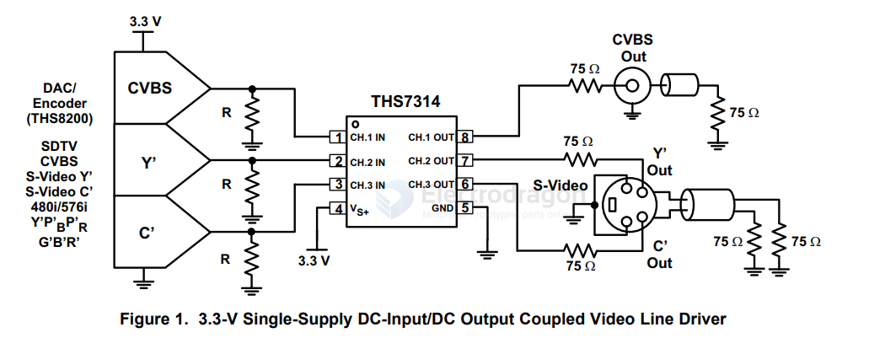
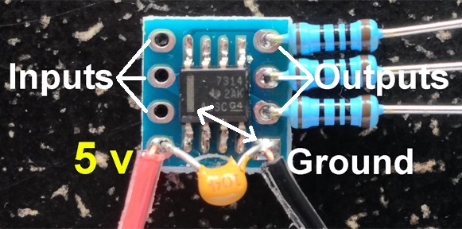

# THS7314-dat

- [[TI-dat]] - [[THS7314-dat]] - [[THS7316-dat]] - [[video-amplifier-dat]]

3-Channel SDTV Video Amplifier With 5th-Order Filters and 6-dB Gain

## DESCRIPTION
Fabricated using the Silicon-Germanium (SiGe)BiCom-II process, the THS7314 is a low powersingle-supply 3-V to 5-V 3-channel integrated videobuffer. It incorporates a 5th-order Butterworth filterwhich is useful as a DAC reconstruction filter or anADC anti-aliasing filter. The 8.5-MHz filter is a perfectchoice for SDTV video which includes Composite(CVBS), S-Video, Y'U'V', G'B'R' (R'G'B'), and Y'P'BP'R480i/576i.
As part of the THS7314 flexibility, the input can beconfigured for ac or dc coupled inputs. The 285-mVoutput level shift to allow for a full sync dynamicrange at the output with 0-V input. The AC coupledmodes include a transparent sync-tip clamp option forCVBS, Y', and G'B'R' signals with sync. AC-coupledbiasing for C'/P'B/P'R channels is achieved by addingan external resistor to Vs+.
The THS7314 is the perfect choice for all outputbuffer applications. Its rail-to-rail output stage with6-dB gain allows for both ac and dc line driving. Theability to drive 2-lines, or 75-Ω loads, allows formaximum flexibility as a video line driver. The 16-mAtotal quiescent current at 3.3-V makes it an excellentchoice for USB powered, portable, or other powersensitive video applications.
The THS7314 is available in a small SOIC-8 packagethat is RoHS compliant.

## FEATURES
3 SDTV Video Amplifiers for CVBS, S-Video,Y'P'BP'R 480i/576i, Y'U'V', or G'B'R' (R'G'B')

Integrated Low-Pass Filters
5th-Order 8.5-MHz (—3dB) Butterworth—1dB Passband Bandwidth at 7-MHz47dB Attenuation at 27-MHz

Versatile Input Biasing
DC-Coupled With 285-mV Output ShiftAC-Coupled with Sync-Tip Clamp
Allows AC-Coupled With DC-Biasing

Built-in 6dB Gain (2V/V)

3-V to 5-V Single Supply Operation

Rail-to-Rail Output:
Output Swings Within 100-mV From theRails Allowing AC or DC Output CouplingAble to Drive up to 2 Video Lines – 75 Ω

Low 16-mA at 3.3-V Total Quiscent Current

Low Differential Gain/Phase of 0.1% / 0.1°

SOIC-8 Package

## APPLICATIONS
- Set Top Box Output Video Buffering
- PVR/DVDR Output Buffering
- USB/Portable Low Power Video Buffering

## SCH diagram 

## How to read the chip markings

- • Part identifier (7314). The top-side device marking for the THS7314D and THS7314DR variants.
- • Lot trace code (62K). An internal Texas Instruments manufacturing date and assembly lot tracking code used for quality control rather than an electrical specification.

Key specifications

- • Function. 3-channel SDTV analog video buffer with integrated 5th-order 8.5-MHz Butterworth low-pass filters.
- • Gain. Fixed 6-dB (2 V/V) gain capable of driving up to two 75-Ω video lines per channel.
- • Power supply. Single-supply operation from 2.85 V to 5.5 V (typically 3.3 V or 5 V).
- • Package. 8-pin SOIC (SOIC-8).
- • Common uses. Set-top boxes, DVD/PVR recorders, and retro gaming console RGB video amplifier mods (such as N64 and SNES).

Pinout (SOIC-8)

Pin	Name	Function

- 1	CH. 1 IN	Video input – Channel 1
- 2	CH. 2 IN	Video input – Channel 2
- 3	CH. 3 IN	Video input – Channel 3
- 4	+Vs	Positive power supply (3 V to 5 V)
- 5	GND	Ground
- 6	CH. 3 OUT	Video output – Channel 3
- 7	CH. 2 OUT	Video output – Channel 2
- 8	CH. 1 OUT	Video output – Channel 1

https://consolemods.org/wiki/AV:THS_Video_Amplifier_Guide

## demo 

## ref 