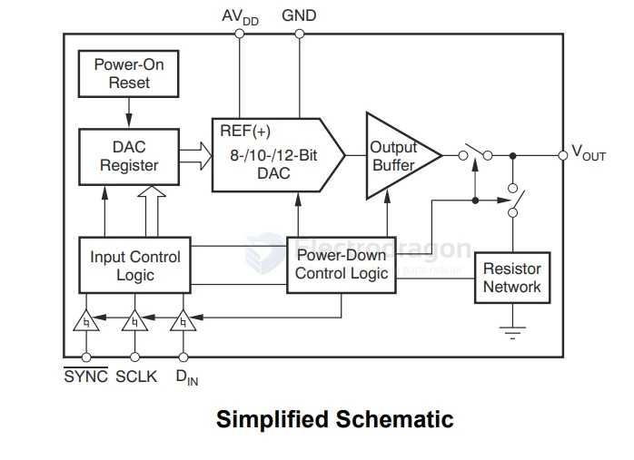

# TI-DAC-dat

- [[OPA211-dat]] - [[DAC5311-dat]] - [[TI-DAC-dat]] - [[DAC-dat]]

## DAC5311 

`DACx311` 2-V to 5.5-V, 80-µA, 8-Bit, 10-Bit, and 12-Bit, Low-Power, Single-Channel, Digital-to-Analog Converters in SC70 Package

SCH 

## DAC

- [[DAC-dat]]

[DAC8801IDGK - DAC8801 - 14-Bit, Serial Input Multiplying Digital-to-Analog Converter](https://www.ti.com/lit/ds/symlink/dac8801.pdf?ts=1759175003115&ref_url=https%253A%252F%252Fwww.google.com%252F)

## ref 

