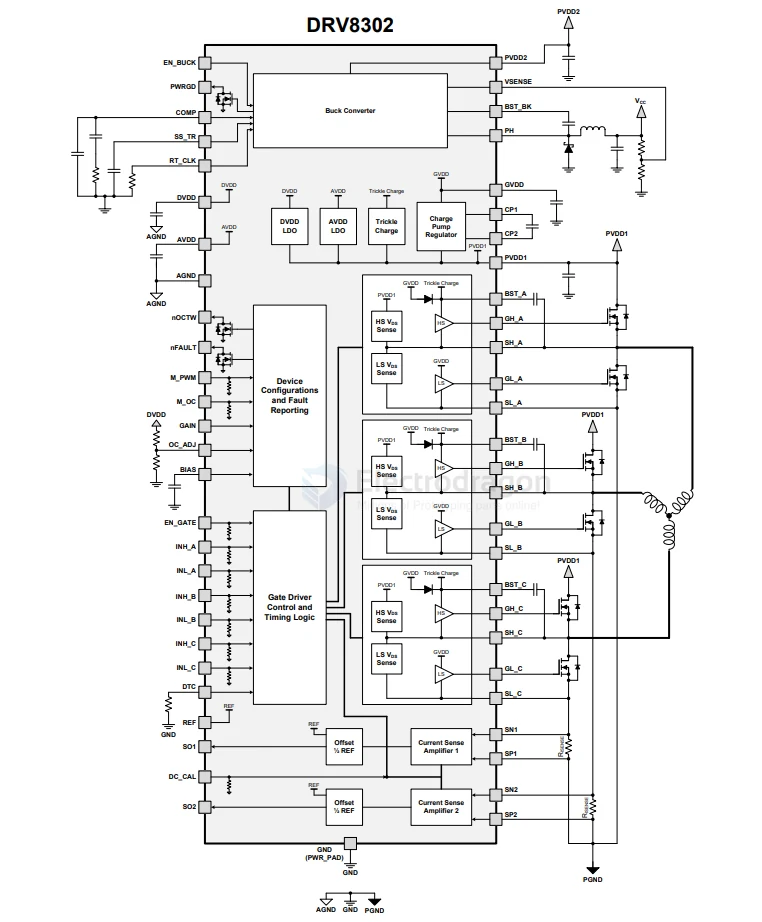
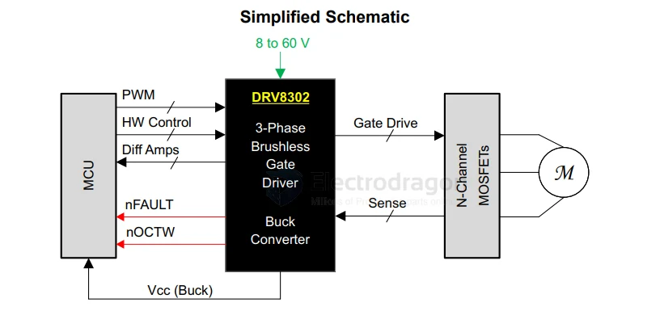
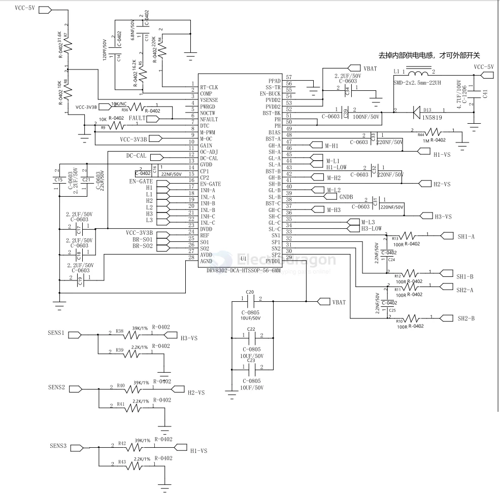

# DRV8302-dat

- [[DRV8302-dat]] - [[motor-driver-BLDC-dat]] - [[ti-motor-driver-dat]]

DRV8302 Three Phase Gate Driver With Dual Current Shunt Amplifiers and Buck Regulator – Hardware Controlled

diagram 

## SCH 

STD 

## build 

## ref 