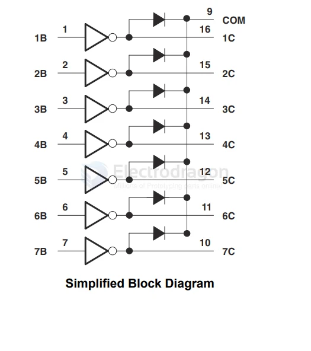
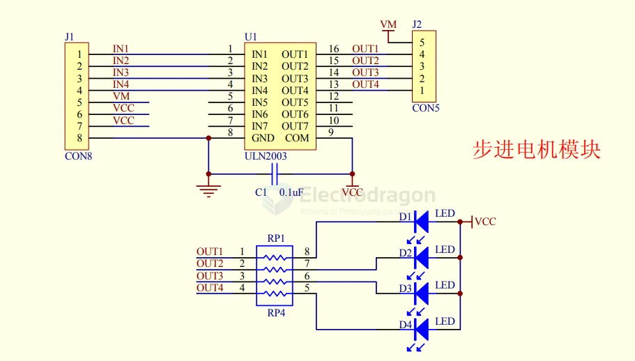
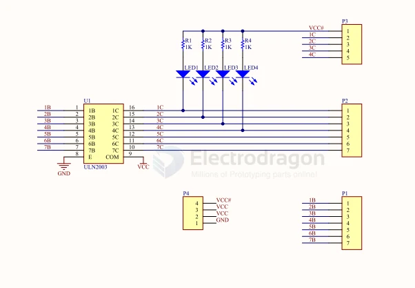
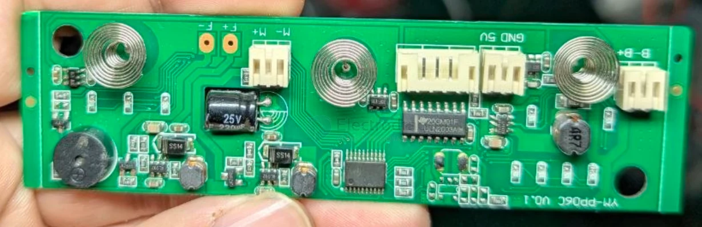
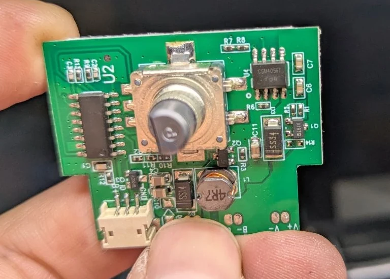
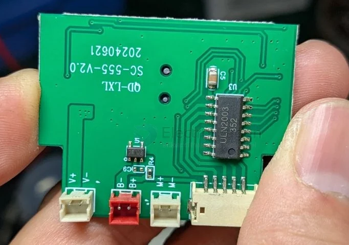

# ULN2003-dat

- [[motor-driver-dat]] - [[Darlington-transistor-array-dat]]

- [[TI-motor-dat]] - [[ULN2003-dat]] - [[Darlington-transistor-array-dat]]

- datasheet [[uln2003a.pdf]]

## SCH 

SCH2 

## build 

build 1 

build 2 

2m1DA 

- [[TP4056-dat]] - [[battery-charger-1s-dat]] - CSM4056T

## info 

The **ULN2003** is a classic **7-channel NPN Darlington transistor array** IC.

In simple terms, it acts as a **current amplifier and low-side switch** between a low-power microcontroller (such as an ESP32, Arduino, or STM32) and higher-current or higher-voltage inductive loads. It allows a weak 3.3V or 5V logic pin (capable of only a few milliamps) to safely switch loads up to **50V** and up to **500mA per channel**, while protecting the microcontroller from inductive voltage spikes.

---

### Core Functions & Features

* **High Current Gain (Darlington Pairs):** Each of the 7 channels uses two cascaded NPN transistors (a Darlington pair), providing high current amplification so tiny logic currents can switch much heavier loads.
* **Open-Collector / Low-Side Sinking (`Sink to GND`):** When an input pin (`IN1`–`IN7`) receives a logic HIGH signal, the corresponding output pin (`OUT1`–`OUT7`) pulls low to `GND`. Because it sinks current rather than sourcing it, loads are wired between the **positive supply (`VCC` / `VM`)** and the **`OUT` pin**.
* **Built-in Flyback Diodes (`COM` Pin):** The chip integrates 7 free-wheeling (flyback) diodes sharing a common cathode on **Pin 9 (`COM`)**. Connecting `COM` to the positive load supply safely clamps inductive kickback when switching coils, relays, or motors off.
* **Integrated Base Resistors:** Each input includes an internal `2.7kΩ` series base resistor, allowing direct connection to standard 5V TTL/CMOS logic (and light-to-moderate 3.3V logic loads) without external gate/base resistors.

---

### Common Applications

* **Unipolar Stepper Motors:** Most famously paired with **28BYJ-48** 5V or 12V 4-phase stepper motors. Four of the seven channels drive coils A, B, C, and D sequentially to control speed, direction, and step position.
* **Relays, Solenoids, and Buzzers:** Driving mechanical relay coils, small DC solenoids, or electromagnetic valves whose coil currents exceed MCU GPIO limits.
* **LED Arrays & Common-Anode Displays:** Sinking current for high-brightness LED strips, indicator banks, or common-anode 7-segment display digits.
* **Logic-to-High-Voltage Buffer:** Serving as a simple level-shifting sink driver for 12V or 24V industrial indicators and control inputs.

---

### Key Engineering Limitations

* **High Saturation Voltage Drop ($V_{CE(sat)} \approx 1.0\text{V} - 1.6\text{V}$):** Because it uses bipolar Darlington pairs rather than MOSFETs, roughly 1V+ drops across the chip when conducting. This reduces the effective voltage delivered to the load and generates noticeable heat at higher currents.
* **No Bidirectional Control (Not an H-Bridge):** It can only pull outputs to ground—it cannot reverse polarity to run a standard brushed DC motor forward and backward (use an H-bridge driver like a DRV8833 or TB6612FNG instead).
* **Not Ideal for High-Frequency PWM:** Slow turn-off recovery and conduction losses make it poorly suited for high-speed PWM dimming or motor speed control at higher currents.

---

### Common Variants

| Part Number | Key Difference |
| --- | --- |
| **ULN2003A / ULN2003AN** | Standard 7-channel version with `2.7kΩ` input resistors; suited for 5V logic (and light 3.3V loads). |
| **ULN2004A** | Features `10.5kΩ` input resistors designed for **6V–15V** CMOS/PMOS logic levels. |
| **ULN2803A** | Expanded **8-channel** version (18-pin package) with the same electrical characteristics, useful for 8-bit buses or 8-relay boards. |

## ref 

- [chip link](https://www.ti.com/product/ULN2003A)

- [[ti-motor-dat]]