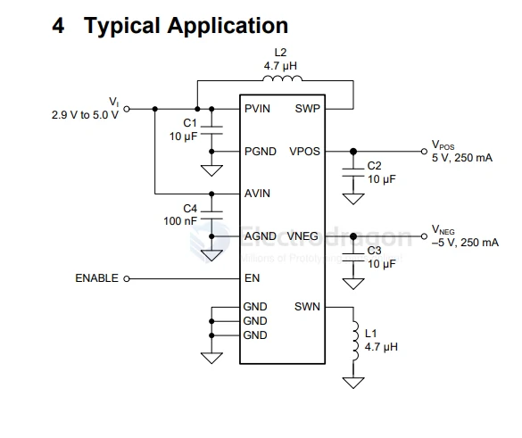
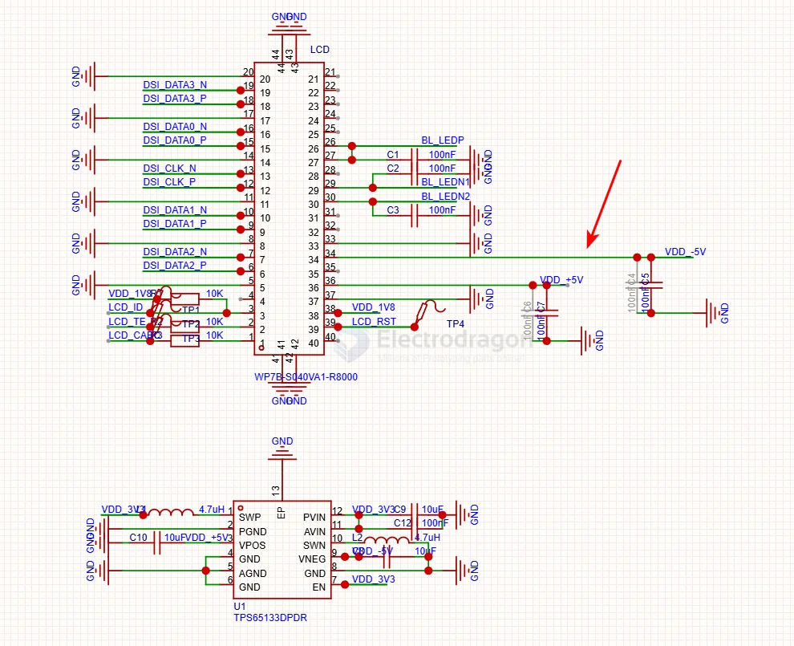

# TPS65133-dat.md

- [[power-negative-dat]] - [[power-dat]] - [[TPS65133-dat]] - [[TI-power-dat]]

TPS65133 ±5-V, 250-mA Dual-Output Power Supply

Features
- 2.9-V to 5.0-V Input Voltage Range
- Fixed 5.0-V Positive Output Voltage (Vpos)Fixed —5.0-V Negative Output Voltage (VnEG)±1% Output Voltage Accuracy
- High Efficiency
- 250-mA Output Current Capability
- Independent Converter Operation Allows 100%Output Current Mismatch
- Excellent Line and Load Transient Response
- Operates in CCM to Minimize Output Noise
- Boost Converter able to Operate with Input SupplyVoltages close to 5.0 V
- Short-Circuit Protection
- Thermal Shutdown

Applications
- LCD Bias
- AMOLED Supplies
- Operational Amplifier Supplies
- Headphone Amplifier Supplies
- Sensor Front-End Supplies
- Data Acquisition Supplies
- General ±5-V Power Supplies

## SCH 

STD 

## build 

SCH 

## ref 