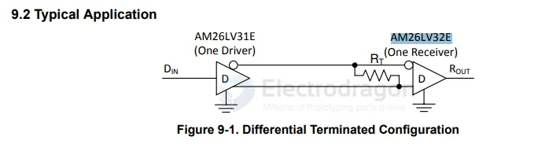

# TI-interface-dat

- [[ti-interface-dat]] - [[ti-dat]]

- [[filter-dat]]

- [[MAX202-dat]] - [[RS232-dat]] - [[TI-interface-dat]]

- [[SNx5LVDSxx-dat]] - [[LVDS-dat]] - [[TI-dat]] - [[TI-interface-dat]] - [[differential-line-receiver-dat]]

## signals 

- [[PCF8574-dat]] - [[NXP-dat]]

[PCF8574 == PCF8574 Remote 8-Bit I/O Expander for I2C Bus](https://www.ti.com/lit/ds/symlink/pcf8574.pdf)

- [[TCA9554-dat]] - [[TI-interface-dat]] - [[TI-dat]]

## LVDS

- [[LVDS-dat]] 

SN65LVDS33, SN65LVDT33, SN65LVDS34, SN65LVDT34 - HIGH-SPEED DIFFERENTIAL RECEIVERS

This family of four LVDS data line receivers offers the widest common-mode input voltage range in the industry. These receivers provide an input voltage range specification compatible with a 5-V PECL signal as well as an overall increased ground-noise tolerance. They are in industry standard footprints with integrated termination as an option.

### RS-485 

`ISOW14x2` Isolated RS-485/RS-422 Transceiver with Integrated Low-Emissions, LowNoise, High-Efficiency DC-DC Converter

`ISOW1412BDFMR` - Low-emissions, 500-kbps, reinforced isolated RS-485/RS-422 transceiver with integrated power

### RS-422 

AM26LV31E - AM26LV32E

`AM26LV32EIDR` - Low-Voltage High-Speed Quadruple Differential Line Receiver With +/-15-kV IEC ESD | D | 16 | -40 to 85

- [[RS422-dat]]

AM26C32,AM26C32C,AM26C32M,AM26C32I

AM26C32 Quadruple Differential Line Receiver

https://www.ti.com/lit/ds/symlink/am26c32.pdf?ts=1770207618743&ref_url=https%253A%252F%252Fwww.google.com%252F

Features for the AM26C32
- Meets or exceeds the requirements of ANSI TIA/EIA-422-B, TIA/EIA-423-B, and ITU recommendation V.10 and V.11
- Low power, I CC = 10 mA typical
- ±7-V Common-mode range with ±200-mV sensitivity
- Input hysteresis: 60 mV typical
- t pd = 17 ns typical
- Operates from a single 5-V supply
- 3-State outputs
- Input fail-safe circuitry
- Improved replacements for AM26LS32 device
- Available in Q-temp automotive

## ref 

- [[TI-dat]]

