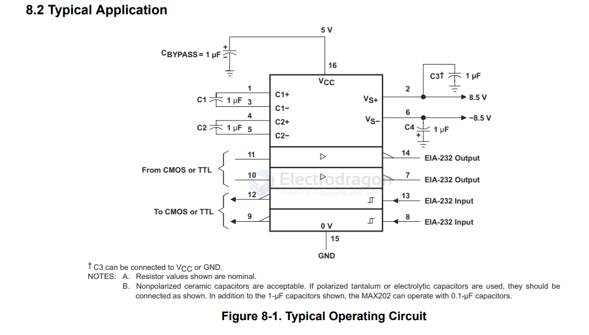

# MAX232-dat

- [[MAX232-dat]] == MAX232CPE+ - [[RS232-dat]] - [[TI-logic-dat]]

The MAX232 is an integrated circuit that converts RS-232 (TIA-232) serial signals to 5V TTL/CMOS logic levels using a single +5V power supply. Built-in charge pumps generate the bipolar RS-232 voltages without needing an external ±12V supply.

Key Specifications

• Channels: 2 drivers (TTL/CMOS to RS-232) and 2 receivers (RS-232 to TTL/CMOS)
• Supply voltage: Single +5V
• Data rate: Up to ~120 kbps
• Receiver input tolerance: Accepts up to ±30V (typical threshold ~1.3V, hysteresis ~0.5V)
• External capacitors: Requires four external charge-pump capacitors (typically 1 µF on standard MAX232; 0.1 µF on MAX232A)
• Common packages: 16-pin PDIP/DIP and 16-pin SOIC

## APP

STD 

## ref 