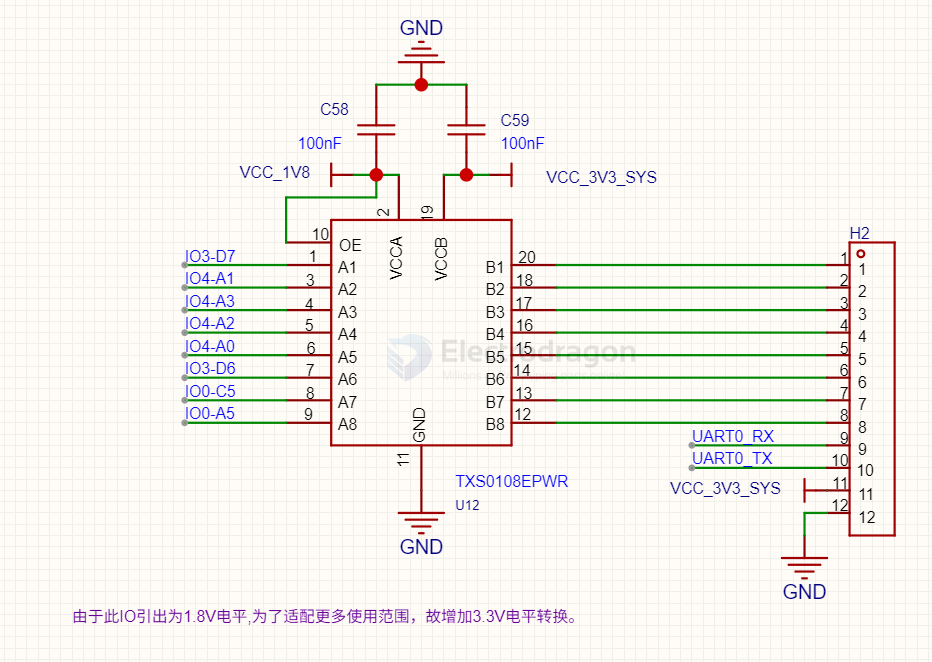

# TXS0108-dat.md

- [[TXS0108-dat]] - [[TXB0108-dat]] - [[logic-level-shifter-dat]] - [[ti-logic-dat]]

资料链接：http://www.ti.com/product/TXS0108E?keyMatch=TXS0108EPWR&tisearch=Search-EN-Everything

Eight-bit bidirectional voltage-level shifter for open-drain and push-pull applications

## SCH 

## ref 

- [[TXS0108]]

