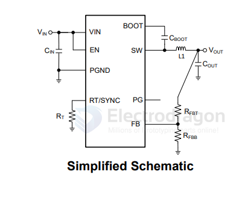

# LMR38020-dat

LMR38020 4.2-V to 80-V, 2-A, Synchronous SIMPLE SWITCHER® Power Converter with 40-µA IQ

- [[TI-power-dcdc-down-dat]] - [[LMR38020-dat]] == 80V 2A - [[dcdc-down-dat]] - [[ESC-FPV-dat]]

1 Features
• Functional Safety-Capable
– Documentation available to aid functional safety
system design
• Configured for rugged industrial applications
– 4.2-V to 80-V input voltage range
– 2-A continuous output current
– Ultra-low 40-µA operating quiescent current
– > 1.5-mm distance between VIN and GND pin
– 200-kHz to 2.2-MHz adjustable switching
frequency
– Frequency synchronization to external clock
– Spread spectrum option for reduced EMI
– 97% maximum duty cycle
– Support start-up with pre-biased output
– ±1.0% tolerance voltage reference at room
temperature
– Precision enable
– Easy to use device with integrated
compensation network enabling low BOM count
– Integrated synchronous rectification
– 8-pin HSOIC with PowerPAD™ integrated circuit
package
– PFM and forced PWM (FPWM) options
– Available in 1-A, LMR38010
• Create a custom design using the LMR38020 with
the WEBENCH® Power Designer

2 Applications
• Industrial transport
• Wireless infrastructure and networking
• Power delivery
• Factory automation and control

## SCH 

STD 

## ref 