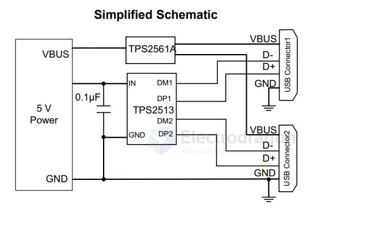

# TI-usb-charger-dat

- [[TI-dat]] - [[TPS251x-dat]] - [[TPS2561-dat]] - [[fast-charge-protocols-dat]] - [[TI-usb-charger-dat]]

- [[TPS251x-dat]] - [[KTG2513-dat]]

1 Features
1• Supports USB DCP shorting D+ line to
D– line per USB battery charging specification,
revision 1.2 (BC1.2)
• Supports shorted mode (shorting D+ line to D–
line) per Chinese Telecommunication Industry
Standard YD/T 1591-2009
• Supports USB DCP applying 2.7 V on D+ Line
and 2 V on D- line (or USB DCP applying
2 V on D+ line and 2.7 V on D– line) (TPS2513,
TPS2514)
• Supports USB DCP applying 2.7 V on D+ line and
2.7 V on D- line (TPS2513A, TPS2514A)
• Supports USB DCP applying 1.2 V on
D+ and D– Lines
• Automatically Switch D+ and D– Lines
Connections for an Attached Device
• Dual USB Port Controller
(TPS2513, TPS2513A)
• Single USB port controller
(TPS2514, TPS2514A)
• Operating range: 4.5 V to 5.5 V
• Available in SOT23-6 package

2 Applications
• Vehicle USB power chargers
• AC-DC adapters with USB ports
• Other USB chargers

3 Description

The TPS251xx devices are USB dedicated charging
port (DCP) controllers. An auto-detect feature
monitors USB data line voltage, and automatically
provides the correct electrical signatures on the data
lines to charge compliant devices among the
following dedicated charging schemes:
1. Divider 1 DCP, required to apply 2 V and 2.7 V
on the D+ and D– Lines respectively (TPS2513,
TPS2514)
2. Divider 2 DCP, required to apply 2.7 V and 2 V
on the D+ and D– Lines respectively (TPS2513,
TPS2514)
3. Divider 3 DCP, required to apply 2.7 V and 2.7 V
on the D+ and D– Lines respectively (TPS2513A,
TPS2514A)
4. BC1.2 DCP, required to short the D+ Line to the
D– Line
5. Chinese Telecom Standard YD/T 1591-2009
Shorted Mode, required to short the D+ Line to
the D– Line
6. 1.2 V on both D+ and D– Lines

## schematic 

## ref 