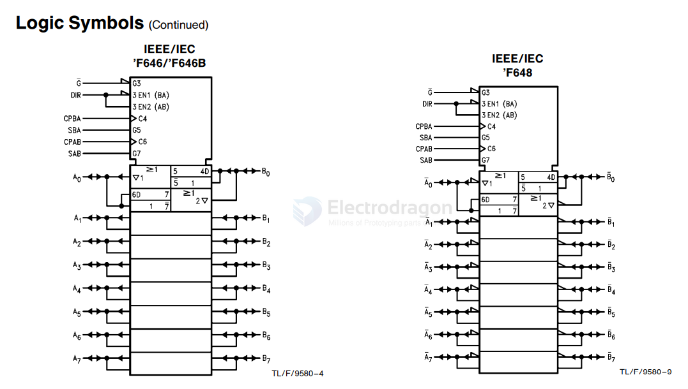

# 54F646B-dat

- [[74F646B-dat]] - [[54F646B-dat]] - [[register-dat]] - [[logic-dat]] - [[national-semiconductor-dat]] - [[TI-dat]]

54F/74F646 # 74F646B # 54F/74F648 Octal Transceiver/Register with TRI-STATEÉ Outputs

These devices consist of bus transceiver circuits with TRISTATE, D-type flip-flops, and control circuitry arranged for multiplexed transmission of data directly from the input bus or from the internal registers. 

Data on the A or B bus will be clocked into the registers as the appropriate clock pin goes to a high logic level. 

Control G and direction pins are provided to control the transceiver function. 

In the transceiver mode, data present at the high impedance port may be stored in either the A or the B register or in both. 

The select controls can multiplex stored and real-time (transparent mode) data. The direction control determines which bus will receive data when the enable control G is Active LOW. 

In the isolation mode (control G HIGH), A data may be stored in the B register and/or B data may be stored in the A register.

Features
Y Independent registers for A and B buses
Y Multiplexed real-time and stored data
Y ’F648 has inverting data paths
Y ’F646/’F646B have non-inverting data paths
Y ’F646B is a faster version of the ’F646
Y TRI-STATE outputs
Y 300 mil slim DIP
Y Guaranteed 4000V minimum ESD protection

## ref 

