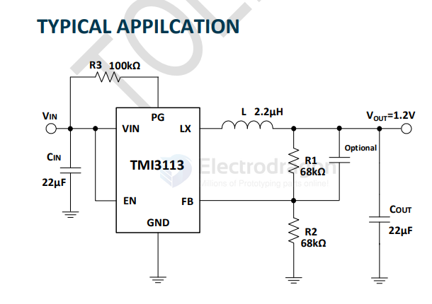
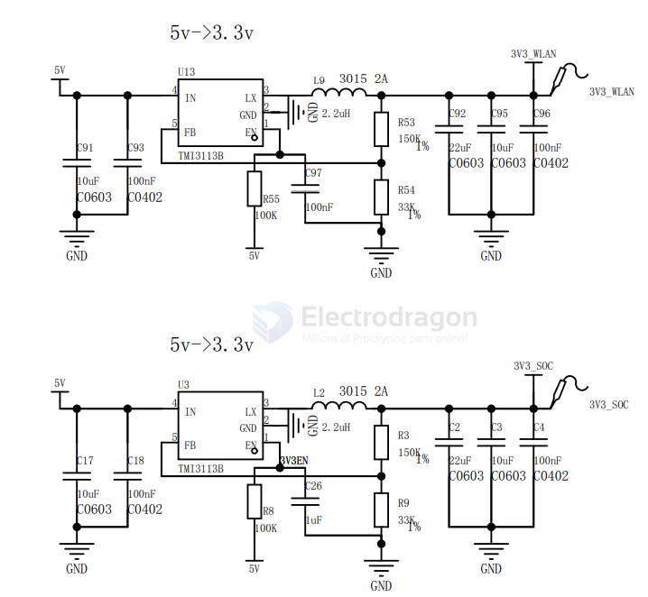

# TMI3113-dat

- [[TMI-dat]] - [[TOLL-dat]] - [[TMI3113-dat]] - [[TMI3411-dat]] - [[TMI3408-dat]] == pin-to-pin compatible

1.0MHz, 3A Synchronous Step-Down Converter

The TMI3113B (by TOLL Microelectronics / TMI) is a 1.0 MHz, 3A synchronous step-down (buck) DC-DC converter in an SOT23-5 package.

Key Specifications

• Input Voltage Range: 2.7 V to 5.5 V
• Output Voltage: Adjustable, down to 0.6 V (\(V_{FB} = 0.600\text{ V}\) typ.)
• Max Output Current: Up to 3 A
• Switching Frequency: 1.0 MHz fixed
• Efficiency: Up to 95% (PFM/PWM modes; 100% duty cycle support)
• Quiescent / Shutdown Current: 50 µA typ. quiescent; < 1 µA shutdown
• Internal FETs (\(R_{DS(on)}\)): ~95 mΩ PMOS / ~50 mΩ NMOS
• Protections & Features: Short-circuit protection, thermal fault protection (~155°C), input OVP (~6.1 V), UVLO (~2.5 V–2.6 V), soft start (~0.8 ms), and no Schottky diode required
• Package: SOT23-5 (differs from the TMI3113 in TSOT23-6/SOT23-6, which includes a Power Good output)

## SCH 

STD 

## build 

## ref 