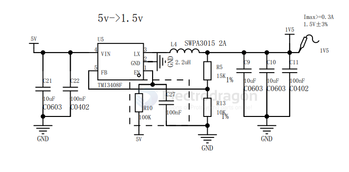

# TMI3408-dat

- [[TMI-dat]] - [[TOLL-dat]] - [[TMI3113-dat]] - [[TMI3411-dat]] - [[TMI3408-dat]] == pin-to-pin compatible

1.5MHz, 1.2A Synchronous Step‐Down Converter

FEATURES
 High Efficiency: Up to 96%(@3.3V)
 1.5MHz Constant Frequency Operation
 1.2A Output Current
 No Schottky Diode Required
 2.5V to 6.0V Input Voltage Range
 Output Voltage as Low as 0.6V
 100% Duty Cycle in Dropout
 Low Quiescent Current: 40µA
 Slope Compensated Current Mode Control for Excellent Line and Load Transient Response
 Soft Start time for 1ms
 Short Circuit Protection with Frequency reduction mode
 Thermal Fault Protection
 Inrush Current Limit and Soft Start
 Input over voltage protection (OVP)
 <1µA Shutdown Current
 SOT23‐5 Package

## build 

## ref 