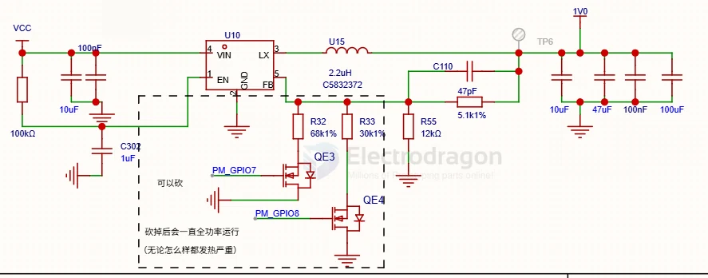
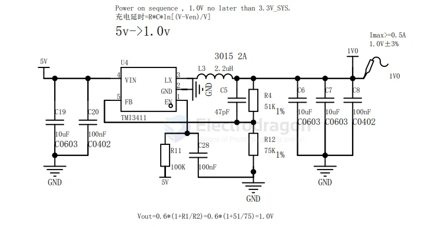

# TMI3411-dat

- [[TMI-dat]] - [[TOLL-dat]] - [[TMI3113-dat]] - [[TMI3411-dat]] - [[TMI3408-dat]] == pin-to-pin compatible

1.0MHz, 2A Synchronous Step-Down Converter

## SCH 

## build 

## ref 

