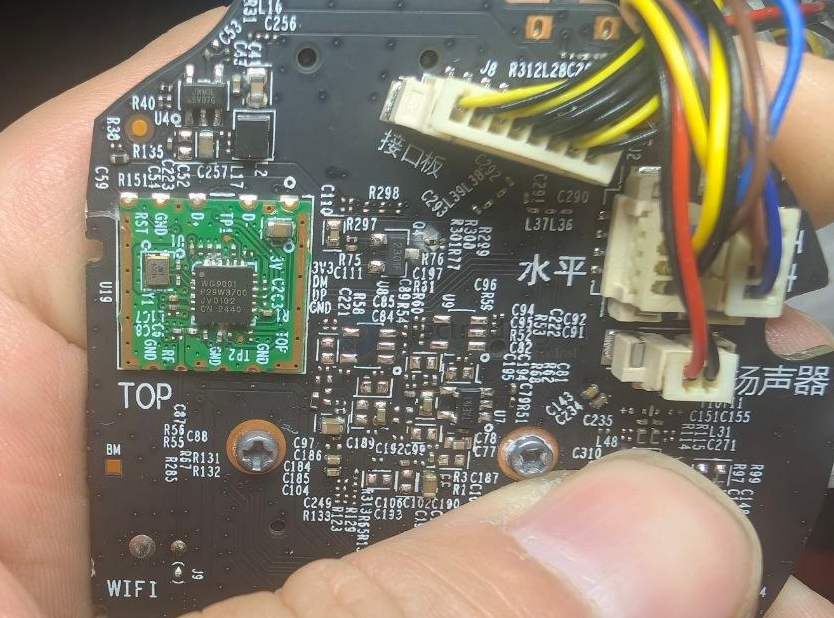
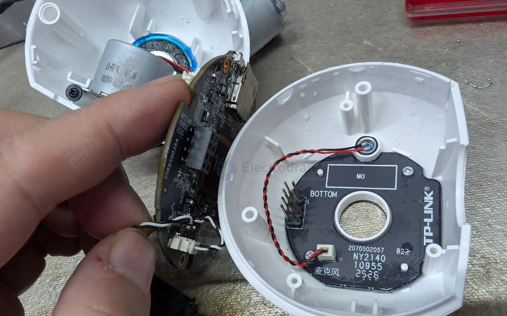
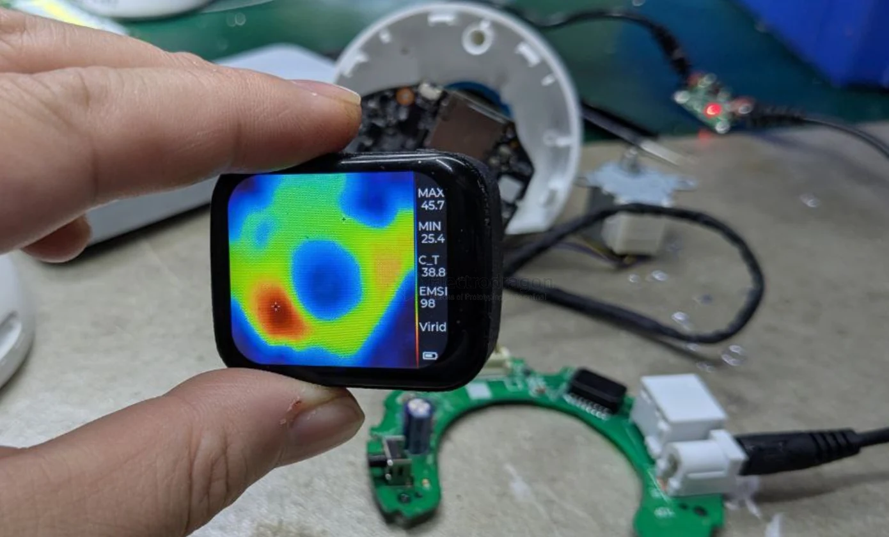

# TPLINK-camera-dat

- [[SSC373-dat]] - [[sigmastar-dat]] - [[TPLINK-camera-dat]]

- [[sensor-camera-dat]] - [[TPLINK-camera-dat]]

- [[sensor-camera-dat]] - [[wifi-sdio-dat]] - [[TPLINK-camera-dat]] - [[DDPAI-dat]]

## build 

WG-9001 

P29W3700

JWM3L - [[joulwatt-dat]] - [[JW5250-dat]]
5V07G

## TPLINK camera 

- [[stepper-dat]] 

[dissembled TP LINK security camera post ](https://www.electrodragon.com/teardown-a-tplink-security-camera-after-oil-soaking/)

## microphone and front leds 

## heat 

- [[Heat-Dissipation-dat]]

## ref 