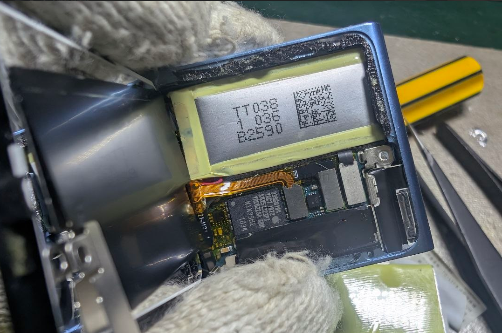
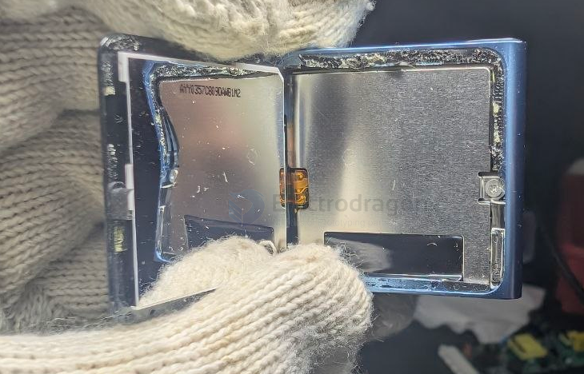
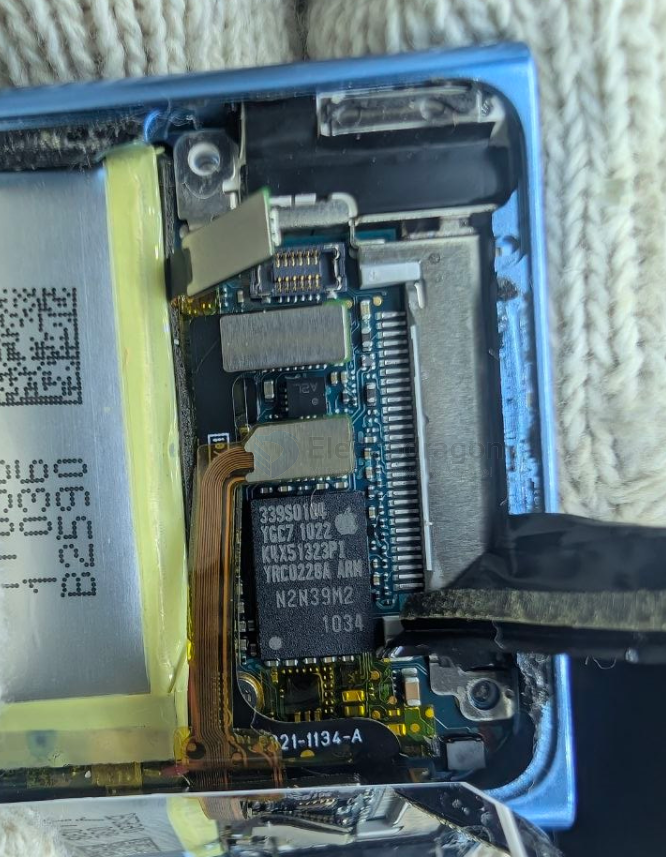
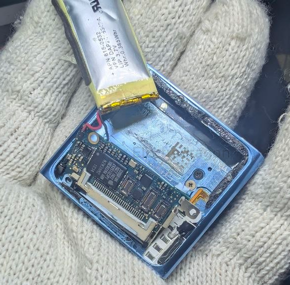
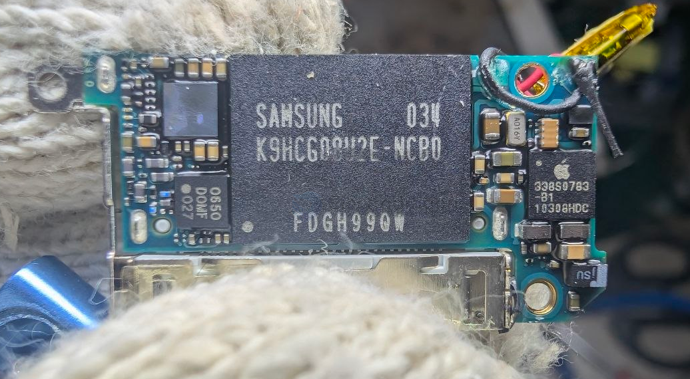

# ipod-dat

- [[apple-dat]] - [[ipod-dat]] - [[heatbed-dat]]

## build 

overview 

339S0104 - [[apple-dat]] - [[339S0104-dat]] - [[samsung-dat]] - [[ARM-dat]] - [[ARM-11-dat]] - [[ipod-dat]]

The Apple `339S0104` is the primary System-on-Chip (SoC) and integrated memory package used in the 6th-generation iPod nano (released in 2010 and updated in 2011). It is a custom Apple-branded silicon package manufactured by Samsung that houses both the main application processor and the device's system RAM.

Technical Specifications

• Processor Architecture. It integrates a Samsung `APL3278A01` application processor built around an `ARM1176JZF-S` core.
• Integrated Memory. The chip uses a Package-on-Package (PoP) design that stacks Samsung K4X51323PI Mobile DDR SDRAM (64 MB) directly onto the processor die.
• Silicon History. Teardown analyses by TechInsights and iFixit indicate that the 339S0104 is a repackaged iteration of the earlier Apple 338S0859 silicon used in previous-generation iPod nano models.

- [[K9HCGD8U2E-dat]] == [[flash-nand-dat]] == 8GB - [[samsung-dat]] - [[ipod-dat]]

The Apple `338S0783` (often marked 338S0783-B1) is a custom Power Management Integrated Circuit (PMIC) used on the logic board of the iPod nano (6th generation).

- [[PMIC-dat]] - [[ipod-dat]] - [[apple-dat]] - [[338S0783-dat]]

## ref 

