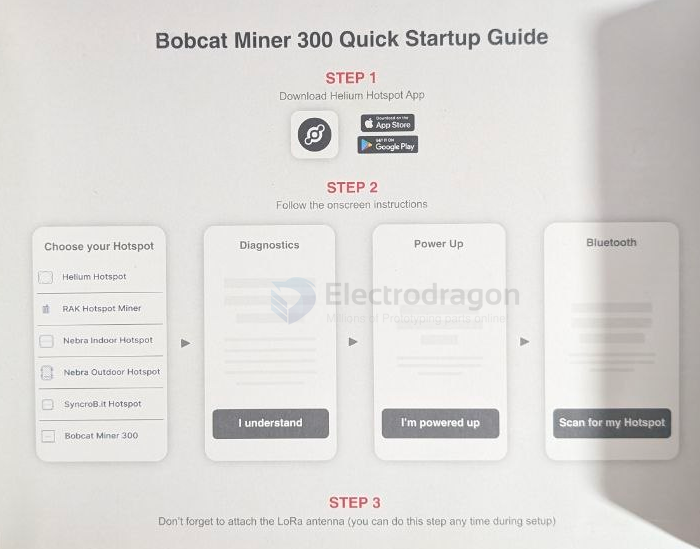
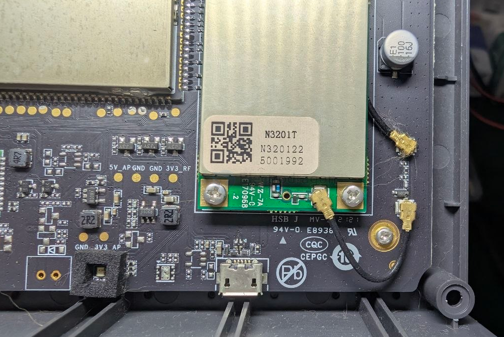
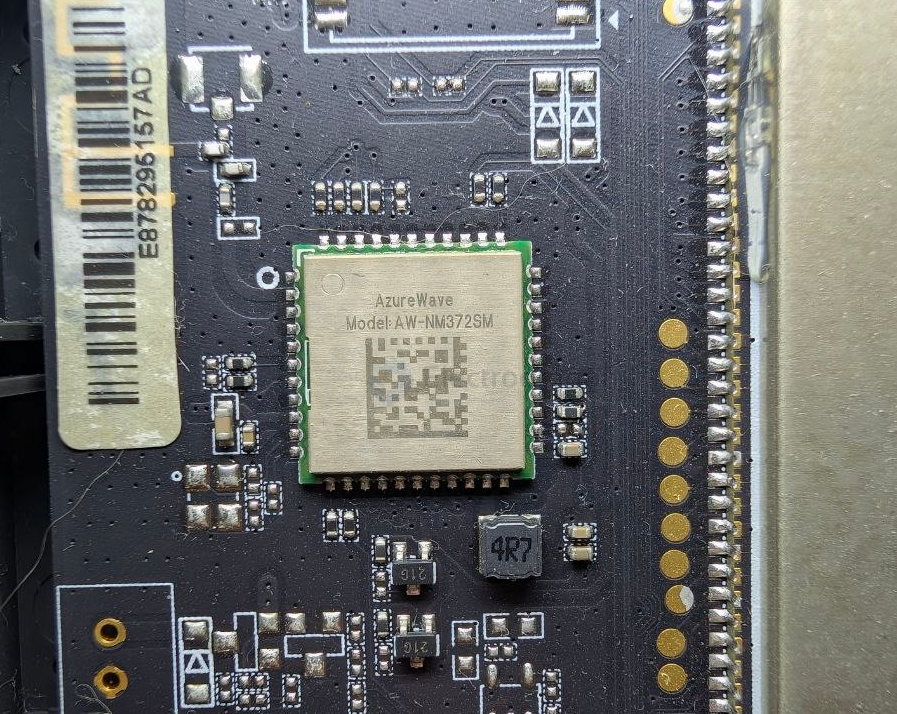
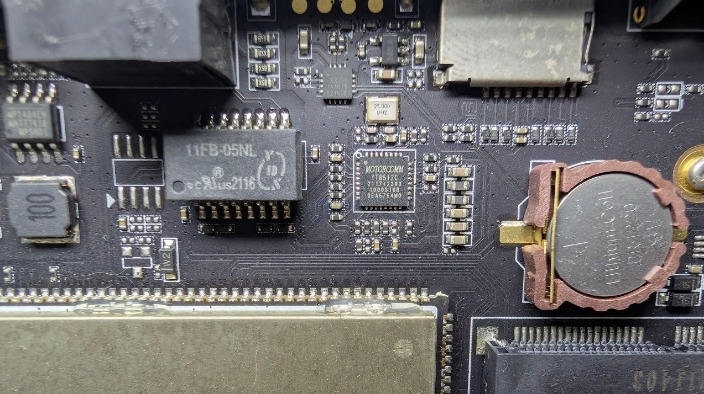
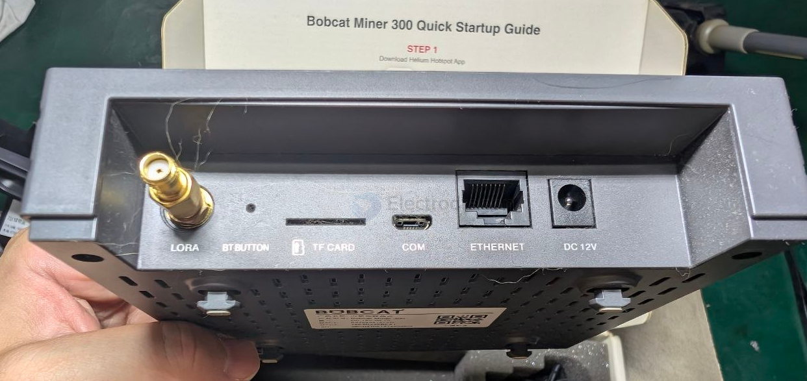
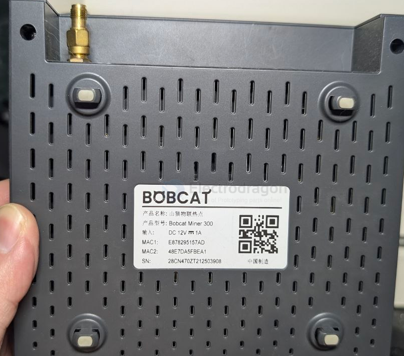

# bobcat-dat

- [[bobcat-dat]] - [[lorawan-dat]] - [[helium-dat]] - [[IOT-dat]]  - [[lora-dat]] - [[docker-dat]]

## build 

- [[N3201T-dat]] - [[bobcat-dat]] 

- [[azureware-dat]] - [[AW-NM372SM-dat]] - [[wifi-dat]] - [[bluetooth-dat]]

- [[semtech-dat]] - [[lora-dat]] - [[bobcat-dat]] 

- [[Rockchip-dat]] - [[PX30-dat]] - [[bobcat-dat]] 

- [[MPS-dat]] - [[MP1484-dat]]

## reuse retarget 

Simply put, the **Bobcat Miner 300**, which was extremely popular back in the day within the Helium (HNT) ecosystem, has **greatly diminished mining earnings**, and its **official manufacturer has long since gone out of business / stopped supporting it**.

If you are thinking about jumping in now, or if you have an idle unit and want to take it out for a spin, its current status and details are primarily as follows:

### 1. Current Status: Manufacturer Defunct, Ecosystem Shifted

* **Manufacturer Shutdown**: The official Bobcat entity no longer exists, meaning official cloud firmware updates, after-sales maintenance, and manufacturer support are entirely cut off.
* **Community Self-Help**: Fortunately, the hardware foundation of this device (Rockchip PX30 quad-core processor, Semtech chip) is decent. Some geek communities (such as flashing lightweight Debian systems via Docker images) allow it to continue running as a standard LoRa gateway.
* **Changed Earning Logic**: Compared to the crazy early days, the current token distribution model of the Helium network has stabilized significantly. Relying on it to get rich or achieve a quick payback is basically impossible.

### 2. Is it Still "Useful" Now?

* **If you plan to buy a brand new one at a high price (e.g., hundreds of dollars)**: **Completely not worth it**. Extremely low cost-performance ratio and high risk (you might end up with a device that cannot be properly bound or connected to an official wallet).
* **If you are a tech enthusiast and can pick up a secondhand unit for a very cheap price (e.g., tens of dollars)**: You can buy it as a **tech toy**.
* **Low Power Consumption**: It runs on very low power (around 5W) and consumes almost no electricity when left running at home.
* **Hacking Space**: You can use it to research LoRaWAN networks, deploy private IoT nodes, or tinker with third-party open-source firmware (like Docker gateway images).
* **Extremely Demanding Location Requirements**: If you insist on using it to mine HNT, it has extremely strict requirements for **high-altitude, unobstructed rooftops or balconies**. If placed merely on an indoor windowsill, you will earn almost zero rewards.

Secondhand market units occasionally appear, but they are mostly only suitable to be bought cheaply as IoT geek toys.

### Recommendation

If you already have one on hand and the environment is suitable (mounted high up with a clear line of sight), you can flash an open-source firmware to keep it running as a low-power node. However, if you are considering spending money to buy one for "investment mining," the timing has passed.

## ref 

