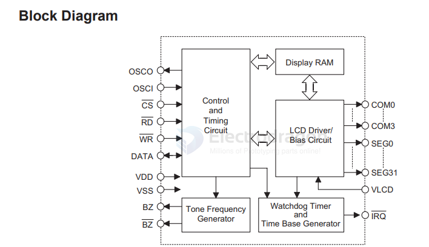
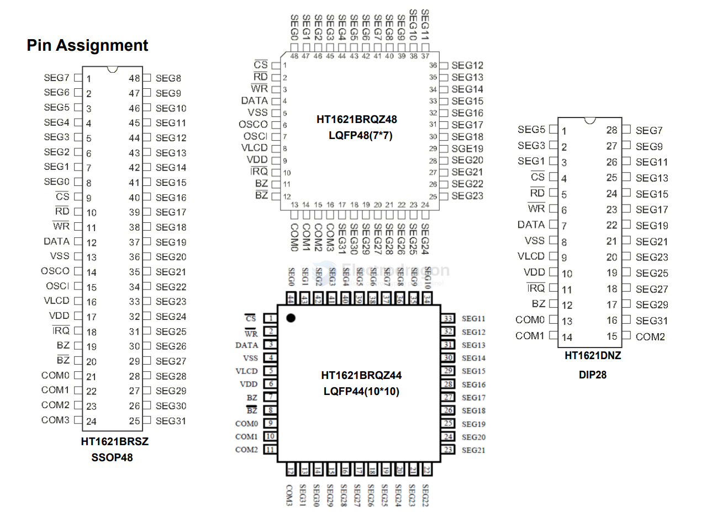
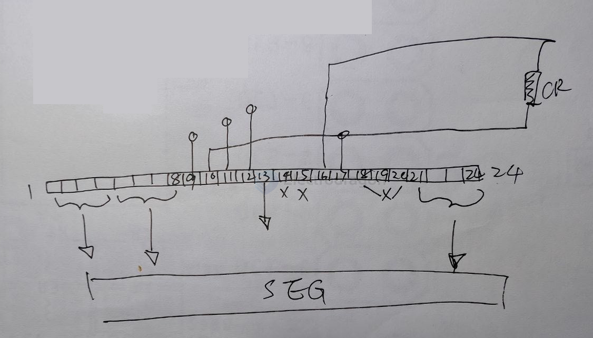
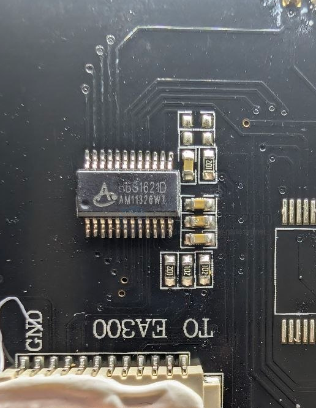

# HT1621-dat

HBS162D 

RAM Mapping 324 LCD Controller for I/O MCU

https://github.com/valerionew/ht1621-7-seg

[[segment-LCD-dat]] - [[ILC1066-dat]] - [[ILC1067-dat]] - [[HT1621-dat]]

## diagram 

## pins 

## SCH 

pins 

| pin   | func |
| ----- | ---- |
| 1~4   | COMs |
| 5~8   | SEGs |
| 21~24 | SEGs |

## build

## ref 

