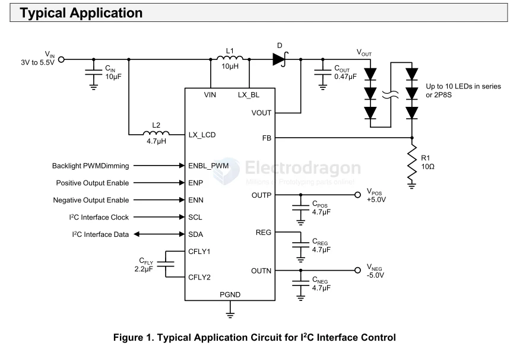

# kinetic-dat

- [[kinetic-dat]] - [[KTZ8850-dat]]

High Efficiency Step-Up LED Driver with Dual Output LCD Bias Power

Features 
• Wide input range: 3.0V~5.5V 
• Low quiescent current  
• Drive up to 10 series LEDs or 2 parallel strings  of 8 series LEDs 
  Backlight efficiency: up to 86% 
  Integrated 40V Power MOSFET 
  Flexible dimming control 
■  256-step I 2 C Controlled or 
■  High resolution PWM 5~100kHz 
  High accuracy across full load range 
  Programmable LED open-circuit (OVP)/Short protection 
  Low 200mV feedback voltage 
  Internal over voltage protection (default 36V) 
• Programmable dual Bias output regulator based on single inductor solution 
  Charge pump PFM mode at light load 
  LCD Bias efficiency: up to 90% 
  Wide dual output voltage range 
■  +/-4.0V to +/-6.3V (100mV/step) 
  +/-1.5% V POS /V NEG  output voltage accuracy 
  Maximum peak output current up to 80mA 
  Active output discharge function 
  Cycle-by-cycle inductor current limit 
• 1 µA shutdown current 
• Pb-free Package: WLCSP-18  
• -40°C to +85°C Temperature Range 
 
Applications 
• Smartphone/Tablet Backlight 
• Netbook/Notebook Backlight 
• PDA/GPS Backlight 
• Portable Media Player

## SCH 

STD 

## ref 