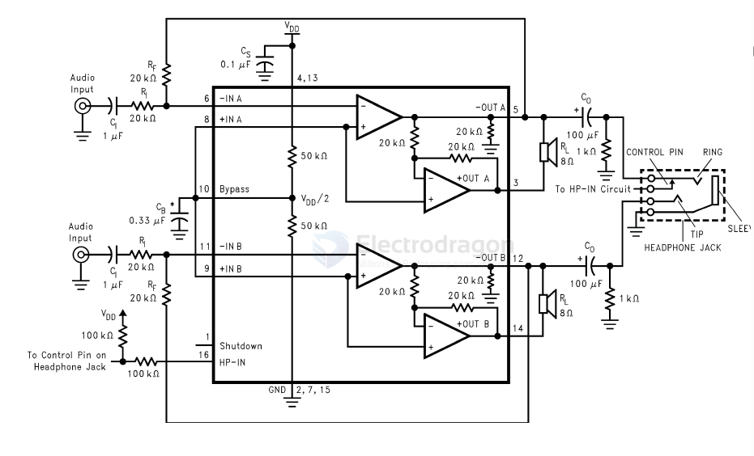

# MC4863PD-dat.md

- [[amplifier-audio-dat]] - [[megapower-dat]] - [[MC4863PD-dat]] - Dual 2.2W Audio Amplifier Plus Stereo Headphone Function - [[ATS2301-dat]]

General Description
The MC4863 is a dual bridge-connected audio
power amplifier which, when connected to a 5V
supply, will deliver 2.2W to a 4Ω load(Note 1) or
2.5W to a 3Ω load(Note 2) with less than 1.0%
THD+N. In addition, the headphone input pin
allows the amplifiers to operate in single-ended
mode to drive stereo headphones.

Boomer audio power amplifiers were designed
specifically to provide high quality output power
from a surface mount package while requiring
few external components,to simplify audio system
design, it combines dual bridge speaker amplifiers and stereo headphone amplifiers on one
chip.

The MC4863 features an externally controlled,
low-power consumption shutdown mode, a stereo
headphone amplifier mode, and thermal shutdown protection. It also utilizes circuitry to reduce
“clicks and pops” during device turn-on.

## SCH 

STD 

## ref 