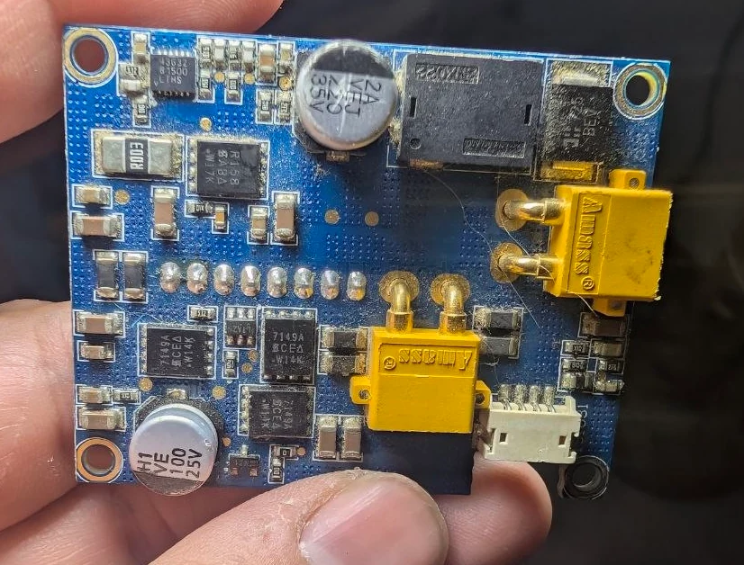

# murata-dat

- [[murata-dat]] - [[MEJ2-dat]] - [[chip-dat]] - [[dcdc-dat]] 

- [[BNX022-dat]] - [[murata-dat]] 

- [[filter-EMI-dat]] - [[murata-dat]] - [[filter-dat]] - [[EMI-dat]]

## BNX022-01L

LC EMI Filter 5th Order Low Pass 2 Channel C = 1µF 20 A 4-SMD, No Lead

https://www.murata.com/en-us/products/productdata/8796777775134/ENFH0008.pdf

## build 

unknown 1 

43632 87500 LTHS

43632 81500 LTHS

43632 B7500 LTHS

43632 B1500 LTHS

- [[filter-EMI-dat]] - [[murata-dat]] - [[filter-dat]] - [[EMI-dat]]

- [[mosfet-dat]] 

## ref 