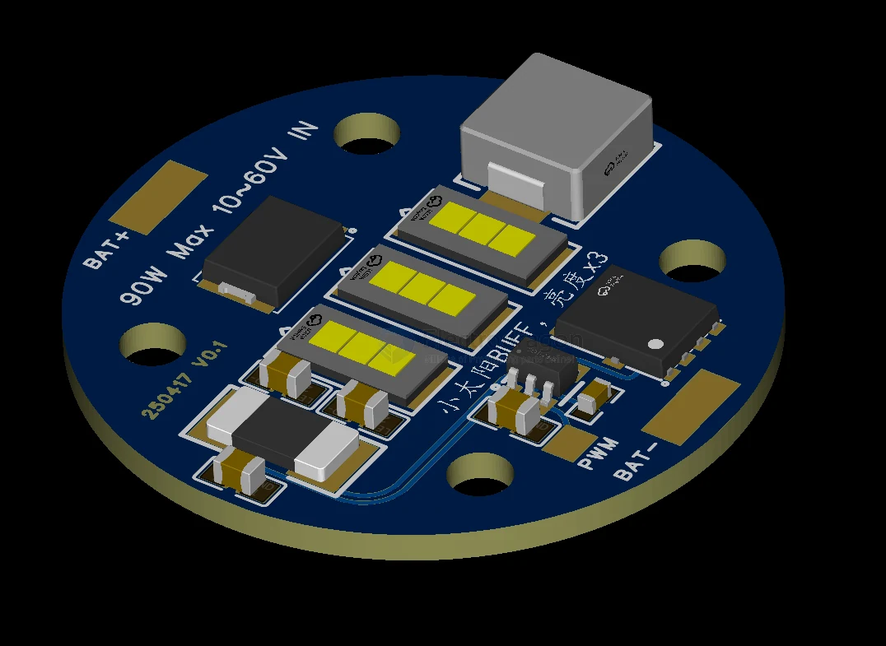
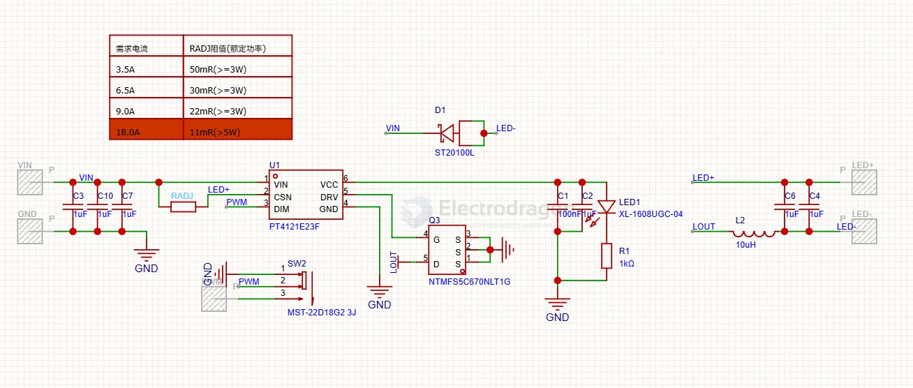
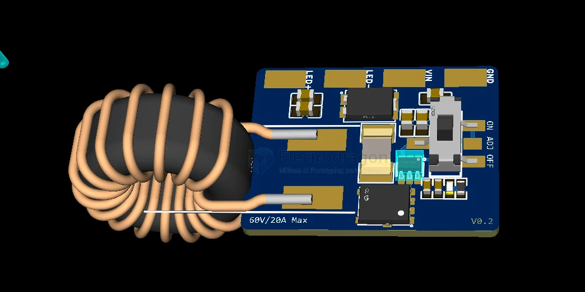

# PT4121-dat

- [[LED-dat]] - [[LED-5730-dat]] - [[led-driver-dat]]

- [[powtech-dat]] - [[PT4121-dat]] - [[led-driver-dat]] - [[LED-dat]] - [[LED-5730-dat]]

## build 

### build 100W-2 

HoYLR2512-3W-20mR-1%

- [[mosfet-dat]] - [[NTMFS5C670NL-dat]] - [[onsemi-dat]] - 60 V, 6.1 m, 71 A

- [[diode-dat]] - [[fuxinsemi-dat]] - [[ST20100L-dat]] - [[PT4121-dat]] - [[led-driver-dat]] == 100V / 20A

APH0630T1R0M

### build 100W-1

- [[mosfet-dat]] - [[NTMFS5C670NL-dat]] - [[onsemi-dat]] - 60 V, 6.1 m, 71 A

- [[diode-dat]] - [[fuxinsemi-dat]] - [[ST20100L-dat]] - [[PT4121-dat]] - [[led-driver-dat]] == 100V / 20A

调整采样电阻以调整输出电流

电流计算公式：I=0.2/Rs

驱动多个LED时，串联以减少发热

## ref 