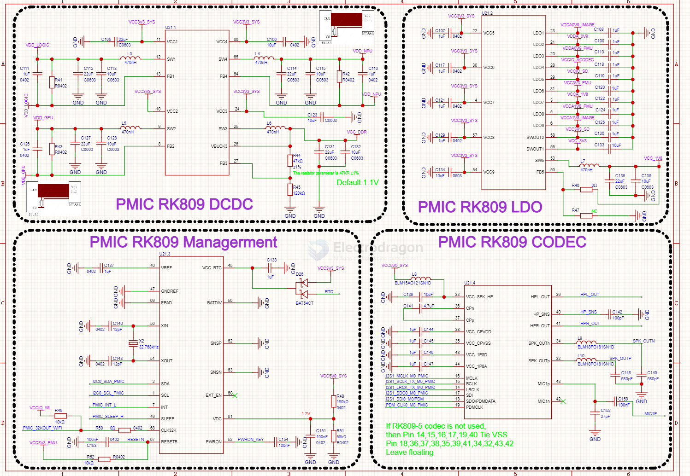
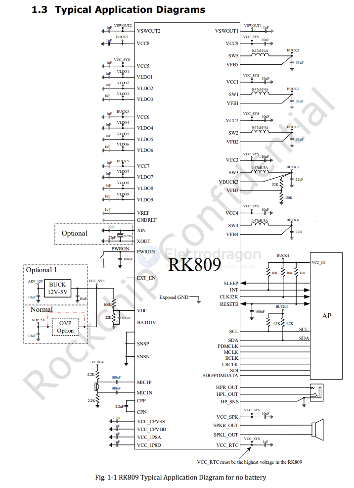

# RK809-dat

- [[rockchip-dat]] - [[RK809-dat]] - [[PMIC-dat]] - [[SBC-dat]]

https://rockchip.fr/RK809%20datasheet%20V1.01.pdf

## SCH 

SCH2 

SCH STD 

## info 

The RK809 is a complex power-management integrated circuit (PMIC) integrated
CODEC for multi-core system applications powered by an external power supply. The
RK809 can provide a complete power management solution with very few external
components.
The RK809 provides five configurable synchronous step-down converters. The
device also contains 9 LDO regulators, two switches and a battery fuel gauge. Powerup/power-down controller is configurable and can support any customized powerup/power-down sequences (OTP based). A real-time clock (RTC) is also integrated to
provide a 32.768-kHz output buffer, and real time function. The RK809 supports 32.768-
kHz clock generation based on a crystal oscillator. It also includes Audio CODEC , real
ground Head phone driver and ClassD driver.
A “battery fuel gauge” is integrated in the RK809. Using the proprietary algorithms
and the sensed battery current and voltage, the gauge can accurately calculate the
battery capacity based on the charging/discharging characteristics of the battery
preloaded in the system. The gauge then sends the battery capacity information to the
processor through the I2C interface.
The RK809 can dynamically adjust the output voltage of each DC-DC converter, as
required by the processor based on the processor’s operation status so as to maximize
the system efficiency. The output voltages of most channels can be configured through
the I2C interface. The inputs of all channels have soft start function, which greatly
reduces the inrush current at the startup.
The 2MHz switching frequency allows small size inductors to be used for both buck and
boost converters. Also, as all the power switches are integrated on chip, no external
power switches and Schottky diodes are needed, which reduces the system cost
significantly.
The RK809 is available in a QFN68 7.0 mm x 7.0 mm package, with a 0.35-mm pin pitch.

## ref 