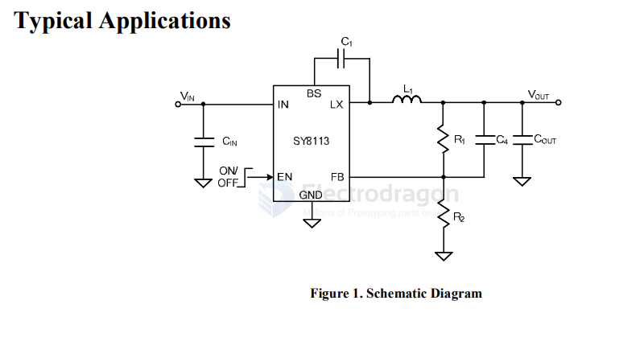
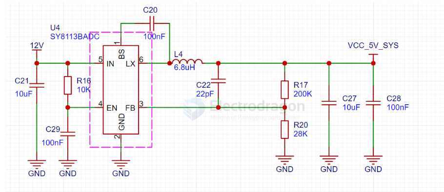

# SY8113-dat

- [[SY8113-dat]] - [[silergy-dat]] - [[down-12V-5V-dat]]

High Efficiency, 500kHz, 3A, 16V Input Synchronous Step Down Regulator

The SY8113 is a high efficiency 500 kHz synchronous
step-down DC-DC converter capable of delivering 3A
current. The SY8113 operates over a wide input
voltage range from 4.5V to 16V and integrates main
switch and synchronous switch with very low RDS(ON)
to minimize the conduction loss.
Low output voltage ripple and small external inductor
and capacitor sizes are achieved with 500 kHz
switching frequency. It adopts the instant PWM
architecture to achieve fast transient responses for high
step down applications

## SCH 

SCH STD 

SCH 1 

## ref 

