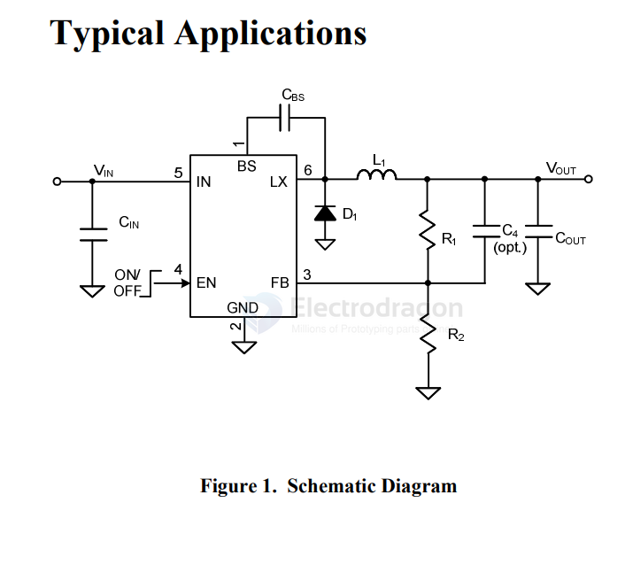

# SY8401-dat

- [[SY8401-dat]] - [[silergy-dat]] - [[dcdc-down-dat]] - [[ITF1009-dat]]

High Efficiency, 1.2MHz, 55V Input, 0.8A Asynchronous Step Down Regulator

General Description

The SY8401 develops a high efficiency asynchronous step down DC/DC regulator capable of delivering 0.8A output current. The IC adopts current mode adaptive constant off time control. The SY8401 operates over a wide input voltage range from 4.5V to 55V and integrates main switch with very low RDS(ON) to minimize the conduction loss.

Low output voltage ripple and small external inductor and capacitor sizes are achieved with 1.2MHz switching frequency

Features
- • Low RDS(ON) for Internal N-channel Power FET: 700mΩ
- • 4.5-55V Input Voltage Range
- • 0.8A Output Current Capability
- • 1.2MHz Pseudo Constant Switching Frequency
- • Internal Soft-start Limits the Inrush Current
- • Hic-cup Mode Output Short Circuit Protection
- • EN ON/OFF Control with Accurate Threshold
- • Cycle by Cycle Peak Current Limit
- • 0.6V±1 % Reference Voltage
- • SOT23-6 Package

Applications
- • Non-Isolated Telecommunication Buck Regulator
- • Secondary High Voltage Post Regulator
- • Automotive Systems

## SCH 

STD 

## ref 