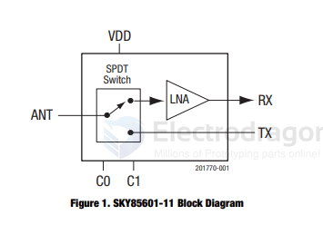

# SKY85601-dat

https://www.skyworksinc.com/-/media/skyworks/documents/products/1801-1900/sky85601_11_201770h.pdf

## Features
-  Low noise figure: 2.5 dB
-  Frequency range: 4.9 to 5.9 GHz
-  High IIP3: +6 dBm
-  High gain: 12 dB
-  Bypass mode with –5 dB insertion loss
-  High transmit to receive isolation for high-power applications
-  Small QFN (16-pin, 2.5 x 2.5 mm) package (MSL1, 260 C per JEDEC J-STD-020) 

- [[skyworks-dat]] - [[wifi-adapter-dat]] - [[RTL8812AU-dat]] - [[SKY85601-dat]] - [[amplifier-dat]] - [[amplifier-5ghz-dat]] - [[wifi-dat]]

The SKY85601-11 is an integrated, single-pole double-throw
(SPDT) switch with a low-noise amplifier (LNA) intended for
wireless applications. The device has a low noise figure (NF) with
high linearity in the transmit mode.

The SKY85601-11 operates at 3.3 V and draws 15 mA of current.
In the transmit mode, a shutdown function saves power when the
device is inactive. The switch requires five external components.

The switch is manufactured in a compact, 2.5 x 2.5 mm, 16-pin
Quad Flat No-Lead (QFN) package. The small footprint provides
the industry’s smallest PCB area needed to implement an
integrated broadband SPDT switch with LNA functionality

## diagram 

## ref 

