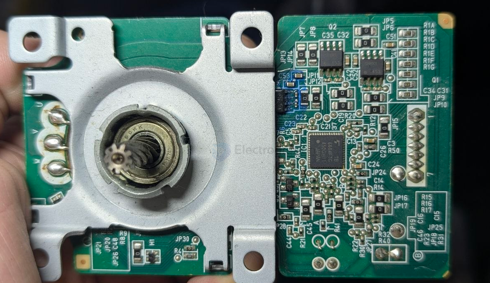
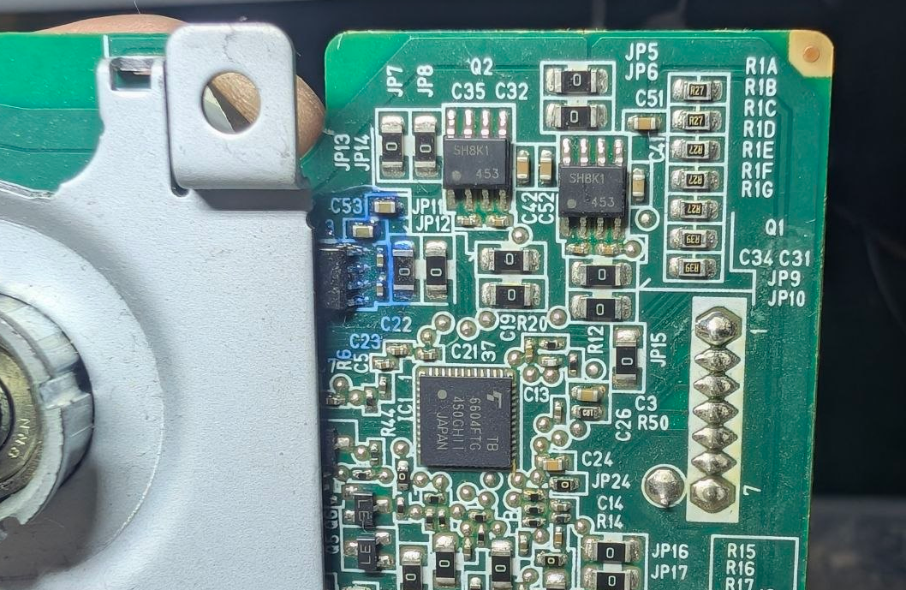

# TB6604-dat

- [[toshiba-dat]] - [[TB6604-dat]] - [[motor-brushless-dat]]

The TB6604 (commonly sold under the full part number TB6604FTG) is a three-phase brushless DC (BLDC) motor controller and pre-driver integrated circuit manufactured by Toshiba. It is housed in a compact 48-pin QFN surface-mount package and is designed to manage commutation, direction, and PWM speed control for BLDC motors.

Key Specifications & Features

• Motor Type. Designed specifically for 3-phase brushless DC (BLDC) motors.
• Output Configuration. Features three half-bridge pre-driver outputs built to drive external power MOSFETs.
• Voltage Rating. Supports load power systems up to 30 V.
• Control Functions. Includes built-in PWM speed control, commutation logic, and motor direction management.
• Protection & Monitoring. Integrates current detection alongside overcurrent, overvoltage, and thermal shutdown protections.
• Package & Mounting. Comes in a low-profile 48-QFN surface-mount package with an exposed thermal pad for heat dissipation.

Common Applications & Availability

• Typical Uses. Frequently found in appliance cooling fans (such as induction cooktops and HVAC blowers), washing machines, pumps, robotics, and automotive auxiliary systems.
• Lifecycle Status. Toshiba has marked the TB6604FTG as Obsolete (End-of-Life). While no longer in active production, replacement stock remains available through secondary distributors and component marketplaces like DigiKey and Mouser Electronics.

## build 

- [[mosfet-dat]] - [[rohm-dat]]

- [[mosfet-dat]] - [[rohm-dat]] - [[SH8K1-dat]] - 4V Drive Dual N-channel MOSFET - [[motor-brushless-dat]] - [[BT6604-dat]]

## ref 

