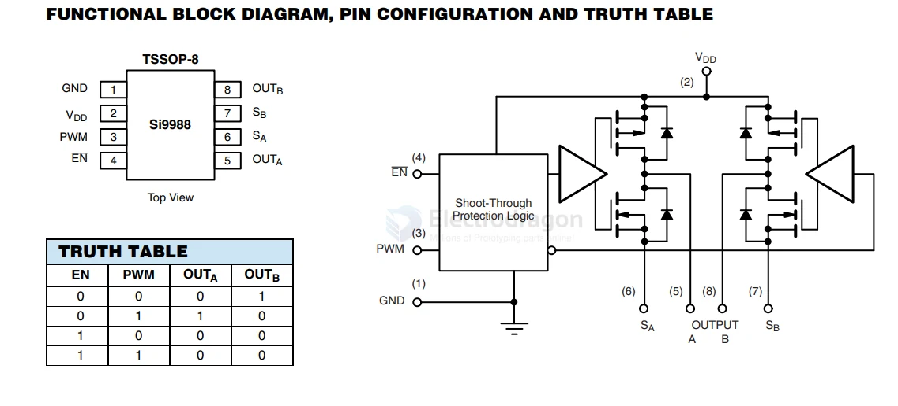

# Si9988-dat

- [[Si9988-dat]] - [[vishay-dat]] - [[driver-bridge-dat]]

DESCRIPTION

The Si9988 is an integrated, buffered H-bridge with TTL compatible inputs and the capability of delivering a continuous 0.65 A at VDD = 5 V (room temperature) at switching rates up to 200 kHz. Internal logic prevents the upper and lower outputs of either half-bridge from being turned on simultaneously. Both outputs may be forced low (for motor braking) by pulling EN to logic high.

The Si9988 is available in both standard and lead (Pb)-free, 8-pin TSSOP packages, specified to operate over a voltage range of 3.8 V to 13.2 V, and the industrial temperature range of - 40 °C to 85 °C (D suffix).

FEATURES
- • 0.65 A H-bridge
- • 200 kHz switching rate
- • Shoot-through limited
- • TTL compatible inputs
- • 3.8 V to 13.2 V operating range
- • Surface mount packaging
- • Total RDS(on) for N- and P-channel: 1.8 at VDD = 4.5 V and TA = 85 °C0.65 A H-bridge

APPLICATIONS
-  • VCM driver
-  • Brushed motor driver
-  • Stepper motor driver
-  • Power converter
-  • Optical disk drives
-  • Power supplies
-  • High performance servo

## diagram

## ref 

