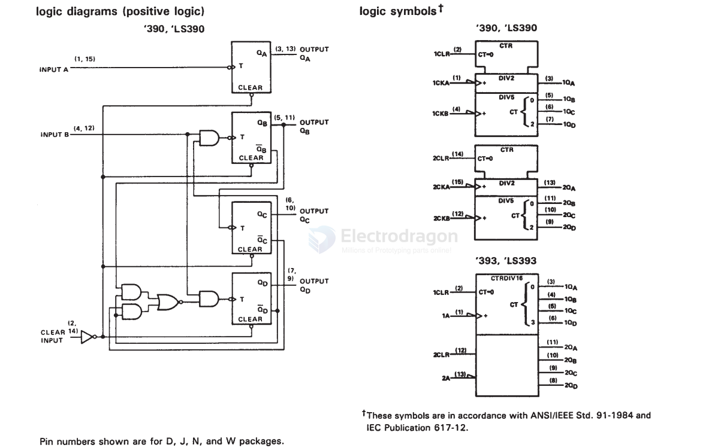
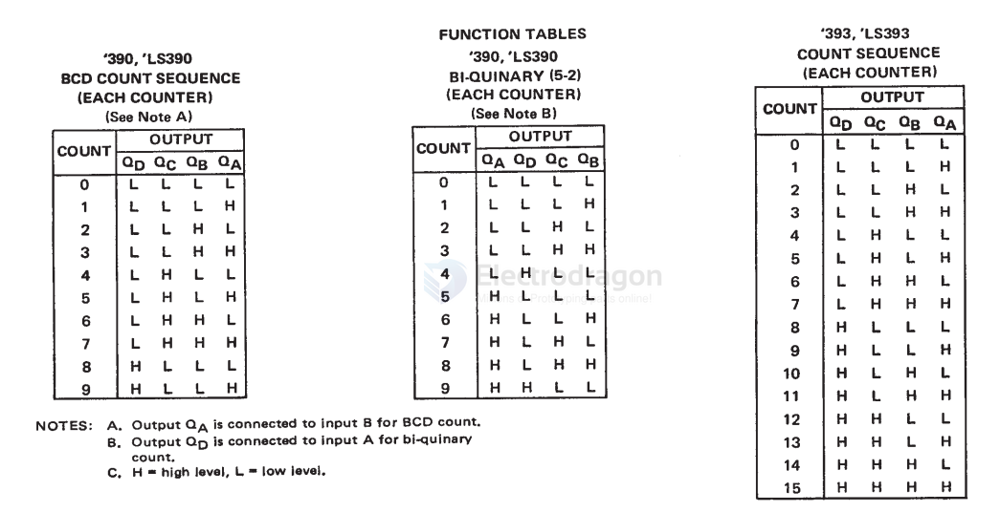

# counter-dat

CD4018B == CMOS Presettable Divide-By-N Counter

## binary counter 

- [[SNJ54LS390J-dat]] - [[counter-dat]] - [[TI-dat]] - [[logic-dat]]

Dual 4-Bit Decade And Binary Counters

https://www.ti.com/product/SN54LS390/part-details/SNJ54LS390J

## ref 

- [[circuits-dat]]