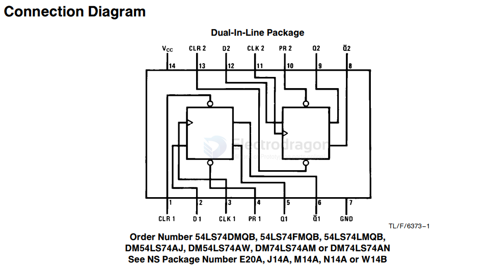
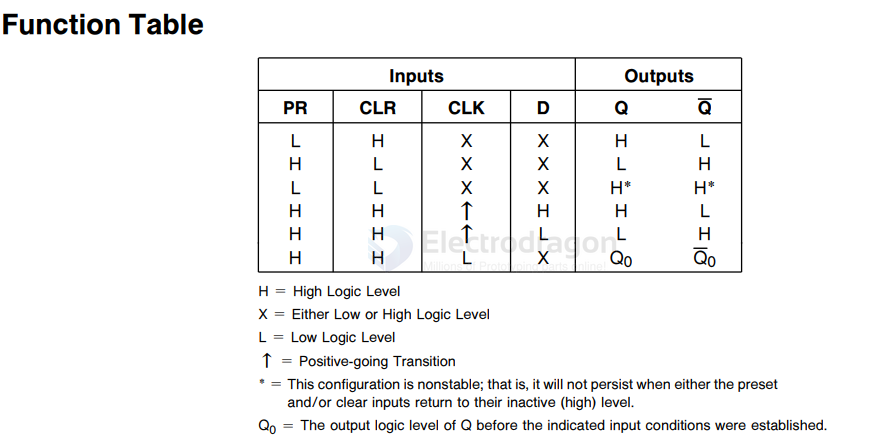

# flip-flop-d-dat

- [[flip-flop-dat]] - [[logic-dat]] - [[digital-dat]] - [[flip-flop-d-dat]]

## chip 

- [[54LS74DM-dat]] 

54LS74/DM54LS74A/DM74LS74A Dual Positive-Edge-Triggered D Flip-Flops with Preset, Clear and Complementary Outputs

## info 

**D Flip-Flop** (Data Flip-Flop) is one of the most fundamental and essential **sequential logic elements** in digital electronics. Its core function is to **store a single bit of binary data (0 or 1)** and introduce a one-clock-cycle delay.

---

### 1. Basic Structure and Pins

A standard edge-triggered D flip-flop typically includes the following core pins:

* **$D$ (Data)**: Data input.
* **$CLK$ (Clock)**: Clock signal input.
* **$Q$**: Normal data output.
* **$\bar{Q}$**: Inverted data output (complement of $Q$).
* *(Some chips also include asynchronous Clear `CLR` or Preset `PRE` pins).*

---

### 2. Working Principle

The defining characteristic of a D flip-flop is **edge-triggering** (typically on the **rising edge**, which is the exact moment the clock signal transitions from low level 0 to high level 1):

1. **Sampling and Latching**: At the **exact moment of the clock rising edge**, the logic level present at the $D$ input is sampled and immediately transferred to the output $Q$ (i.e., $Q = D$).
2. **Holding State**: Outside of the clock edge (whether the $CLK$ signal is steady high, steady low, or changing), any changes on the $D$ input are ignored. The output $Q$ **maintains its current state** until the next clock rising edge arrives.

#### Simplified Truth Table (Rising-Edge Triggered):

| $CLK$ (Clock) | $D$ (Input) | $Q_{next}$ (Next State) | Description |
| --- | --- | --- | --- |
| $\uparrow$ (Rising Edge) | 0 | **0** | Latches low level |
| $\uparrow$ (Rising Edge) | 1 | **1** | Latches high level |
| Steady / Low / High | X (Don't Care) | **Hold Previous State** | No change / memory state |

---

### 3. Key Applications

1. **Data Registers and Shift Registers**
* Connecting multiple D flip-flops in series forms **registers** or **shift registers**, which are used to temporarily store multi-bit binary data or perform serial-to-parallel data conversion.

2. **Clock Synchronization and Metastability Mitigation**
* In FPGA, ASIC, or microcontroller design, asynchronous external signals (like push buttons or external interrupts) are typically passed through two or more cascaded D flip-flops to synchronize them with the system clock, preventing logic errors caused by metastability.

3. **Frequency Dividers**
* If the inverted output ($\bar{Q}$) of a D flip-flop is fed directly back into the $D$ input, the output state will toggle on every clock pulse. This cuts the output clock frequency exactly in half (**divide-by-2**).

## ref 