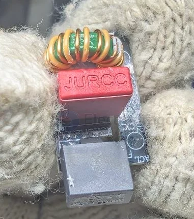
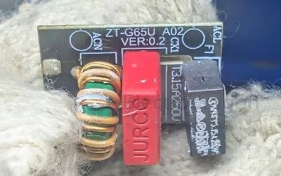
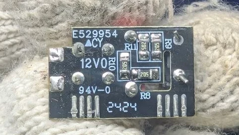
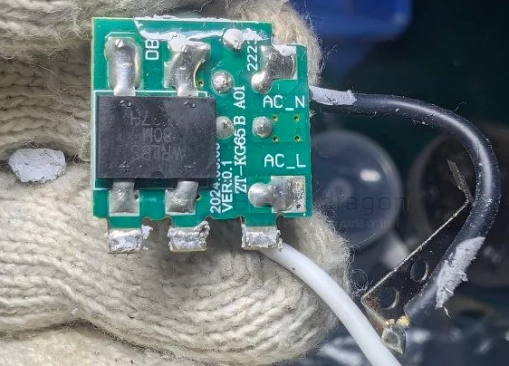
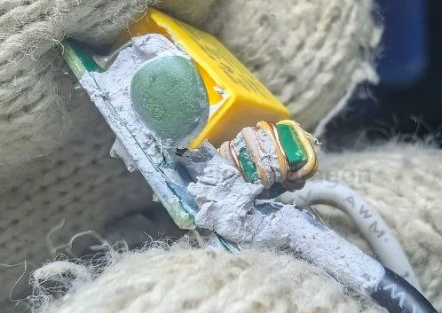
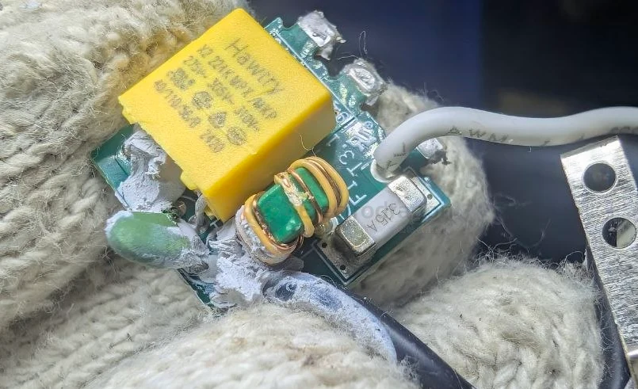
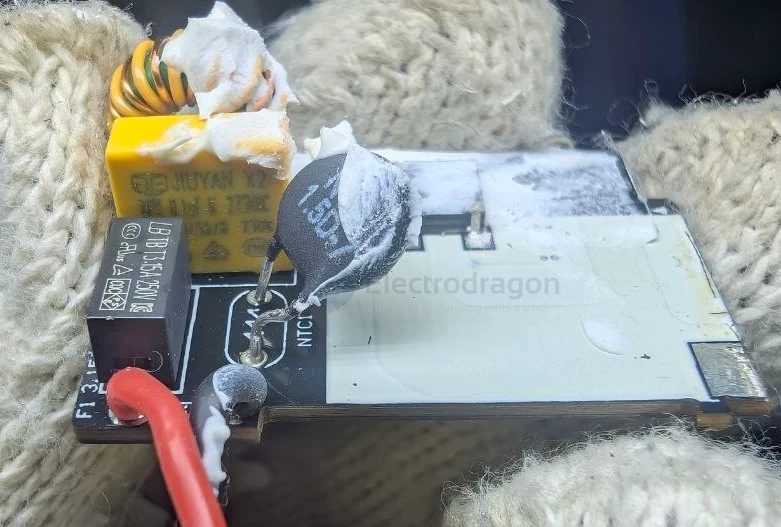
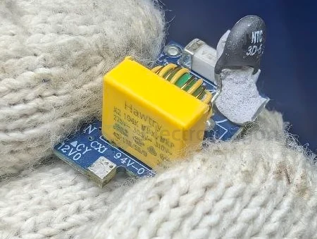

# protection-acdc-dat

- [[protection-power-dat]] - [[protection-dat]] - [[protection-acdc-dat]]

- [[acdc-dat]] - [[acdc-psr-dat]]

## build 

build 2 

build 1 

WRLBS
80M 

5D 

- [[capacitor-x2-dat]] - [[protection-acdc-dat]] - [[HAWRRY-dat]]

- [[fuse-dat]] - [[protection-acdc-dat]] - 3.15A - LB TB T3.15A 250V

- [[sensor-NTC-dat]] - 1.5D-7 - [[protection-acdc-dat]]

## ref