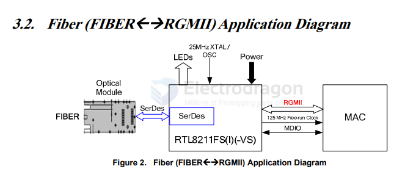
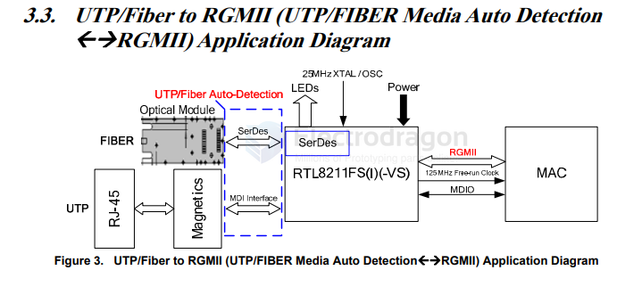

# PHY-fiber-to-copper-dat

- [[fiber-optic-PCB-dat]] - [[phy-dat]] - [[phy-fiber-to-copper-dat]] 

- [[PHY-dat]] - [[fiber-optic-dat]] - [[ethernet-dat]] - [[PHY-fiber-to-copper-dat]]

- [[RGMII-dat]] - [[MAC-dat]] 
  
- [[SerDes-dat]] - [[fiber-optic-interface-dat]] - [[fiber-optic-dat]]

## options 

- [[RTL8213-dat]] - [[RTL8211-dat]] - [[PHY-fiber-to-copper-dat]] - [[realtek-dat]]

### 方案一：光模块转 RJ45 网线（做成“光纤收发器”）

如果你想把光信号直接变成普通的 RJ45 网口（双绞线），只需要一颗支持“光转电（Fiber-to-Copper Media Converter）”模式的双模 PHY 芯片，甚至不需要单片机或 CPU 参与数据转发。

信号链路： 

SFP光模块 (1000BASE-X) $\rightarrow$ PHY 芯片 (光电转换模式) $\rightarrow$ 网络变压器 $\rightarrow$ RJ45 网口

常用芯片型号：

- Realtek RTL8211FS（非常经典，通过外围配置电阻即可直接工作在 Fiber-to-UTP 纯硬件媒体转换模式）。
- Marvell 88E1111 / 88E1512（支持 1000BASE-X 到 1000BASE-T 的直接桥接）。
- 裕太微 YT8521S / YT8531S（国产替代，支持 SerDes 转 RJ45 电口）。

- [[realtek-dat]] - [[RTL8211-dat]] - [[RTL8211FS-dat]] - [[PHY-fiber-to-copper-dat]]
  
- [[88E1111-dat]] - [[YT8521S-dat]]

### 方案二：光模块对接单片机 / SoC / FPGA（RGMII / RMII 接口）

- [[RMII-dat]] - [[PHY-dat]]

如果你的 PCB 上有一颗主控芯片（例如带以太网 MAC 的 MCU、Linux SoC 或 FPGA），但主控只有标准的 RGMII 或 RMII 平行接口，没有高速 SerDes 光口，同样需要一颗带 SerDes 接口的以太网 PHY 芯片做协议和电平转换。

信号链路： 

SFP光模块 (1000BASE-X) $\rightarrow$ PHY 芯片 (SerDes 转 RGMII) $\rightarrow$ 主控 MAC (RGMII)

常用芯片型号：

RTL8211FS / YT8521S / 88E1512（均支持一侧接 SFP 的 1000BASE-X 差分线，另一侧输出标准 RGMII 给主控）。

注意： 如果你的单片机（如普通 STM32F103/F407）只有百兆 RMII 接口，而你用的是千兆 SFP 光模块（1.25Gbps），普通 PHY 无法直接降速匹配，此时需要在中间加一颗带交换功能的芯片（如 RTL8305 / IP175G / KSZ8863 等百兆交换芯片的 Fiber 模式，或 RTL8367S / MT7530 千兆交换芯片）来做速率缓存与适配。

### 方案三：主控自带高速 SerDes 接口（直连，无需转换芯片）

- [[Serdes-dat]] - [[MT7621-dat]] - [[MT7981-dat]] - [[IPQ6000-dat]] - [[RK3588-dat]] - [[mediatek-dat]] - [[PHY-fiber-to-copper-dat]]

如果你的主控芯片本身就内置了 1.25Gbps SerDes（支持 SGMII / 1000BASE-X），那么不需要任何转换芯片，SFP 连接器的 TD± 和 RD± 差分线可以直接连到主控的 SerDes 引脚上（中间通常需串联 0.1µF 交流耦合电容）。

常见支持直连的主控：

高端网络处理器 / 路由器 SoC： 如 MT7621、MT7981、IPQ6000、RK3588（部分引脚复用）等。

FPGA： 带 GTP/GTX/SerDes 收发器的型号（如 Xilinx Artix-7、Zynq-7000 等）。

交换机芯片： 如 Realtek RTL8367RB / RTL8370N、微芯 KSZ9477 等。

## 硬件连接时的 3 个关键细节

`交流耦合电容（AC Coupling Caps）`： SFP 模块内部通常在 TD± 端已经集成了耦合电容，但 RD± 端视具体 PHY 芯片要求，一般需要在靠近接收端芯片的位置串联 0.1µF（100nF，0402封装） 隔直电容。

`协议模式匹配（1000BASE-X vs SGMII）`： 绝大多数单模光模块（SM1310/SM1510）跑的是 1000BASE-X 协议（固定 1.25Gbps，无带内自协商速率信息），配置 PHY 芯片或主控 SerDes 时，必须将其寄存器或上下拉电阻设为 1000BASE-X（Fiber 模式），而不是电口常用的 SGMII 模式。

`LOS（光信号丢失）引脚`： SFP 的 RX_LOS 引脚可以接到 PHY 芯片的 SD（Signal Detect）或 LOS 检测脚上，这样拔掉光纤时，芯片能立刻检测到链路断开（Link Down）。

## ref 