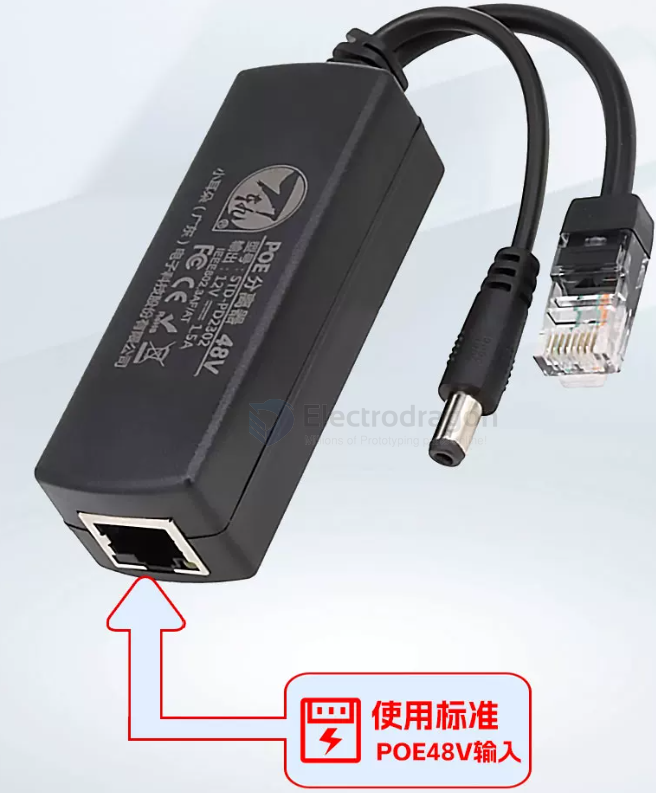
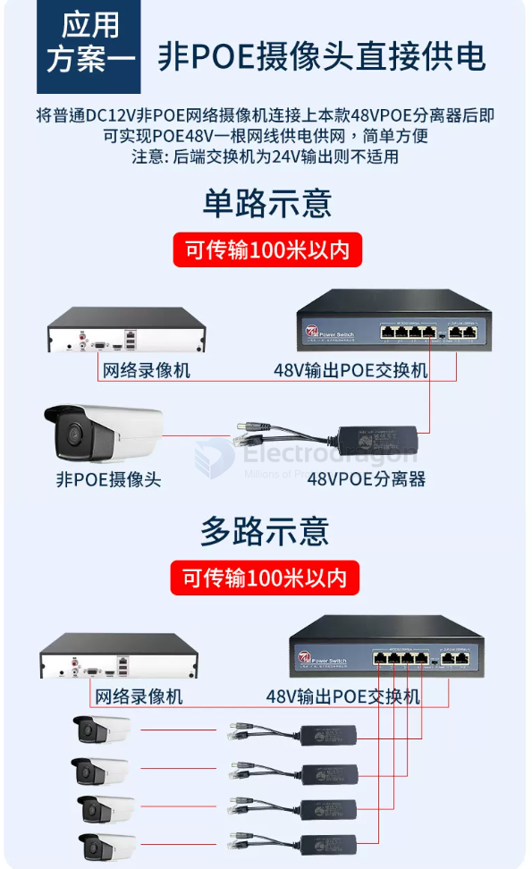
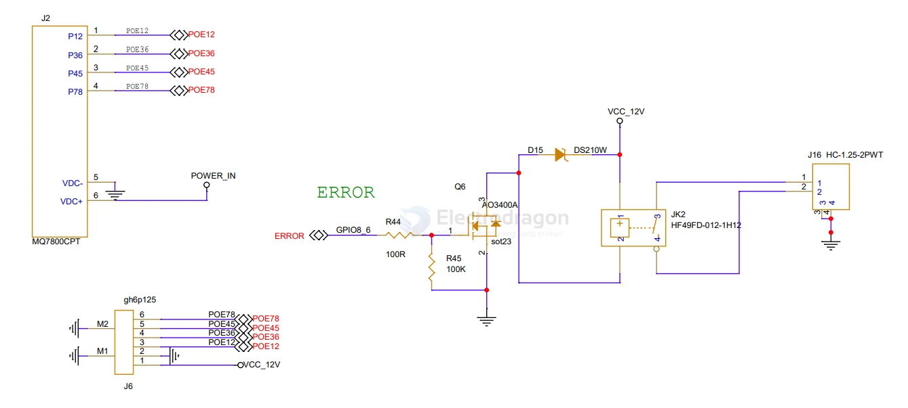
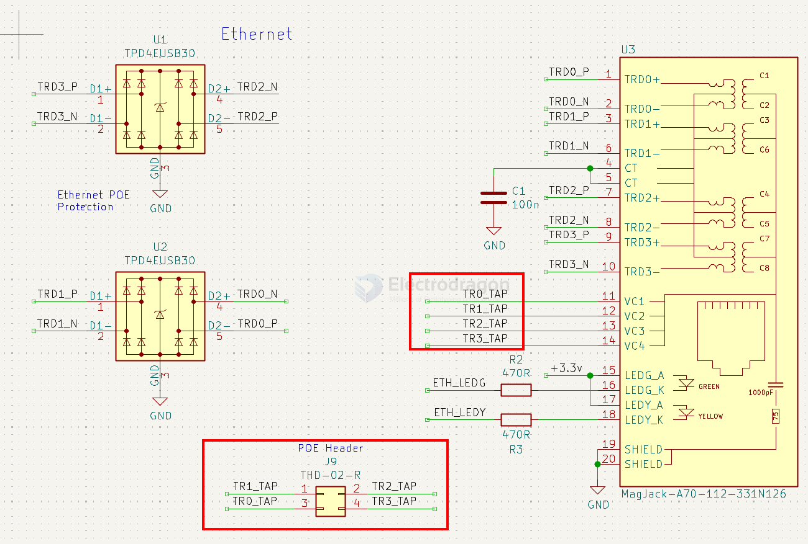
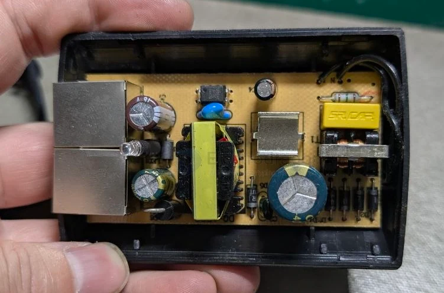
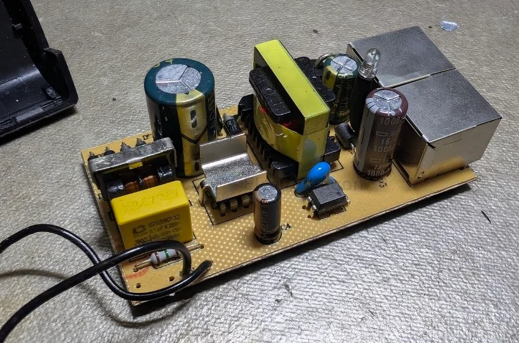
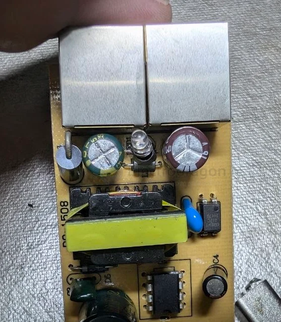
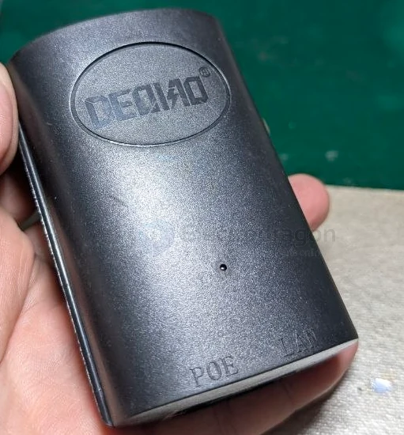
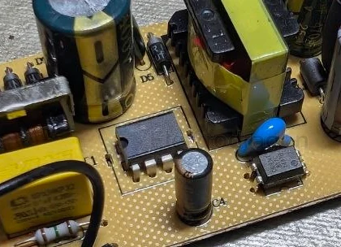
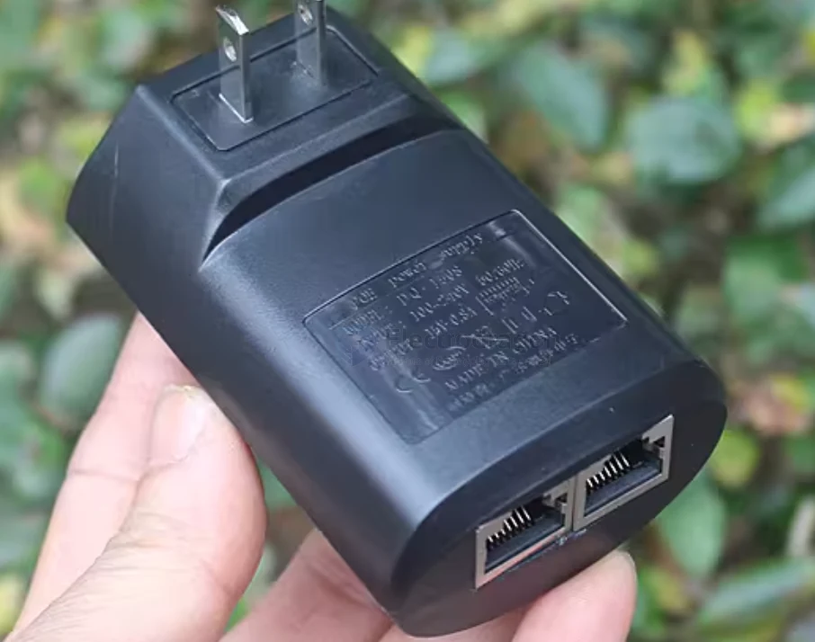

# POE-dat

真国标协议支持 IEEE802.3AF/AT

支持4芯（2+,36-）/8芯（12+,36-,45+,78-）输入

宽电压40-57V输入高传输低耗能

输出电压稳定,输入端电压波动隔离,防止烧坏摄像机

输入宽电压40-57V,输出电压DC12V供电

供电方式标准型自适应,根据POE供电设备自适应引脚

[4芯（1,,2）+(3,6)-数据+供电]

或

[8芯{1,2)+(3,6)-数据+(4,5)+(7,8)-供电]

## apps 

- [[RPOE-dat]] - [[POE-dat]] - [[cable-ethernet-dat]] - [[cable-ethernet-expander-dat]] - [[fiber-media-converter-dat]]

### POE seperator 

## options 1 

## info 

- [[LAN-dat]]

## ESP32 POE / RS485 test 

- https://twitter.com/electro_phoenix/status/1639165025679212547

- https://x.com/electro_phoenix/status/1629048715637039104

- https://www.youtube.com/shorts/DEzd7XtT4Cw

- [[ESD-protection]]

## SCH 

SCH 2 ? 

SCH 1 

- [[ethernet-dat]] 

- [[RJ45-dat]]

## deqiao dq-1508 POE module 

interface POE and LAN 

name scrapped chip 

output 15V 0.8A 

## ref 

- [[POE]]