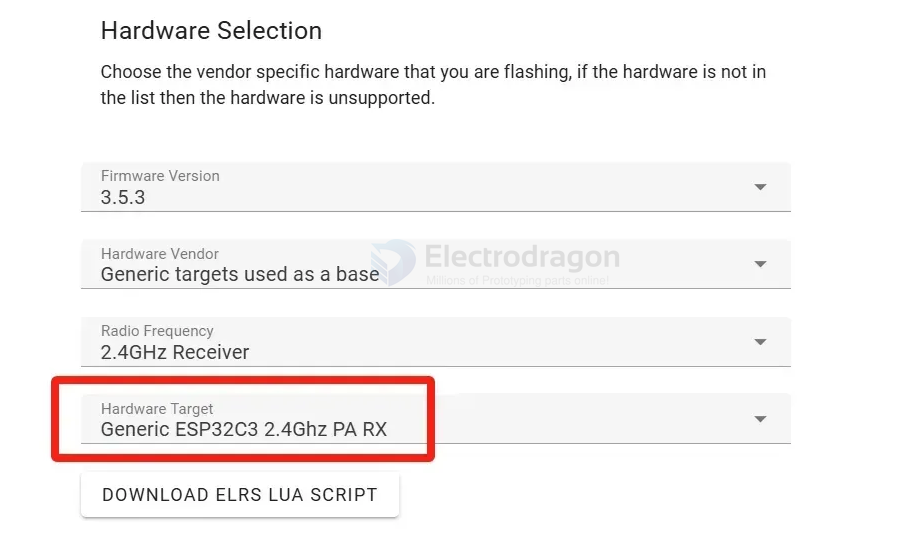
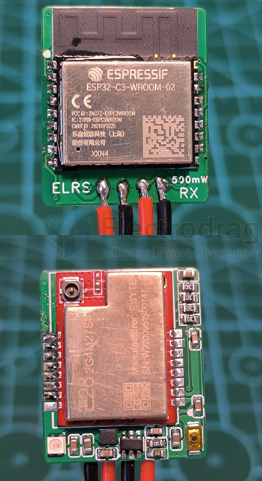
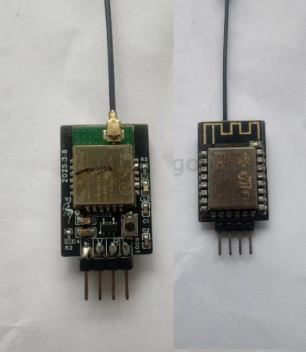
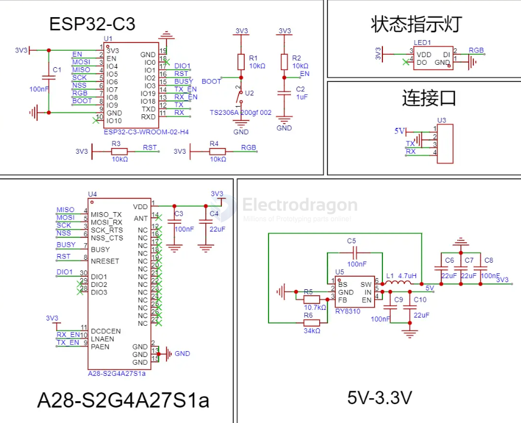
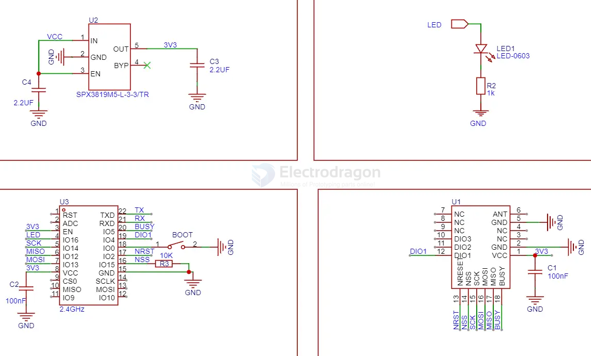

# ELRS-TX-HDK-dat

- [[ELRS-dat]] - [[ELRS-TX-dat]] - [[ELRS-TX-HDK-dat]]

## build 

### flash 

- 1、浏览器打开https://elrs.bayckrc.com。
- 2、点击 `Receiver。`
- 3、Hardware Vendor里选择`Generic targets used as a base。`
- 4、Radio Frequency里选择`2.4GHz Receiver。`
- 5、Hardware Target里选择`Generic ESP32C3 2.4Ghz PA RX。`

### ESP32-C3 + SX1262 RF Module == 900mhz

- [[900mhz-dat]] - [[SX1262-dat]] - [[semtech-dat]] - [[lora-dat]] - [[ELRS-TX-HDK-dat]] - [[E22-dat]] - [[ebyte-dat]]

### ESP32-C3 + SX1280 RF Module == 2.4ghz 

- [[dcdc-down-dat]] - [[RY8310-dat]] - [[rychip-dat]] 

- [[ELRS-dat]] - [[ELRS-TX-dat]] - [[ELRS-TX-HDK-dat]] - [[ESP32-C3-dat]] - [[espressif-dat]] - [[ebyte-dat]] - [[E28-dat]] - [[SX1280-dat]] - [[2.4ghz-dat]]

SCH 1 

SCH 2 

- [[LDO-dat]] - [[SPX3819-dat]] - [[maxlinear-dat]]

Combining an `ESP32-C3` microcontroller with an `Ashining A28`, `Ebyte E28`, or other `SX1280-based 2.4GHz RF modules` is a popular DIY choice in the open-source hardware and RC model community. It is frequently used to build 2.4GHz ExpressLRS (ELRS) RF TX modules or high-power 500mW telemetry receivers.

### Core Features and Specifications

* **Microcontroller: ESP32-C3**
* Powered by a 32-bit RISC-V single-core architecture running up to 160MHz, with integrated 2.4GHz Wi-Fi and Bluetooth 5 (LE).
* Features native USB capabilities (supporting USB-CDC serial communication and JTAG debugging), making it easy to flash firmware directly via a Type-C port.
* Supports OTA (Over-The-Air) wireless firmware updates and Web UI configuration over Wi-Fi for ELRS systems.

* **RF Module: A28 / E28 Series (SX1280 Solution)**
* Operates in the 2.4GHz frequency band. Versions equipped with a Power Amplifier (PA) can achieve higher transmission and telemetry output (such as up to 500mW telemetry power).
* Widely used within the ELRS ecosystem to build cost-effective DIY receivers, PWM receivers, or compact high-frequency modules.

---

### DIY Guide and Common Pitfalls

1. **Power Supply and Current Consumption:**
* RF modules featuring a Power Amplifier (such as high-power A28-27 variants) draw significant instantaneous current during transmission and telemetry bursts. Sharing a low-current LDO with the ESP32-C3—or using an inadequate power supply (such as unstable 5V or low voltage)—can easily cause the module to repeatedly disconnect or reboot.
* It is recommended to use an independent, high-current LDO for the RF section, or adopt a wider-voltage step-down power supply design (such as a 12V input voltage regulator).

2. **Pinouts and Soldering Details:**
* When using certain Ashining A28 modules, pay close attention to insulation treatment on specific bottom pads (such as applying PI high-temperature tape or UV solder mask/green oil isolation) to prevent short circuits or signal interference.

3. **Firmware Compilation and Flashing:**
* For flashing, open the ELRS configurator, select **Generic Target**, choose **Generic ESP32 C3** as the hardware target, and select standard receiver firmware or PWM-enabled receiver firmware based on your requirements.
* When flashing a blank chip for the first time, you must hold down the **Boot** button (pulling GPIO9 LOW) while powering on or resetting the board to enter download mode.

## ref 

- [[ELRS-TX]] - [[ELRS]] - [[ELRS-TX-HDK]]