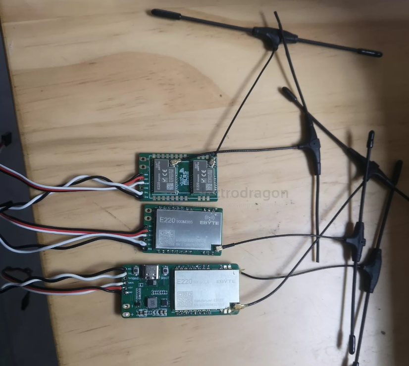
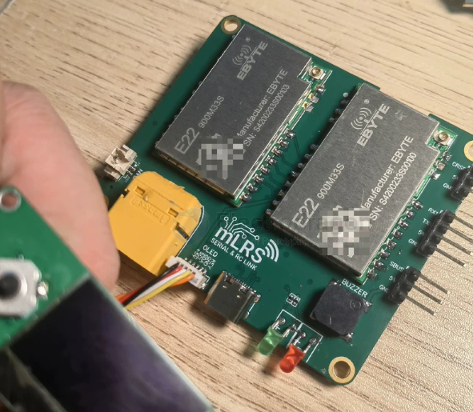

# MLRS-dat

- [[fixed-wing-dat]] - [[MLRS-dat]] - [[RC-protocols-dat]]

MLRS 915 150mw+150mw双分集接收机 120元。

MLRS 915 单1w接收机 100元。

MLRS 915 1w+1w双分集接收机 200元。

mlrs 915 分集高频头 2w+2w双发射功率芯片加持，
sbus转发， - [[SBUS-dat]] - [[rc-protocols-dat]] - [[MLRS-dat]]
带蓝牙,
mavlink数传功能，
联接地面站 app，
双天线覆盖范围更广,
远航FPV必备神器，
搭配分集接收机挑战拉锯100km以上

## ref 

