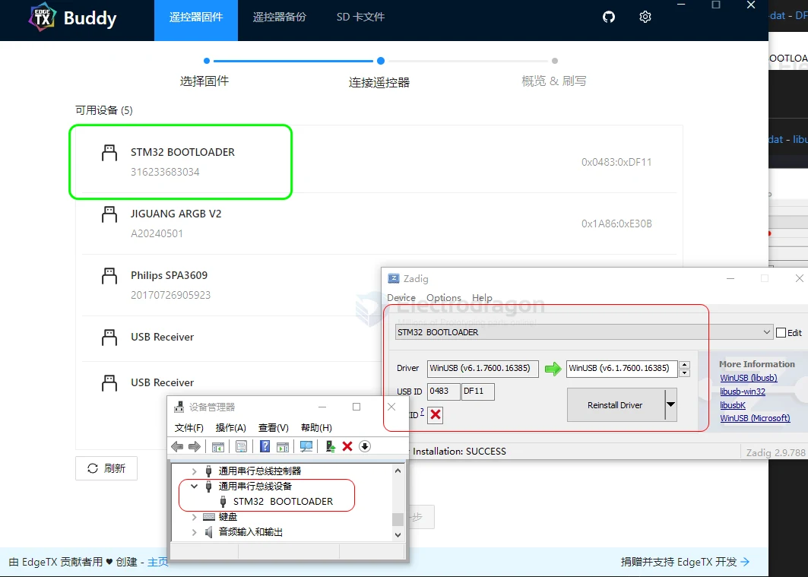

# edgetx-dat

- [[rc-protocols-dat]] - [[edgetx-dat]] - [[ELRS-dat]]

- [[radiomaster-dat]] - [[radiomaster-pocket-dat]] == system - [[edgetx-dat]] 

## scripts 

https://edgetx.org/lua-scripts/

Installation:

Copy ELRS_Finder.lua into /SCRIPTS/TOOLS/ on your SD card.

On your radio: Long-press SYS → Tools tab → run ELRS Finder
For best results:
- Set fixed low TX power (10–25 mW) in ELRS menu
- Sweep the radio slowly to locate signal peaks

## SD Card OS 

- BACKUP
- FIRMWARE
- LOGS
- MODELS
- RADIO
- SCREENSHOTS
- SCRIPTS
- SOUNDS
- edgetx.sdcard.version 
  - 2.8

## script

- [[edgetx-dat]] - [[edgetx-script-dat]] - [[LUA-dat]] - [[ELRS-script-dat]] - [[radiomaster-lua-dat]]

scripts\tools 

ASTEROIDS
BREAKOUT
TBSAGENTLITE
X-TRIS
elrsV3.lua
elrsV3.luac
Game-Asteroids.lua
Game-Asteroids.luac
Game-Breakout.lua
Game-Pong.lua
Game-Simulator.lua
Game-Simulator.luac
Game-Snake.lua
Game-Snake.luac
Game-X-Tris.lua
Game-X-Tris.luac
readme.txt
TBSAgentLite.lua
TBSAgentLite.luac
WizardLoader.lua
WizardLoader.luac
ELRS Finder.lua
Field Notes.lua

## info 

https://github.com/EdgeTX/edgetx

## edge-tx-buddy 

https://buddy.edgetx.org/#/backup

https://github.com/EdgeTX/buddy

## flash 

## ref 