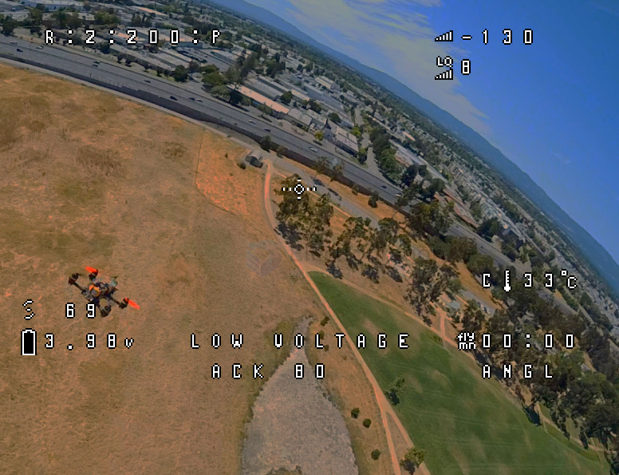

# betaflight-OSD-dat

- [[betaflight-OSD-dat]] - [[betaflight-video-transmitter-dat]] - [[betaflight-dat]]

- [[betaflight-OSD-dat]] - [[betaflight-firmware-dat]] - [[betaflight-receiver-dat]]

## common error == can not drag elements 

📚 Betaflight Configurator GitHub Issue #5596「OSD elements can't be moved in Windows app」 原文：
“With dragDropEnabled left at its default (true), the webview on Windows and macOS doesn't receive HTML5 drag events, so dragging OSD elements shows the 'not allowed' cursor.”

修复 PR #5402 已把 src-tauri/tauri.conf.json 的 dragDropEnabled 改成 false（2026-08 合并）

如果你用的是【Windows 独立安装版】
        ↓
⭐⭐ 拖不动 = 已知 bug，不是你设置错了
        ↓
✅ 立刻可用：改用网页版 → https://app.betaflight.com
   （Reddit 原话：standalone app for windows is bugged,
     when i use the web app, it lets me move the OSD elements）
✅ 或升级到含 PR #5402 修复的版本

## enter OSD 

- 将油门推到最上方正中间（Throttle Center/High），
- 航向（Yaw）拉到最左，
- 俯仰（Pitch）拉到最前方（Top）。

## chip 

- [[RTC6705-dat]]

RTC6705 = 经典 5.8G 模拟图传芯片（TX01/TX02 那类）
        ↓
⚠️ 它【不支持】SmartAudio / Tramp
   （那两种协议需要 VTX 自带 MCU —— RTC6705 没有）
        ↓
控制方式只有两种：
  a) 【按键/拨码开关】（独立模块，最常见）← 手动切
  b) 飞控 SPI 直控（少数 AIO 集成）
        ↓
⭐️ 所以：OSD 菜单里【看不到、也调不了】它的功率

## screen 

value - 1 

- Adjustment range
- Aircraft name
- AG
- Altitude
- Angle: pitch
- Angle: roll
- Anti gravity
- Artificial horizon
- Artificial horizon sidebars
- Aux value
- Battery average cell voltage
- Battery current draw
- Battery current mAh drawn
- Battery current Wh drawn
- Battery efficiency
- Grap
- Battery usage
- Battery voltage
- Blackbox log status
- Camera frame
- Compass bar
- Core temperature
- Crosshairs
- Debug
- Disarmed
- ESC RPM
- ESC RPM frequency
- ESC temperature
- Flight distance
- Flip after crash arrow
- Fly mode
- G force
- Goggle DVR status
- Goggle fan speed
- Goggle link quality
- Goggle system warnings
- Goggle voltage
- GPS latitude
- GPS longitude
- GPS sats
- GPS speed
- Home direction
- Home distance
- Link quality
- Motor diagnostics
- Numerical heading
- Numerical vario
- PID pitch
- PID roll
- PID yaw
- Pilot name
- Power
- Profile: OSD profile name
- Profile: PID and rate
- Profile: PID profile name
- Profile: rate profile name
- RC Channels
- Ready Mode
- RSNR Value
- RSSI dBm value
- RSSI value
- RTC date and time
- Stick overlay left
- Stick overlay right
- Throttle position
- Timer 1
- Timer 2
- Timer: remaining time estimate
- Total flights
- Tx uplink power
- Up (Pitch 90 deg)/Down (Pitch -90 deg) Reference
- VTX bitrate
- VTX channel
- Band:Channel:Pwr:Pit
- VTX delay
- VTX distance
- VTX DVR status
- VTX temperature
- VTX voltage
- Warnings

## ref 

