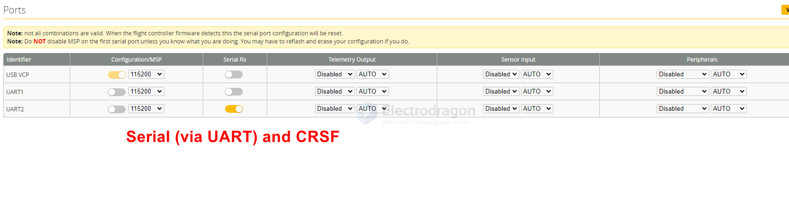
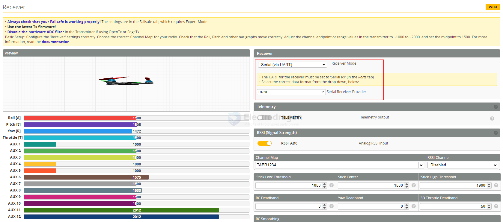

## betaflight-ports-dat

- [[ELRS-RX-PWM-dat]] - [[betaflight-ports-dat]]

https://betaflight.com/docs/wiki/app/ports-tab

configure UART to receive CRSF serial module 

• The UART for the receiver must be set to ‘Serial Rx' (in the Ports tab)
• Select the correct data format from the drop-down, below:

## ref 

