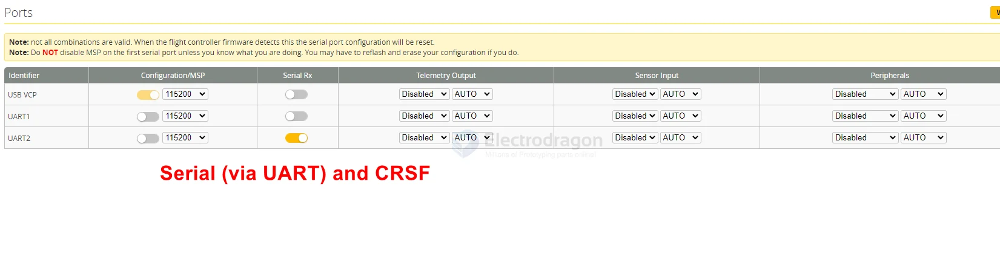
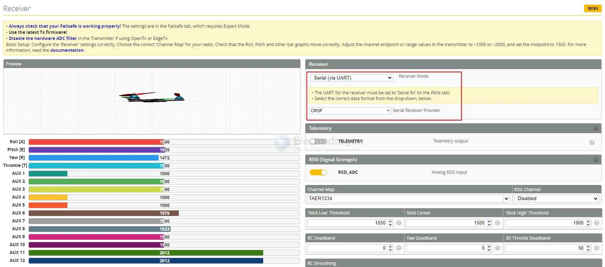

## betaflight-ports-dat

- [[ELRS-RX-PWM-dat]] - [[betaflight-ports-dat]] - [[betaflight-CLI-dat]]

https://betaflight.com/docs/wiki/app/ports-tab

configure UART to receive CRSF serial module 

• The UART for the receiver must be set to ‘Serial Rx' (in the Ports tab)
• Select the correct data format from the drop-down, below:

## periperals 

- [[VTX-dat]] - [[blackbox-dat]] - [[OSD-dat]] - [[betaflight-ports-dat]] - [[VTX-analog-protocols-dat]]

- Benewake LIDAR
- Blackbox logging
- Camera (RunCam Protocol)
- OSD (FrSky Protocol)
- VTX (IRC Tramp)
- VTX (MSP + Displayport)
- VTX (TBS SmartAudio)

- [[VTX-TBS-smartaudio-dat]] - [[VTX-IRC-tramp-dat]] - [[VTX-MSP-displayport-dat]] - [[VTX-runcam-protocol-dat]] - [[VTX-Frsky-protocol-dat]] - [[VTX-analog-dat]] - [[vtx-dat]] - [[VTX-analog-protocols-dat]]

- [[sensor-lidar-dat]] - [[blackbox-dat]]

## sensor input 

- ESC
- GPS

## telemetry output

- FrSky
- HoTT
- iBUS
- LTM
- MAVLink
- SmartPort

## ref 

