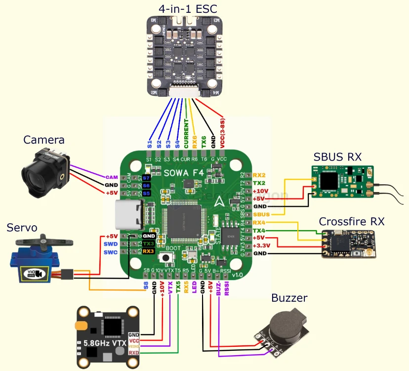
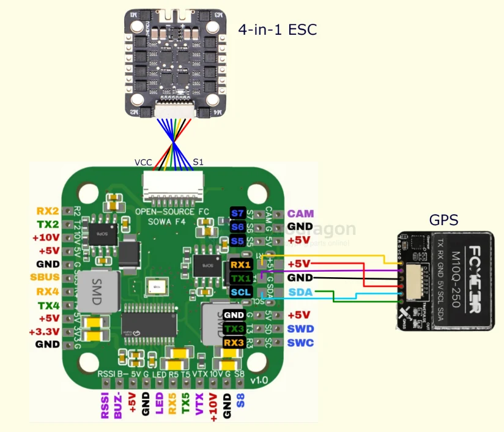
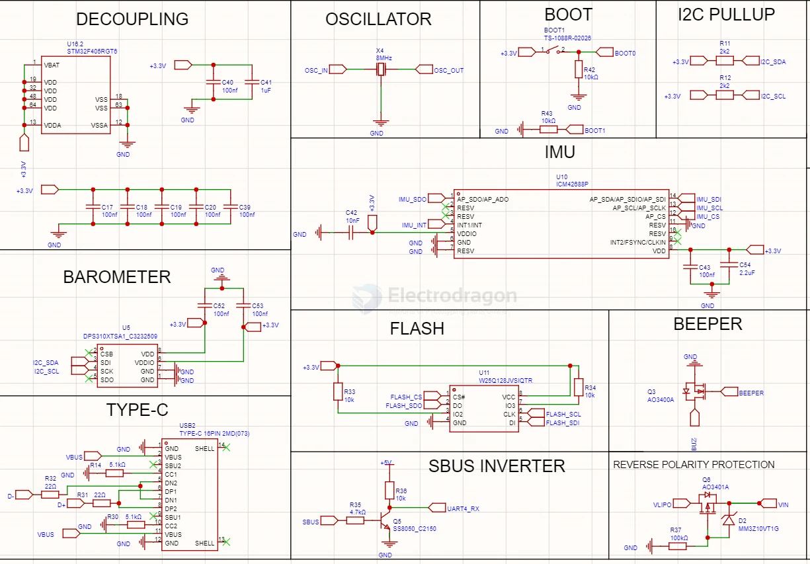
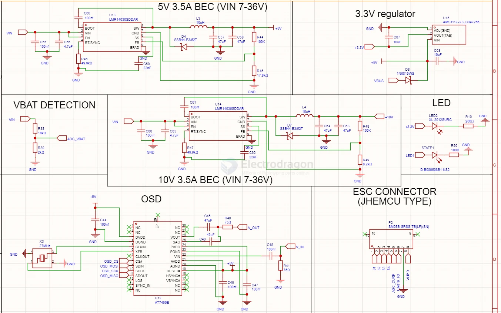
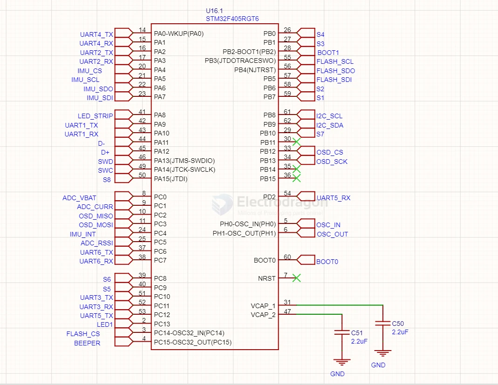
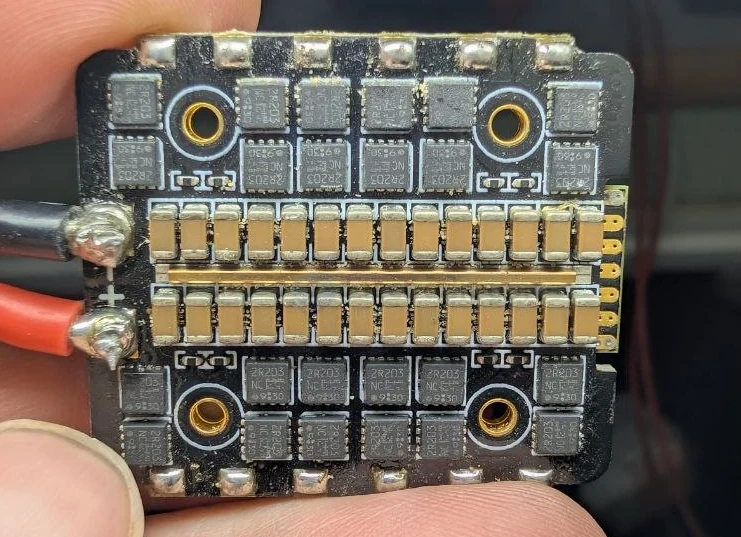
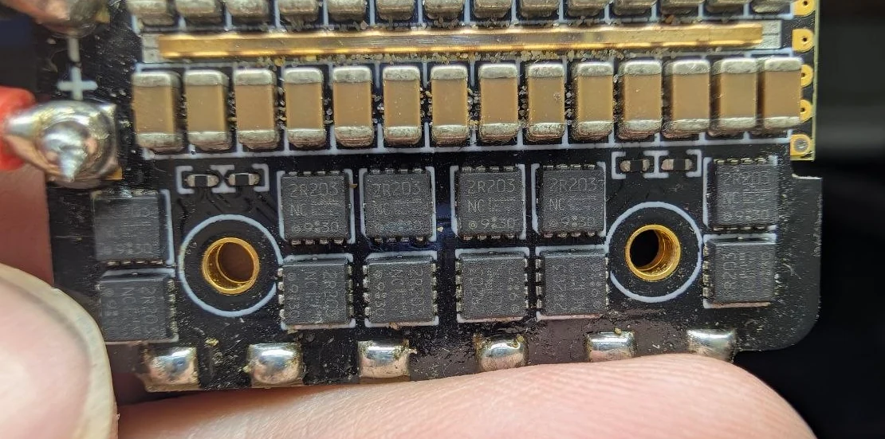
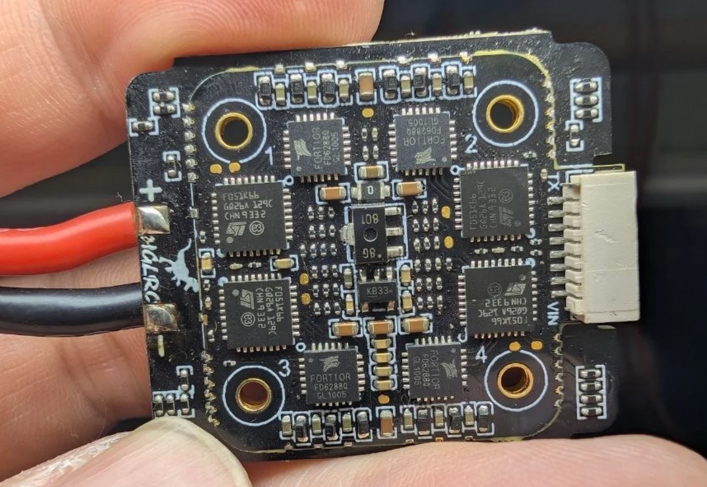
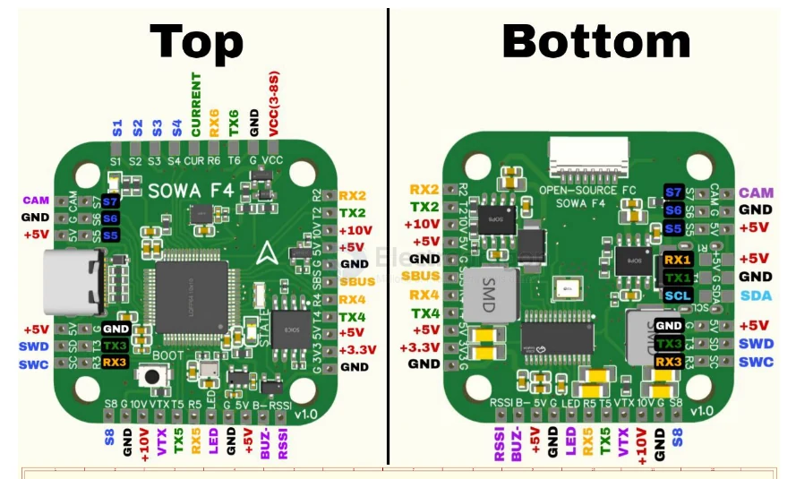

# FC-stack-dat

- [[FC-stack-dat]] - [[PCB-stack-dat]] - [[PCB-design-dat]]

- [[flight-controller-dat]] - [[FC-AIO-dat]] - [[FC-stack-dat]]

- [[flight-controller-dat]] + [[ESC-dat]] + [[VTX-dat]]

- [[MCU-dat]] - [[FC-stack-dat]] - [[flight-controller-dat]]

- [[SBUS-dat]]

## schema 

## SCH 1 

- [[STM32-F4-dat]] - [[FC-stack-dat]] - [[STM32-dat]]

## board 

build 2 

- [[HGLRC-dat]] - [[fc-stack-dat]] - [[flight-controller-dat]] - [[FPV-dat]]

2R203 - [[mosfet-dat]] - [[toshiba-mosfet-dat]] - [[toshiba-dat]] - [[PCB-footprint-dat]] - [[TSON-8-dat]]

- [[STM32F051K6-dat]] - [[STM32-F0-dat]] - [[MCU-dat]] - [[flight-controller-dat]] - [[STM32-dat]]

- [[fortier-dat]] - [[FD6288Q-dat]] - [[motor-driver-BLDC-dat]] - [[driver-gate-dat]] - [[driver-dat]]

build 1 

SOWA F4 - https://oshwlab.com/poplavskyib/SOWA_F4

## ref 

