# ethernet-dat 

- [[ethernet-dat]] - [[MAC-dat]] - [[networking-dat]]

- [[ethernet-dat]] - [[cable-ethernet-dat]] - [[ethernet-POE-dat]] - [[cable-dat]] - [[power-dat]]

- [[TCPUDP-dat]]

- [[PHY-dat]] - [[MAC-dat]] - [[CAT-V-dat]] - [[RGMII-dat]]

- [[ethernet-SDK-dat]]

- [[ethernet-dat]] - [[video-baluns-dat]] - [[cable-video-dat]] - [[cable-ethernet-dat]]

- [[network-dat]] - [[ethernet-TPI-dat]] - [[ethernet-dat]]

## 超五类（Cat5e）vs 六类（Cat6）

Both **Category 5e (Cat5e)** and **Category 6 (Cat6)** Ethernet cables can reliably support Gigabit speeds (1 Gbps), but Cat6 offers higher **bandwidth, superior crosstalk/interference resistance, and better future-proofing**, at the trade-off of being thicker and stiffer.

---

### Core Specifications Comparison

| Feature | Cat5e | Cat6 | Practical Impact |
| --- | --- | --- | --- |
| **Jacket Marking** | `CAT.5E` | `CAT.6` | Check the printed text on the outer jacket to quickly identify existing or newly bought cables. |
| **Frequency (Bandwidth)** | **100 MHz** | **250 MHz** | Cat6 provides much more headroom, resulting in lower latency and more stable signals under heavy multi-device traffic. |
| **Max Speed** | **1 Gbps** (up to 100 m) | **1 Gbps** (up to 100 m)  **10 Gbps** (up to 55 m) | Both run full Gigabit speeds; Cat6 is noticeably more reliable for 2.5 Gbps or short-distance 10 Gbps local networks. |
| **Internal Structure** | 4 twisted pairs bundled directly (no spline) | Built-in **plastic cross-separator (spline)** | The cross-separator isolates the 4 wire pairs from one another, drastically reducing internal crosstalk. |
| **Conductor Gauge** | ~**0.45–0.51 mm** (24 AWG) | ~**0.56–0.58 mm** (23 AWG) | Thicker copper cores in Cat6 mean lower resistance, less signal attenuation over distance, and less heat during PoE power delivery. |
| **Flexibility & Feel** | Thinner, softer, easier to bend | Thicker, stiffer, larger bend radius | Cat5e is significantly easier to pull through tight conduits and route inside compact media enclosures. |
| **RJ45 Connectors** | 8 pins aligned in a single straight row (~1.0 mm bore) | 8 pins staggered up and down (~1.2 mm bore) | Not interchangeable when crimping your own cables—thick Cat6 conductors will not fit into standard Cat5e plugs. |

---

### Buying & Usage Recommendations

* **New Home Renovation / In-Wall Conduit (Choose Cat6):** In-wall cabling stays in place for a decade or more. Cat6 costs only slightly more than Cat5e while giving you better shielding against interference and headroom for future 2.5 Gbps or short-run 10 Gbps upgrades.
* **Tight Existing Conduits / Short Patch Cables (Choose Cat5e):** If you are pulling wire through narrow pipes with sharp bends, or just connecting devices on a desk or next to a router, a genuine pure-copper Cat5e cable will easily max out a 1 Gbps connection while remaining flexible and easy to manage.
* **What to Watch Out For:** Whichever category you choose, make sure the conductors are **pure bare copper** (avoid Copper-Clad Aluminum / CCA or Copper-Clad Steel / CCS), and match your RJ45 plugs and keystone jacks to the cable category—otherwise, the entire link will default to the lowest-rated component.

## wiring 

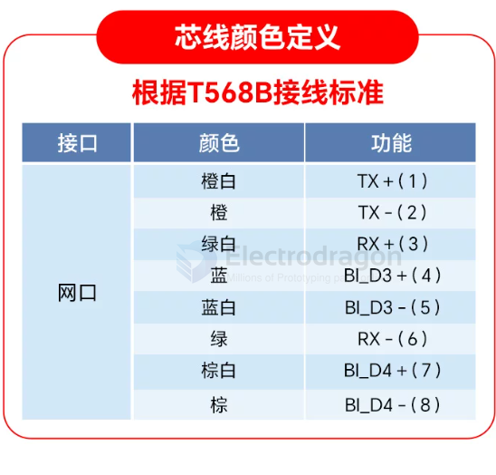

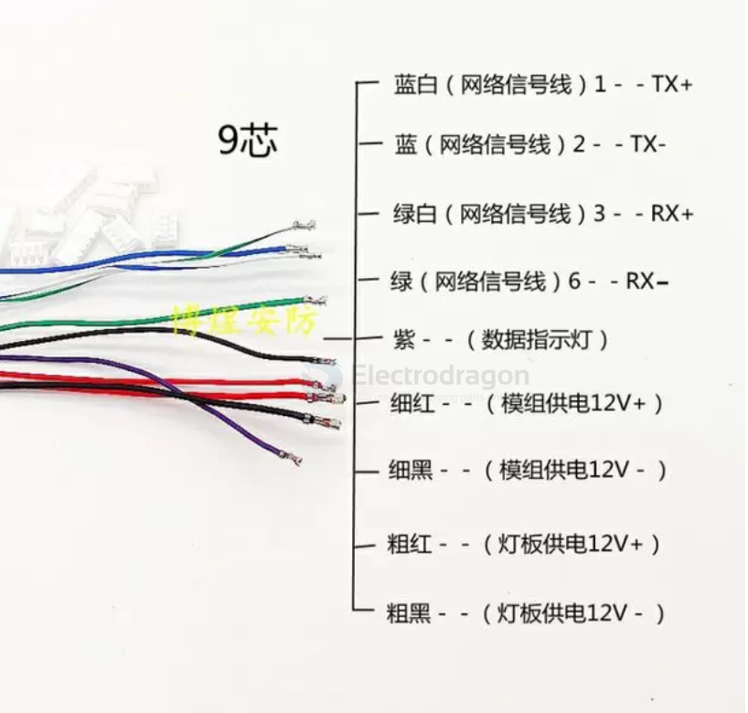

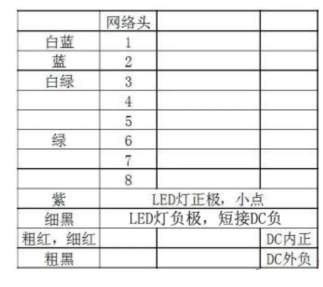

### T568B 

**T568B** is the most widely used international **wiring standard for Ethernet (twisted-pair) RJ45 connectors**. It defines the exact pinout order in which the 8 color-coded copper wires inside an Ethernet cable are arranged when crimped into an RJ45 plug or punched down into a keystone jack.

In residential wiring, commercial installations, and almost all pre-made patch cables, **T568B is the default standard**.

---

#### T568B 8-Pin Color Sequence

Hold the RJ45 connector with the **gold metal contacts facing up, the plastic locking clip facing down, and the cable entry facing toward you**. From left to right (Pin 1 to Pin 8), the wire order is:

1. **White/Orange** (Transmit Data + / TX+)
2. **Orange** (Transmit Data - / TX-)
3. **White/Green** (Receive Data + / RX+)
4. **Blue** (Unused / Telephony or PoE power)
5. **White/Blue** (Unused / Telephony or PoE power)
6. **Green** (Receive Data - / RX-)
7. **White/Brown** (Unused / Gigabit data & PoE power)
8. **Brown** (Unused / Gigabit data & PoE power)

> **Quick Memory Aid:** White-Orange, Orange, White-Green, Blue, White-Blue, Green, White-Brown, Brown.

---

#### Why Must You Follow This Exact Order?

A common misconception is that as long as both ends of the cable match color-for-color, any arbitrary order will work. In reality, **a random wire order will cause severe speed drops or complete connection failure** on 100 Mbps and 1 Gbps networks for two reasons:

* **Crosstalk & Interference Cancellation:** Inside an Ethernet cable, the 4 pairs of wires are twisted at slightly different rates to cancel out electromagnetic interference (crosstalk) from adjacent pairs.
* **Keeping Differential Pairs Together:** Network signals rely on **differential signaling** (a positive and negative wire paired together). Under T568B, **Pins 1 & 2** (White/Orange & Orange) form one twisted differential pair, and **Pins 3 & 6** (White/Green & Green) form another. Splitting a twisted pair across non-paired pins destroys this noise cancellation, causing massive packet loss and forcing Gigabit links to drop down to 10 Mbps or disconnect.

---

#### T568B vs. T568A

Alongside T568B, there is an alternative standard called **T568A**. The only difference between the two is that **the orange and green wire pairs are swapped**:

| Pin Number | T568B (Most Common) | T568A |
| --- | --- | --- |
| **1** | **White/Orange** | **White/Green** |
| **2** | **Orange** | **Green** |
| **3** | **White/Green** | **White/Orange** |
| **4** | Blue | Blue |
| **5** | White/Blue | White/Blue |
| **6** | **Green** | **Orange** |
| **7** | White/Brown | White/Brown |
| **8** | Brown | Brown |

* **Straight-Through Cable (T568B on both ends):** Used in 99% of modern networking scenarios (connecting PCs to routers, routers to modems, wall jacks to switches, etc.).
* **Crossover Cable (T568A on one end, T568B on the other):** Historically used to connect two computers directly together without a switch. Virtually all modern network adapters and switches support **Auto MDI/MDIX** (automatic port detection), making dedicated crossover cables obsolete.

**Practical Tip:** If your wall keystone jacks were punched down using the **T568B** color code, you must terminate the other end of the cable in your network cabinet using **T568B** as well—both ends must follow the exact same standard to achieve full Gigabit speeds.

## cable  

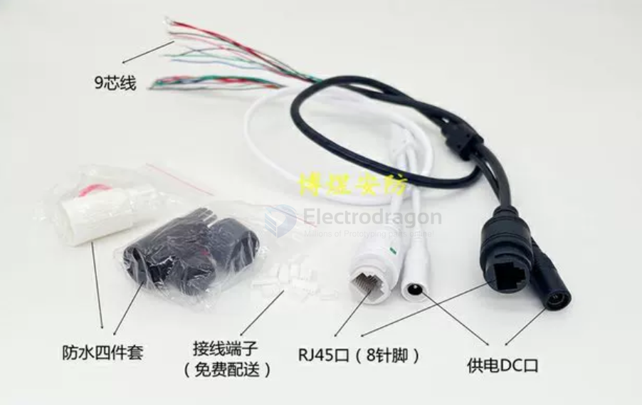

## waterproof cable 

带护套的网线和成品网线不可以连接该款防水直通

监控尾线防水帽 - 可穿手工压制的网线

产品参数：
- 1.连接器:RJ45 female+DC female（5.5*2.1mm）防水头2.材质:纯铜导体.PVC外护套
- 3.外 径（OD）:5.0mm.
- 4.颜色：白色/黑色
- 5.长度:0.7m
- 6.尾部端子处理:可配2P+4P+6P或2P+4P+8P，默认发2P+4P+8P。
- 7.尾线一扎50条，一箱500条。量大从优，欢迎询价。

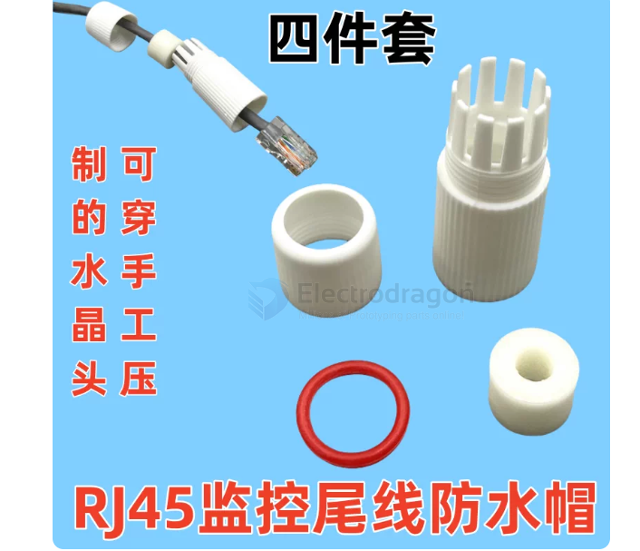

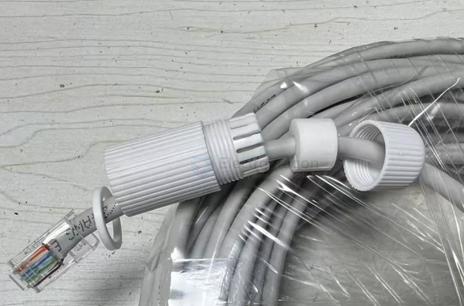

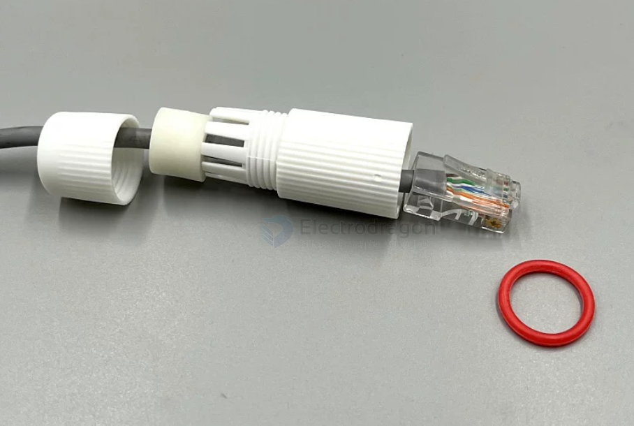

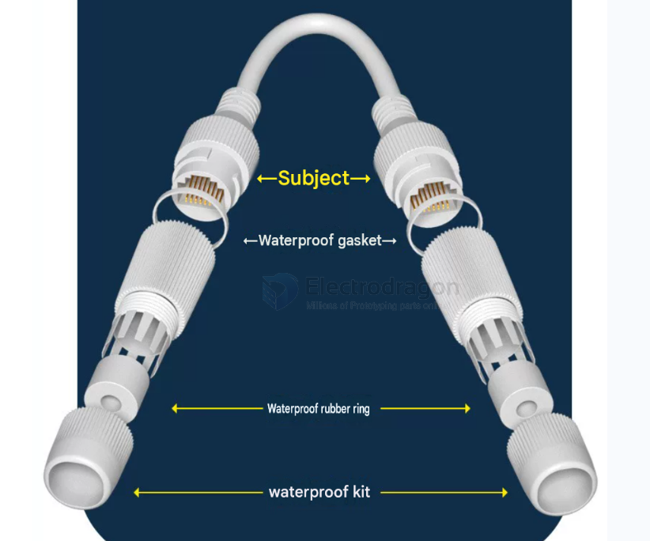

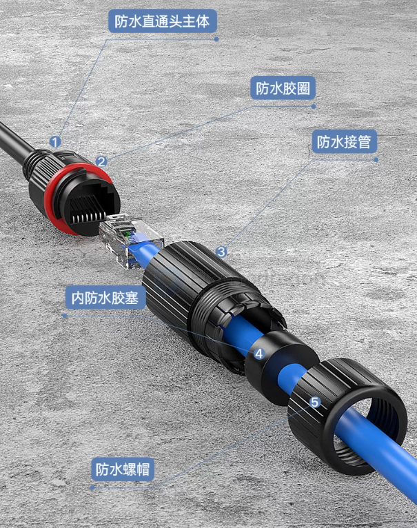

## isolator 

A 10/100BASE-TX Magnetics Module is a small electronic component containing transformers and chokes used in Fast Ethernet ports to isolate circuits, block noise, and protect equipment

- [[TF1102-dat]] - [[ethernet-dat]]

## info

### Basic Ethernet Concepts

Ethernet is an asynchronous, carrier-sense multiple access with collision detection (CSMA/CD) protocol/interface. While Ethernet is generally not ideal for low-power applications, it is widely used due to its broad deployment, efficient network connectivity, high data rates, and unlimited scalability. Nearly all wired communications can be achieved via Ethernet.

Ethernet is categorized by speed:
- Standard Ethernet (10 Mbit/s)
- Fast Ethernet (100 Mbit/s)
- Gigabit Ethernet (1000 Mbit/s)
- 10-Gigabit Ethernet (10 Gbit/s) and higher

Ethernet interface types include RJ45 (the most common for computers and the ESP32-P4 board), and RJ11 (telephone line interface). - [[RJ45-dat]] - [[RJ11-dat]]

The ESP32-P4 network model can be explained as follows:

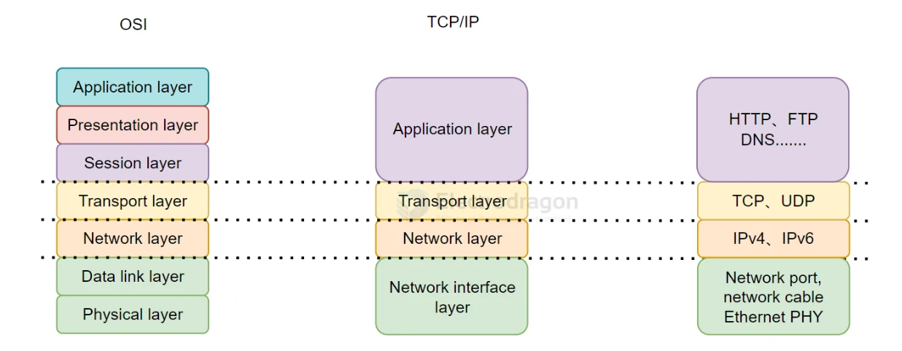

- **Network Interface Layer**: ESP32-P4 connects to the IP101GRI PHY via RMII interface, and the network transformer leads to the RJ45 port. The MAC layer is integrated in the ESP32-P4 chip, handling frame encapsulation, checksums, and MAC addresses.
- **Network and Transport Layers**: Managed by ESP32-P4 driving the IP101GRI PHY.
- **Application Layer**: Once network connection is established, ESP32-P4 can perform HTTP requests, use MQTT, and other server communications.

## chip 

- [[ti-network-dat]] - [[ethernet-dat]] - [[DP83848-dat]]

- [[ethernet-dat]] - [[corechips-dat]] - [[chip-cn-dat]] - [[SR9900-dat]]

- [[W5500-dat]] - [[ENC28J60-dat]]

- [[LAN8720-dat]] - [[conn-HR911105A-dat]]

- [[realtek-dat]]

- [[WCH-dat]] - [[CH9121-dat]]

- [[motorcomm-dat]] - [[YT8512C-dat]] - [[bobcat-dat]] - [[ethernet-dat]]

## BOM 

- [[CONN-RJ45-dat]] - [[cable-ethernet-dat]] - [[conn-HR911105A-dat]]

## SCH 

SCH 3

- [[RK3568-dat]] - [[rockchip-dat]] 

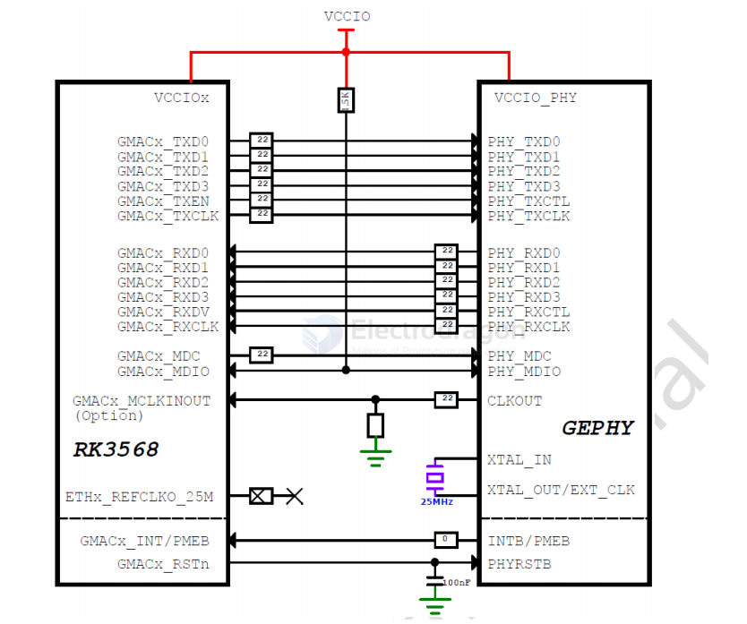

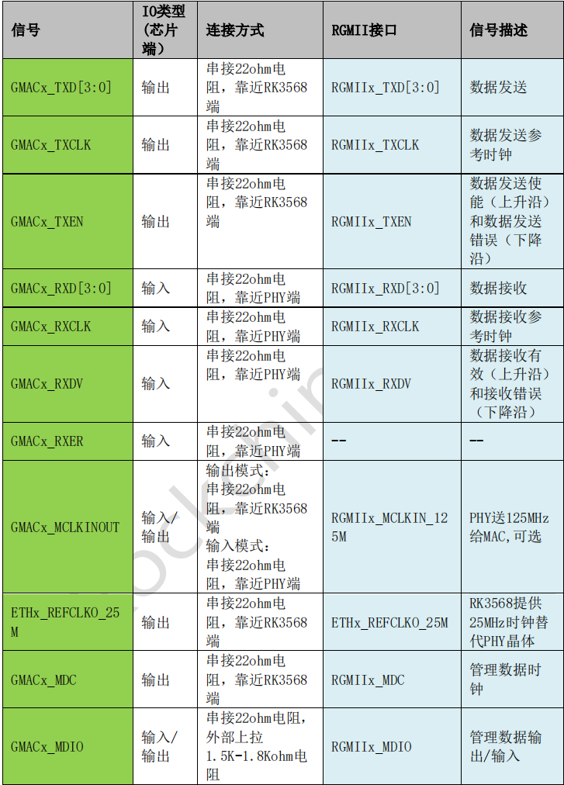

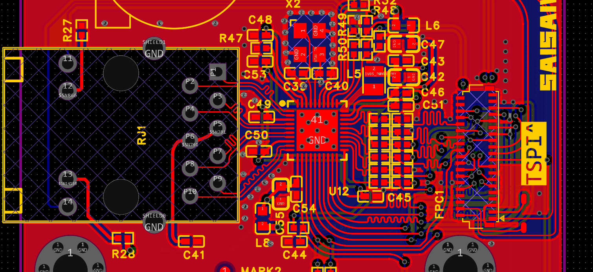

SCH 2 

- [[conn-RJ45-dat]]

RJ-45 w/[[CH579-dat]]

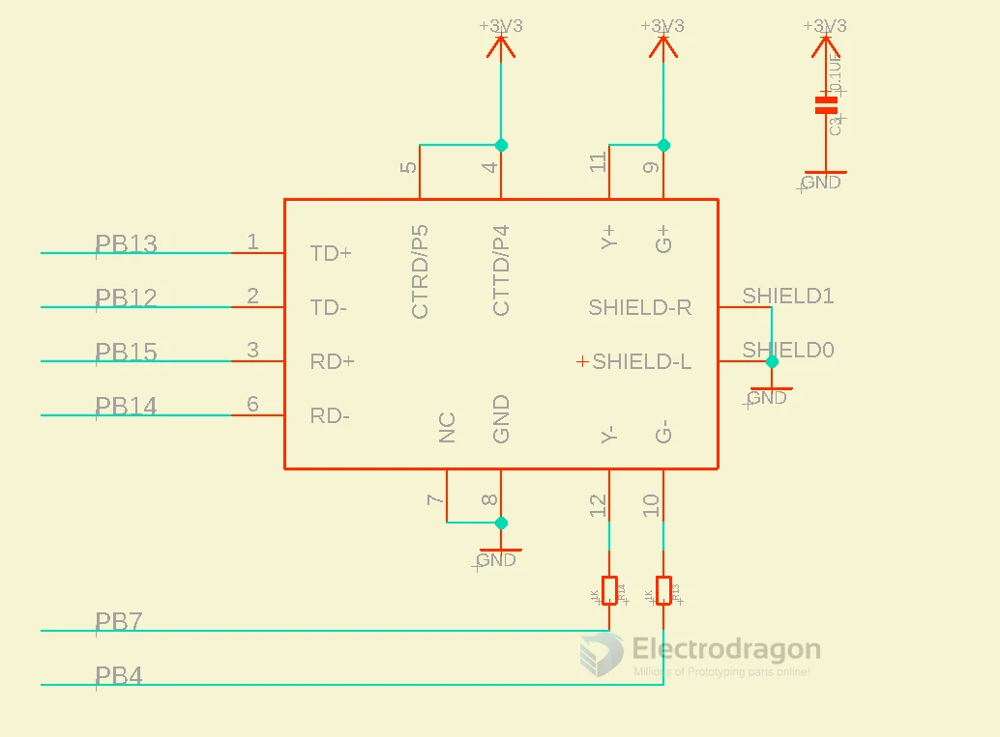

transfomer == G2406S_C507595 and RJ45

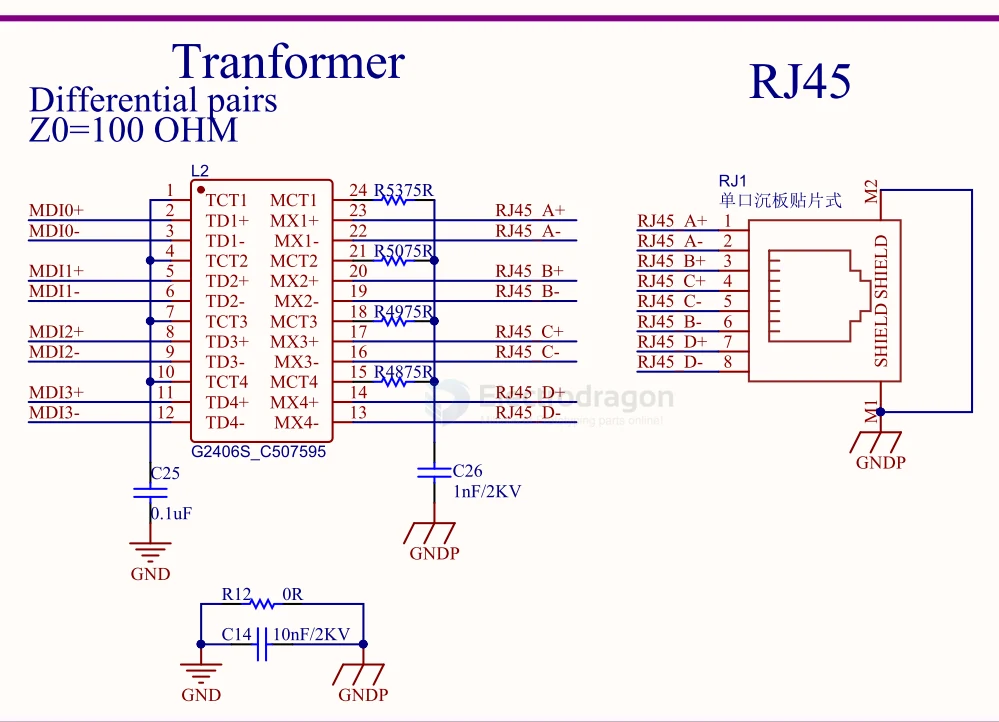

SCG 1 - SCH RPI CM4 

- [[RPI-CM4-expansion-board-dat]] - [[ESD-dat]]

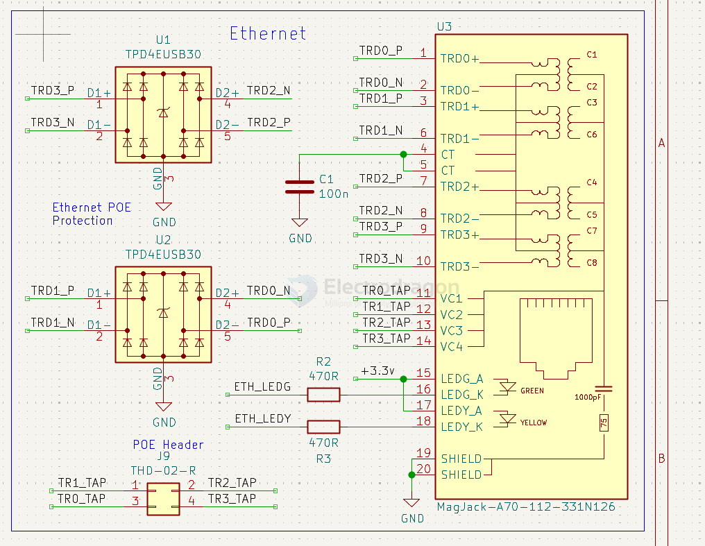

## CAT6

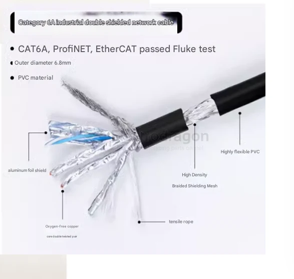

## build 

build 1 

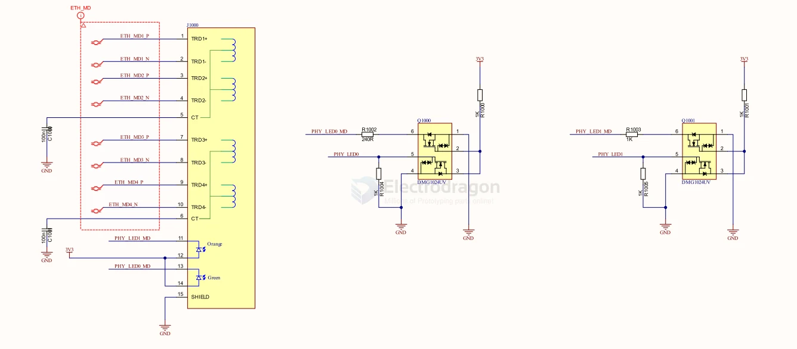

## unsort 

- KSZ8041TL/FTL/MLL - 10BASE-T/100BASE-TX/100BASE-FX Physical Layer Transceiver 

- [[microchip-dat]]

- IC Plus IP175G ==	5 Port 10/100 Ethernet Integrated Switch

## apps 

- [[VTX-openIPC-ethernet-dat]] - [[VTX-openIPC-dat]] - [[ethernet-dat]]

- [[NAS-dat]] - [[ethernet-dat]] - [[RK3566-dat]] - [[rockchip-dat]]

- [[POE-dat]] - [[ethernet-dat]]

- [[camera-IP-dat]]

## ref 

- [[RGMII-dat]] - [[PHY-dat]] - [[TCPUDP-dat]] - [[TCPIP-dat]]

- [[RTL8211-dat]]

- [[ethernet]]