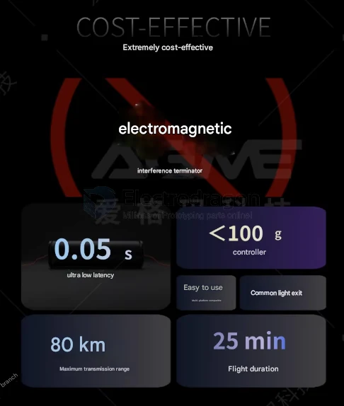
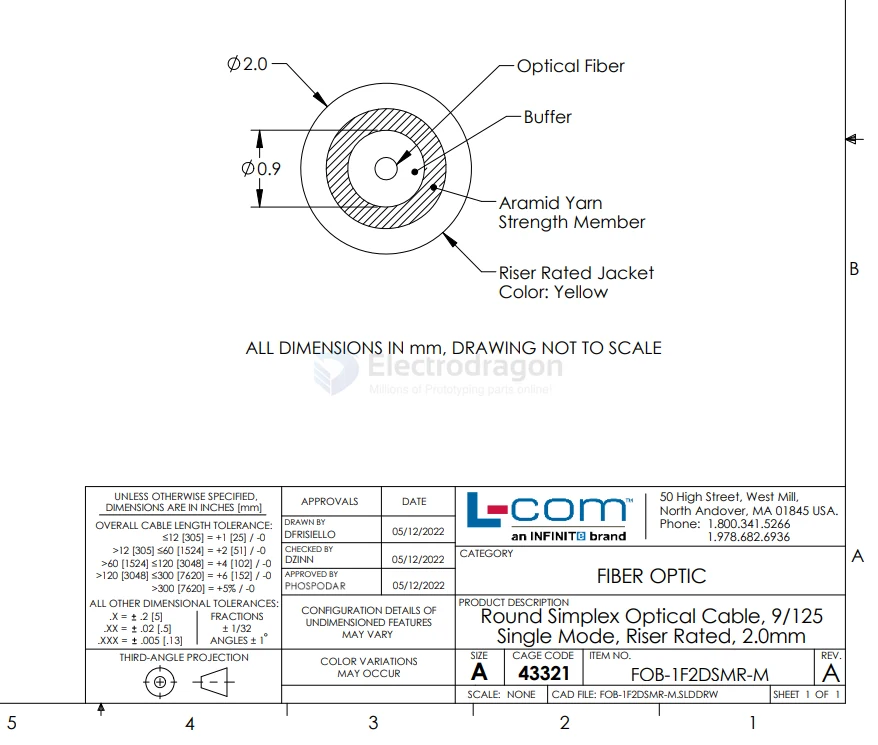

# fiber-optic-dat

info and knowledge 

- [[SFP-transceiver-dat]] - [[SFP-housing-dat]]

-  [[fiber-optic-transceiver-dat]]

- [[fiber-optic-cable-dat]] - [[POF-dat]]

- [[fiber-optic-connector-dat]] - [[LC-connector-dat]] - [[SC-connector-dat]]  - [[MTP-MPO-Connector-dat]]

already to go systems  - [[toslink-dat]] - [[photolink-dat]]

apps and solutions - [[fiber-optic-app-dat]] 
  
Signal == [[SerDes-dat]]

- [[fiber-optic-dat]] - [[cable-video-dat]]

## note 

Gigabit optical-to-electrical modules must be used with Category 5e, Category 6, and Category 6e network cables

10G optical-to-electrical modules must be used with Category 7 and Category 8 10G network cables

## advantage 

## demo 

- https://t.me/electrodragon3/342

## specs 

圆形单工光缆,9/125 单模,Riser 等级,2.0mm

## Usage 

- [[self-loop-test-dat]]

## comparison 

| Feature                  | 🔌 RS-485 (Twisted Pair)    | 🔴 Plastic Optical Fiber (POF)      | 🧪 Glass Optical Fiber               |
| ------------------------ | -------------------------- | ---------------------------------- | ----------------------------------- |
| **Max Distance**         | ~1200 m (4000 ft)          | ~50–100 m                          | >10 km (with proper transceivers)   |
| **Typical Data Rates**   | 9.6 kbps – 10 Mbps (short) | 10 kbps – 250 kbps (up to ~100m)   | 10 Mbps – 100 Gbps+                 |
| **Best Range vs Speed**  | 9.6 kbps @ 1.2 km          | 9600–38400 bps @ 100 m             | 1 Gbps @ 10+ km (SM fiber)          |
| **Signal Medium**        | Electrical (differential)  | Light (650nm LED, red)             | Light (laser or LED, 1310/1550nm)   |
| **EMI Immunity**         | Good                       | Excellent                          | Excellent                           |
| **Electrical Isolation** | Optional (via ICs)         | Yes (complete)                     | Yes (complete)                      |
| **Installation Cost**    | Low                        | Medium                             | High                                |
| **Ease of Termination**  | Simple (screw/crimp)       | Easy (cut and polish or click-fit) | Difficult (cleave, polish, splice)  |
| **Connectors**           | Screw terminal, DB9, etc.  | Snap-in (HFBR, Versatile Link)     | SC, LC, ST, FC                      |
| **Multi-node Support**   | Yes (up to 32 nodes)       | Point-to-point                     | Point-to-point (or splitter system) |
| **Use Cases**            | Industrial control, MODBUS | EMI-safe short serial links, DIY   | High-speed data, WAN/LAN, telecom   |

## fiber & copper ethernet PHY board 

[DP83869EVM - Copper & fiber industrial Ethernet PHY evaluation module](https://www.ti.com/tool/DP83869EVM)

- DP83869HM

## Applications 

[From the drones community on Reddit: Unjammable drones being flown via 12 mile long fiber optic cables.](https://www.reddit.com/r/drones/s/VfXIHkhMBL)

## concept 

自建FTTH PON组网 / 私网PON / 软OLT

FTTH：Fiber to the Home（光纤到户）。

私网PON / 软OLT：一些极客玩家或企业，利用X86工控机、软路由（安装开源OLT软件，如 OpenOLT、Voltha 等）配合这种PON猫棒/模块，自己搭建一套低成本的局端光纤管理系统，用于技术研究或特定局域网组网

`1490发射、1310接收`

解释：指光模块工作时使用的光波长。

原理：在GPON系统中，下行（局端发给用户端）使用 1490nm 波长的光；上行（用户端发给局端）使用 1310nm 波长的光。单纤双向就是利用这两个不同的波长在同一根光纤里“各走各的路”。

`C+大功率 / 分光比上限高`

分光比：在一个PON网络中，通过光分路器（Splitter）将一根主光纤分给多少个终端用户使用（常见如 1:16、1:32、1:64 等）。

大功率与分光比的关系：因为是Class C+大功率，光信号能量足，所以分光比上限高（例如可以带更多节点，或者分出更多路），带机量更大。

`远端ONU注册更稳 / 不容易出现远距离光衰大、频繁离线`

ONU：Optical Network Unit（光网络单元），即用户端设备（普通光猫）。

光衰（光衰减）：光在光纤传输过程中由于距离、熔接点、分光器导致的信号强度减弱。

解释：因为C+功率大、接收灵敏度高，即使拉线距离很远、损耗较大，光猫也能稳定收到信号，不会因为信号太弱而导致“频繁离线”。

`原装DFB激光器`

DFB：Distributed Feedback Laser（分布式反馈激光器）。这是一种高性能的半导体激光器，光谱纯度高、调制带宽大、传输距离远，是光模块中的核心发光器件。

`突发接收性能优秀`

解释：在PON系统中，上行方向（多个ONU发给OLT）采用的是时分多址（TDMA）的突发模式。也就是说，局端的接收端需要在极短时间内瞬间捕捉、锁定并解调来自不同远端ONU的不连续突发光信号。突发接收性能好，代表上行数据不容易丢包、链接更稳定。

`GPON`

解释：Gigabit-capable Passive Optical Network（吉比特无源光网络），是一种由ITU-T（国际电信联盟电信标准化部门）制定的光纤接入网标准。

特点：属于点到多点（P2MP）结构，下行速率通常为 2.5 Gbps，上行速率为 1.25 Gbps。

`OLT`

解释：Optical Line Terminal（光线路终端），是PON系统的核心局端设备（通常放在机房或主控端），相当于整个光纤网络的“母机”或“路由器上联口”，负责控制、管理和调度远端的用户端设备（ONU）。

`Class C+ 光模块（光功率等级）`

解释：PON光模块按光功率和发射接收能力分为不同的等级（如 Class B+, Class C+, Class C++ 等）。

特点：Class C+ 是功率较大、预算链路损耗更高的高级光模块。它的发射光功率更大、接收灵敏度更高，能够支持更大的分光比和更远的光纤传输距离。

`单纤双向 SFP PON猫棒 (Stick)`

单纤双向（BiDi - Bi-Directional）：指光模块通过一根光纤同时实现双向的数据传输（通过不同的光波长分别发送和接收数据，避免互相干扰）。

SFP：Small Form-factor Pluggable（小封装可插拔模块），是一种标准的网络接口形态，可以像U盘一样插拔在交换机、路由器或软路由的SFP插槽上。

PON猫棒（PON Stick）：将一个完整的ONU（光猫）功能集成在一个标准SFP光模块尺寸内的微型设备。插在设备的SFP口上，设备本身就变身成了一个光猫。

## ref 

- [[RJ45-DAT]] - [[RS485-dat]] - [[ethernet-dat]]

- [[fiber-optic]] - [[maker]]