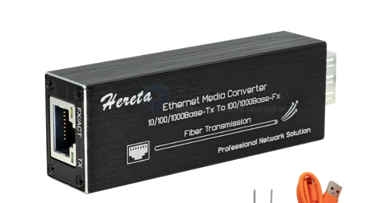
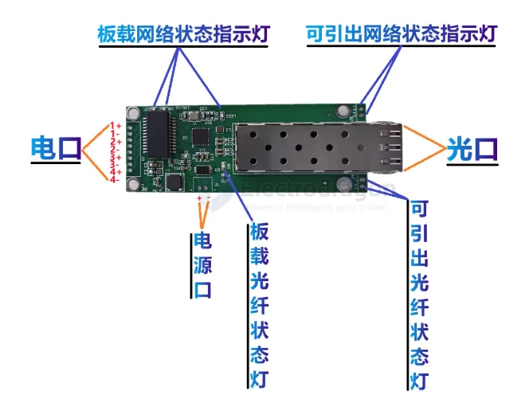
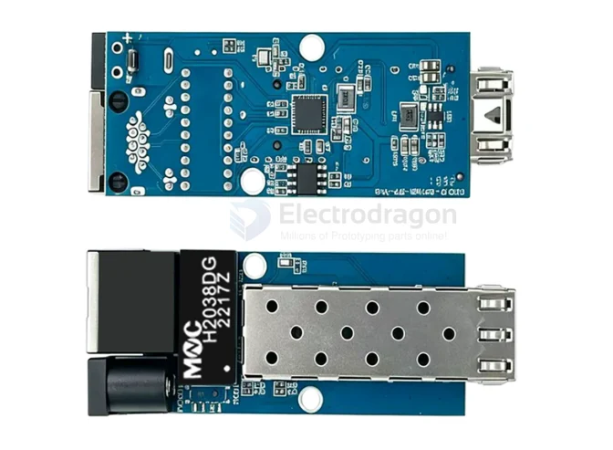
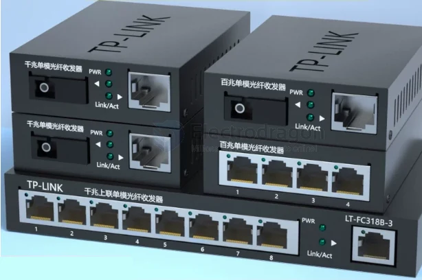

# fiber-media-converter-dat

- [[fiber-media-converter-dat]] - [[fiber-optic-interface-dat]] - [[fiber-optic-dat]] - [[phy-dat]] - [[sfp-dat]]

（插 SFP 光模块、转 RJ45 网线的设备）

Fiber Media Converter（最通用、标准的行业叫法，常简称为 Media Converter）

SFP 光纤收发器

单光单电

## apps 

## ref 

