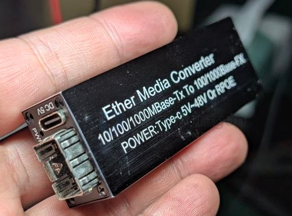
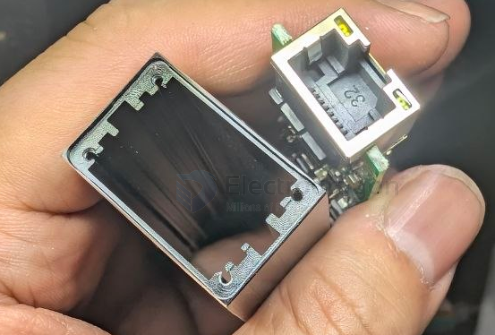
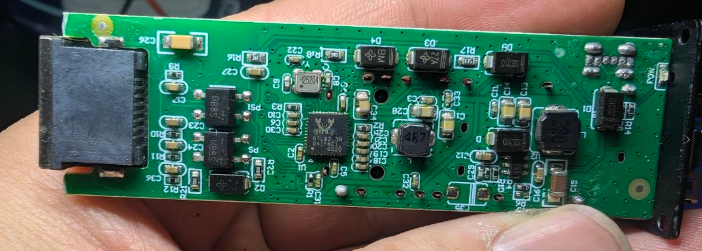
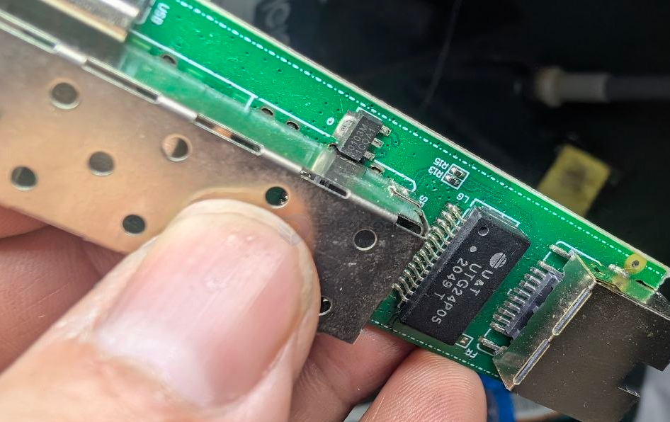
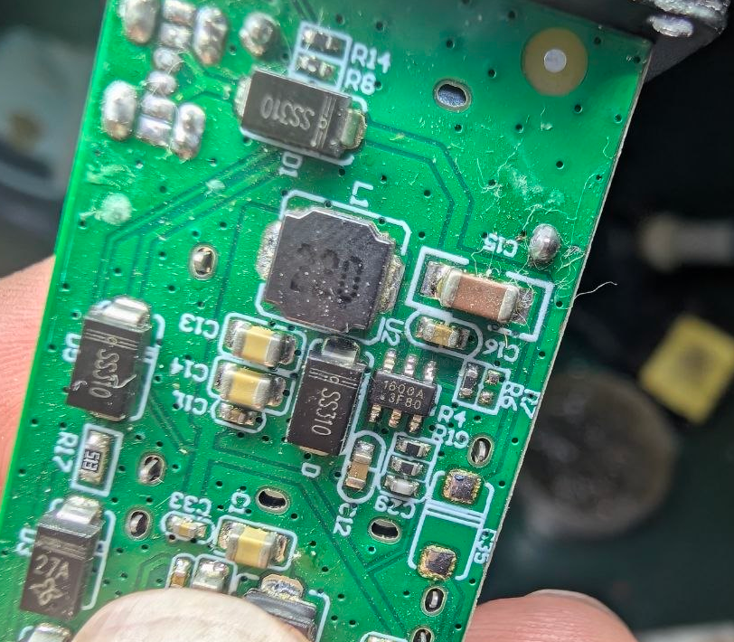
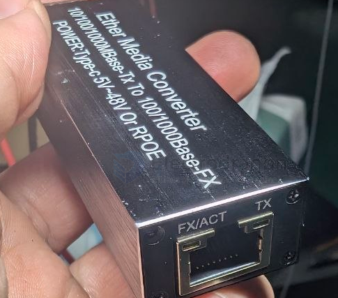
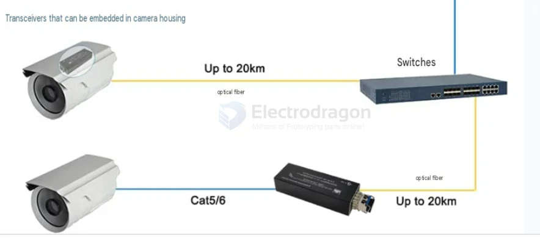

# fiber-media-converter-dat

- [[fiber-media-converter-dat]] - [[fiber-optic-interface-dat]] - [[fiber-optic-dat]] - [[phy-dat]] - [[sfp-dat]]

（插 SFP 光模块、转 RJ45 网线的设备）

Fiber Media Converter（最通用、标准的行业叫法，常简称为 Media Converter）

SFP 光纤收发器

## build 

单光单电

10/100/1000Base-TX to 100/1000Base-FX - [[PHY-dat]] - [[fiber-media-converter-dat]]

- [[RPOE-dat]] - [[POE-dat]] - [[cable-ethernet-dat]] - [[cable-ethernet-expander-dat]] - [[fiber-media-converter-dat]]

- [[RTL8213-dat]] 

0103M SOT89 - [[NCEpower-mosfet-dat]] - [[NCE0103M-dat]] - [[mosfet-dat]] - [[fiber-media-converter-dat]]

- [[tokmas-dat]] - [[dcdc-down-dat]] - 1600A SOT23-6 - [[fiber-media-converter-dat]] - [[LMR16006-dat]]

### other builds 

## apps 

## ref 

