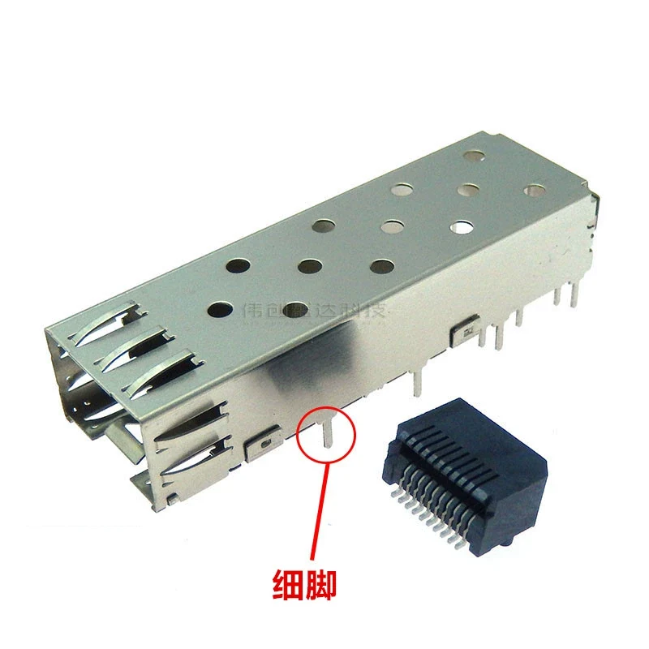
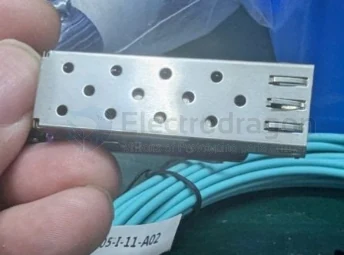
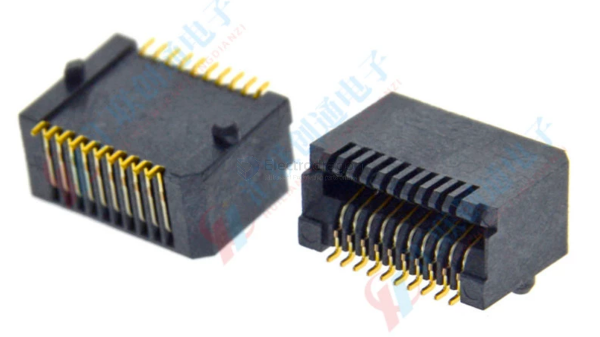
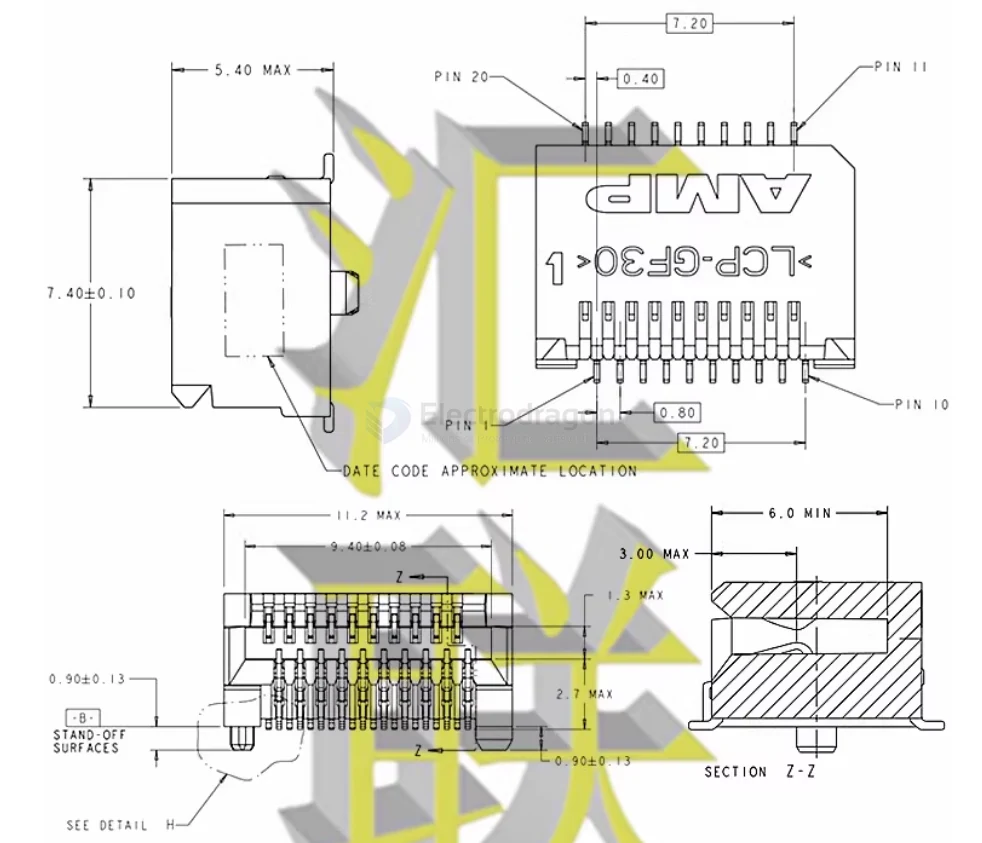
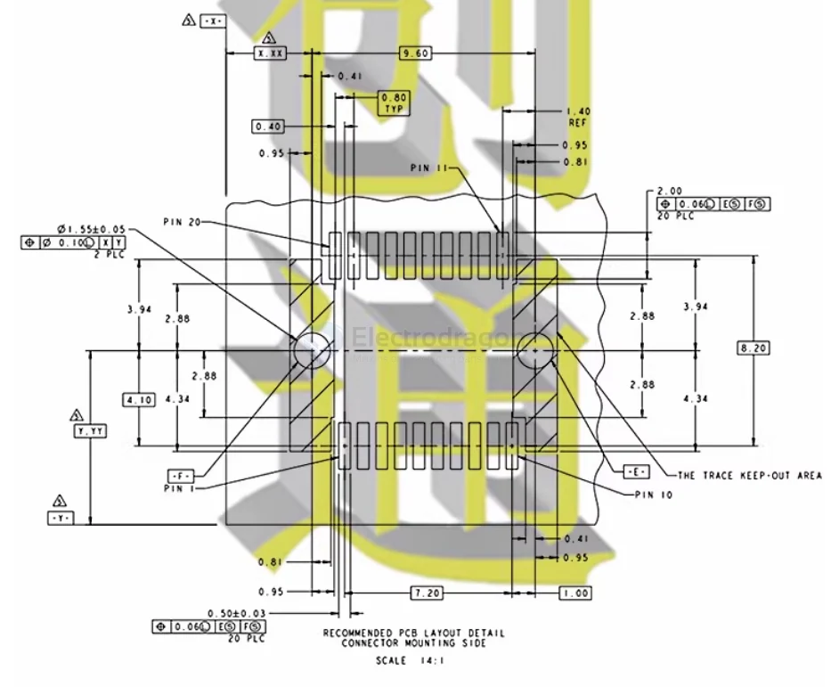
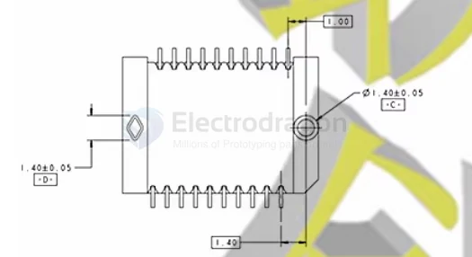
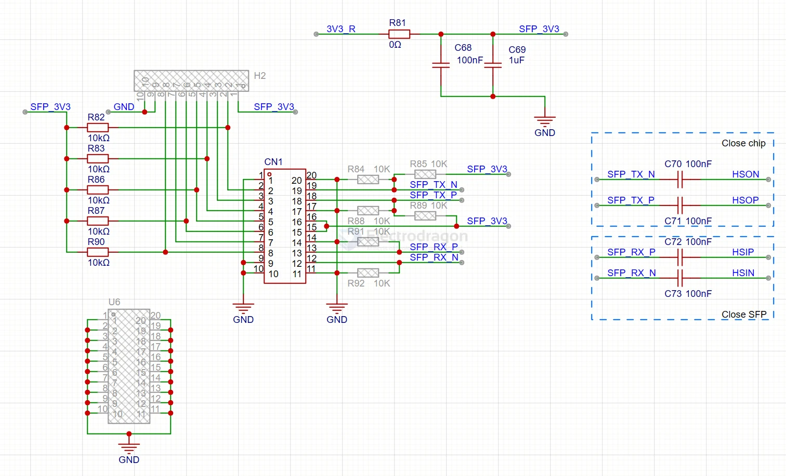

# SFP-cage-dat

- [[SFP-dat]] - [[SFP-cage-dat]] - [[SFP-connector-dat]]

---

### Option 1: Place an SFP Cage + Connector on the PCB (Recommended)

Standard finished **SM1310 / SM1510 SFP transceivers** (with metal housings and gold fingers) are hot-pluggable modules and **cannot be soldered directly onto a PCB**. Instead, you solder an **SFP Cage (metal EMI shield) and a 20-pin SFP SMT connector** onto your PCB, and plug the finished modules into them.

* **Board A:** PCB with SFP cage + **SM1310** module inserted (TX 1310nm / RX 1510nm).
* **Board B:** PCB with SFP cage + **SM1510** module inserted (TX 1510nm / RX 1310nm).

#### Key PCB Design Notes:

1. **Footprint Selection:** Search your EDA library (KiCad, EasyEDA/立创EDA, etc.) for a standard **20-Pin SFP SMT Connector** (e.g., Molex 74441-0010 or compatible) and a **1x1 SFP Cage**. Place the cage at the PCB edge so the front bezel slightly overhangs the board for smooth insertion and extraction.

2. **Host Interface:** Connect two high-speed differential pairs (`TD+`/`TD-` for transmit and `RD+`/`RD-` for receive) directly from your MAC/PHY/FPGA (via SGMII or 1000BASE-X) to the SFP connector.

3. **Impedance Control:** Route `TD±` and `RD±` with **100Ω differential impedance**, match intra-pair trace lengths, minimize vias, and maintain a solid reference ground plane underneath.

4. **Power Filtering & Control Pins:**
* **Power (`VccT` / `VccR`):** Feed 3.3V through separate ferrite bead + capacitor ($\pi$-filter) networks to isolate the laser transceiver from digital switching noise.
* **Low-Speed Pins:** Pull `TX_DISABLE` to GND (to keep the laser enabled by default) and add pull-up resistors (4.7kΩ–10kΩ to 3.3V) on `MOD_DEF1` (SCL) and `MOD_DEF2` (SDA) if you plan to read DDM diagnostics via I2C.

## TE/AMP 1367073-1 20-pin connector 

## SCH 

## ref 

- [[kicad-footprint-dat]]