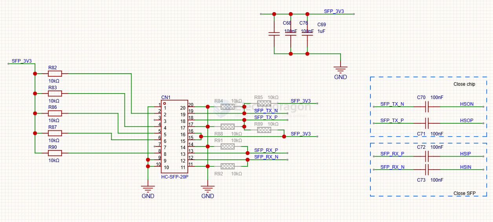

# SFP-connector-dat.md

- [[SFP-dat]] - [[SFP-cage-dat]] - [[SFP-connector-dat]]

- [[fiber-optic-PCB-dat]] - [[phy-dat]] - [[phy-fiber-to-copper-dat]] 

## design 

to [[SFP-connector-dat]] - from [[RTL8213-dat]]

- [[RTL8213-dat]] - [[SFP-connector-dat]] - [[SFP-dat]] - [[realtek-dat]]

## 20-pin electrical edge connector of an SFP (Small Form-factor Pluggable) module. 

The pin functions are defined by the SFP Multi-Source Agreement (MSA), which ensures interoperability between different vendors' modules and host equipment.

Pin Numbering Convention:

When looking directly at the module's edge connector pins as shown in your picture (with the contacts facing you):
 * Top Row: Pins 20 down to 11 (from left to right in your image)
 * Bottom Row: Pins 10 down to 1 (from left to right in your image)
So, the leftmost pin on the top is Pin 20, the rightmost pin on the top is Pin 11. The leftmost pin on the bottom is Pin 10, and the rightmost pin on the bottom is Pin 1.

Standard SFP Pin Functions:

Here is the standard pinout based on the SFP MSA specification:

| Pin | Name         | Function Description                         | Row    | Side (looking at pins) |
| --- | ------------ | -------------------------------------------- | ------ | ---------------------- |
| 1   | VeeT         | Transmitter Ground                           | Bottom | Right                  |
| 2   | TX_FAULT     | Transmitter Fault Indication (Active High)   | Bottom |                        |
| 3   | TX_DISABLE   | Transmitter Disable (Input, Active High)     | Bottom |                        |
| 4   | MOD-DEF2/SDA | Module Definition 2 / Serial Data I/O        | Bottom |                        |
| 5   | MOD-DEF1/SCL | Module Definition 1 / Serial Clock Input     | Bottom |                        |
| 6   | MOD-DEF0/ABS | Module Definition 0 / Module Absent (Output) | Bottom |                        |
| 7   | RS0          | Rate Select 0 (Input, often unused/grounded) | Bottom |                        |
| 8   | LOS          | Loss of Signal Indication (Active High)      | Bottom |                        |
| 9   | VeeR         | Receiver Ground                              | Bottom |                        |
| 10  | VeeR         | Receiver Ground                              | Bottom | Left                   |
| 11  | VeeR         | Receiver Ground                              | Top    | Right                  |
| 12  | RD-          | Inverted Received Data Output                | Top    |                        |
| 13  | RD+          | Non-Inverted Received Data Output            | Top    |                        |
| 14  | VeeR         | Receiver Ground                              | Top    |                        |
| 15  | VccR         | Receiver Power Supply (+3.3V)                | Top    |                        |
| 16  | VccT         | Transmitter Power Supply (+3.3V)             | Top    |                        |
| 17  | VeeT         | Transmitter Ground                           | Top    |                        |
| 18  | TD+          | Non-Inverted Transmit Data Input             | Top    |                        |
| 19  | TD-          | Inverted Transmit Data Input                 | Top    |                        |
| 20  | VeeT         | Transmitter Ground                           | Top    | Left                   |

How to Identify Them on Your Module:
 * Orientation: Hold the module so you are looking directly at the gold contacts as in your picture.
 * Locate Pin 1: It's the bottom-rightmost pin.
 * Locate Pin 10: It's the bottom-leftmost pin.
 * Locate Pin 11: It's the top-rightmost pin.
 * Locate Pin 20: It's the top-leftmost pin.
 * Refer to the Table: Use the table above to know the function associated with each pin number/position.

Key Pin Groups:
 * Power: VccR (Pin 15), VccT (Pin 16) provide the 3.3V power. VeeR and VeeT are the corresponding grounds.
 * High-Speed Data: RD+/RD- (Pins 13, 12) are the differential receiver output pair. TD+/TD- (Pins 18, 19) are the differential transmitter input pair.
 * Control/Status: TX_FAULT (Pin 2), TX_DISABLE (Pin 3), LOS (Pin 8) are important status and control signals.
 * Management/ID: SDA (Pin 4), SCL (Pin 5), and MOD_ABS (Pin 6) are used for the I2C interface to read module information (like vendor, model, S/N, DDM/DOM values).

While this pinout is standard, the datasheet for the specific SFP module model (like the Avago AFBR-709SMZ from your first image) is always the definitive source. However, for standard SFP/SFP+ functions, this MSA pinout is reliable.

## ref 

