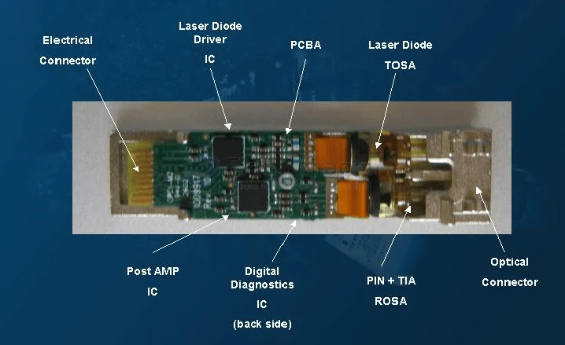
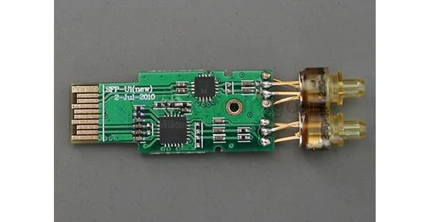
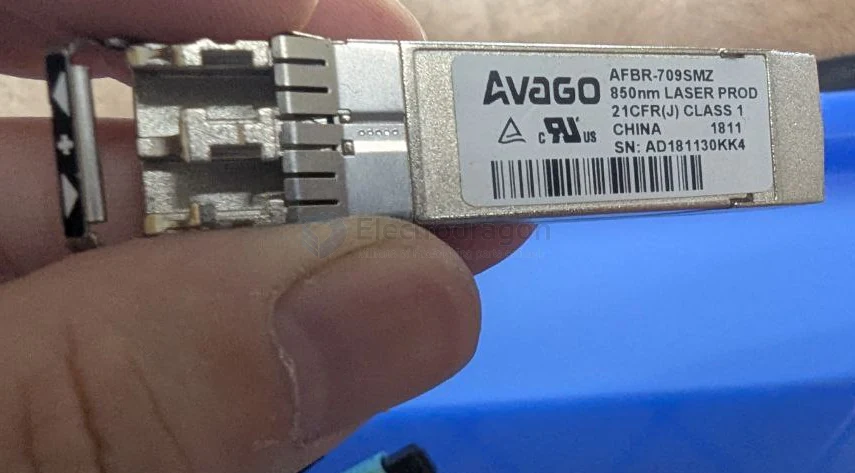
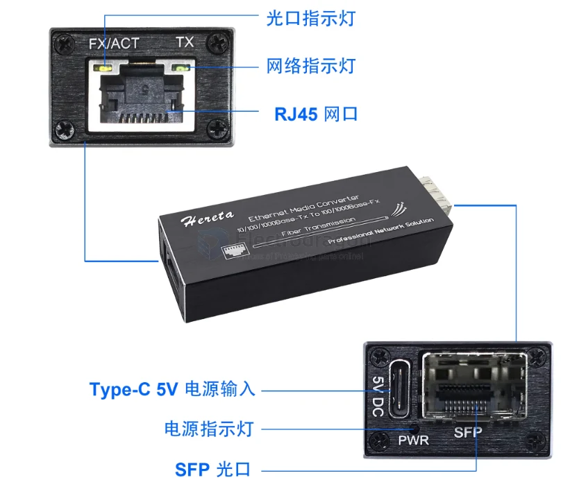
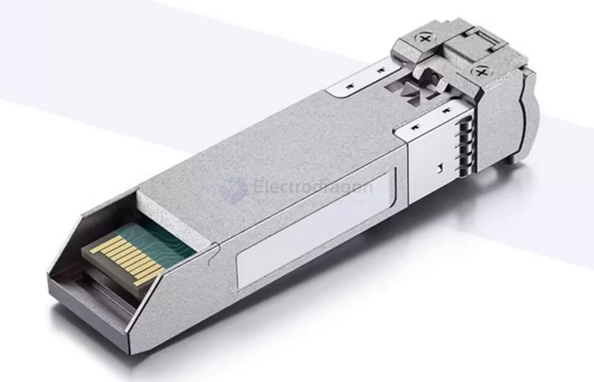
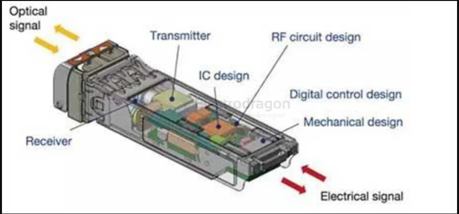
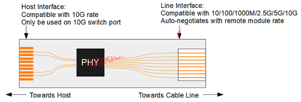
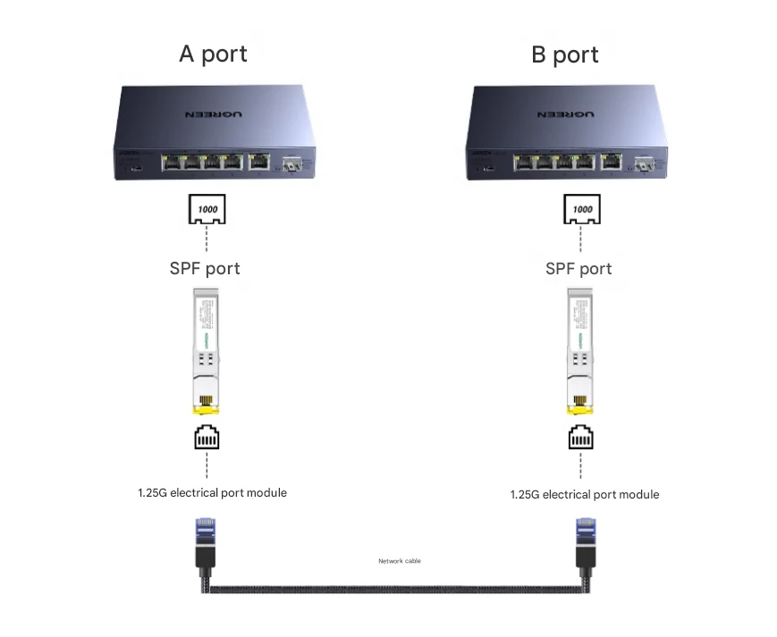

# SFP-transceiver-dat

- [[SFP-dat]] - [[SFP-cage-dat]] - [[SFP-connector-dat]]

- [[SFP-cage-dat]] - [[SFP]] - [[pmod-dat]]

Most SFP modules use LC connectors, though some may use SC (older gear) or others for special applications. - [[LC-connector-dat]]

## What is inside a SFP transceiver?

Fiber optic transceivers are key components of the fiber optic transmission network. They are designed in small form-factor with some integrated optical sub-assemblies which can be suitable for the high-density network. There are many SFPs available in the market with different features and specifications(SFP & SFP+). 

Aren’t you aware of the major functions of these transceiver modules?

- SFPs will transmit data and receive the data.
- Transceivers provide the conversion of electrical signals to optical signals and vice versa.

Inside the metal casing of a transceiver, there are several components and sub-assemblies that join together to form this.

- Transmitter Optical Sub Assembly (TOSA)
- Receiver Optical Sub Assembly (ROSA)
- Bi-Directional Optical Sub Assembly (BOSA)

## 🔌 Common SFP Solutions for Optical Fiber

SFP (Small Form-factor Pluggable) modules are compact, hot-swappable transceivers used to connect networking equipment (like switches and routers) to fiber optic or copper cables.

### 📦 Common Types of SFP Modules

| SFP Type | Description                 | Fiber Type | Wavelength         | Typical Distance |
| -------- | --------------------------- | ---------- | ------------------ | ---------------- |
| SFP SX   | Short-range (Multimode)     | Multimode  | 850 nm             | Up to 550 m      |
| SFP LX   | Long-range (Singlemode)     | Singlemode | 1310 nm            | Up to 10 km      |
| SFP ZX   | Extended reach (Singlemode) | Singlemode | 1550 nm            | Up to 80 km      |
| SFP BX   | Bidirectional (BiDi)        | Singlemode | 1310/1490 nm       | 10–40 km         |
| SFP CWDM | Coarse Wavelength Division  | Singlemode | 1270–1610 nm       | 20–80 km         |
| SFP DWDM | Dense Wavelength Division   | Singlemode | Various (ITU grid) | 40–100+ km       |

### 🔧 Things to Consider

- **Connector Type:** Most fiber SFPs use LC connectors.
- **Vendor Compatibility:** Some switches (e.g., Cisco, HPE) may require brand-specific or coded modules.
- **Fiber Type:** Match your module to either Singlemode (SMF) or Multimode (MMF) cable.
- **Wavelength Matching:** For BiDi or WDM modules, ensure the transmit/receive wavelengths match.
- **Distance Needs:** Choose SX, LX, ZX, etc., based on your required reach.

### ✅ Example Use Cases

- 🌐 Short-distance data center links: Use SFP SX with OM3/OM4 multimode fiber
- 🏢 Building-to-building links: Use SFP LX or BX with singlemode fiber
- 🌍 Long-haul backbone links: Use CWDM or DWDM SFPs for multiplexed transport

## What Type of Fiber Does SFP Use?

| SFP Type      | Fiber Type        | Connector | Description                                  |
| ------------- | ----------------- | --------- | -------------------------------------------- |
| SFP SX        | Multimode (MMF)   | LC        | Short-range, up to 550m (850 nm)             |
| SFP LX        | Single-mode (SMF) | LC        | Long-range, up to 10 km (1310 nm)            |
| SFP ZX        | Single-mode (SMF) | LC        | Extended-range, up to 80 km (1550 nm)        |
| SFP BX (BiDi) | Single-mode (SMF) | LC        | Bidirectional over 1 fiber, 10–40 km         |
| SFP CWDM/DWDM | Single-mode (SMF) | LC        | Wavelength-division multiplexing, 40–100+ km |

## SFP+ transceiver

### AFBR-709SMZ SFP+ transceiver module.

Here's a breakdown of the information on the label:

 * Avago: The manufacturer (now part of Broadcom).
 * AFBR-709SMZ: The specific model number.
 * 850nm LASER PROD: Indicates it uses an 850-nanometer wavelength laser. This is typically used for short-range communication over multi-mode fiber optic cables.
 * 21CFR(J) CLASS 1: Refers to its laser safety classification (Class 1 is generally safe under reasonably foreseeable conditions).
 * CHINA: Country of manufacture.
 * 1811: Likely a date code, possibly indicating it was manufactured in the 11th week of 2018.
 * SN: AD181130KK4: The unique serial number for this specific unit.

In simple terms, this is a pluggable module used in networking equipment (like switches or routers) to convert electrical signals to optical signals (and vice-versa) for transmitting data over fiber optic cables, likely at 10 Gigabit per second speeds (10GBASE-SR standard).

SFP to [[RJ45-dat]]

The optical-to-electrical module converts the SFP optical port of the device into an RJ45 network port/electrical port.

光转电模块是将设备SFP光口转成RJ45网口/即电口

##  sfp transceiver module

SFP stands for Small Form-factor Pluggable.

It is a compact, hot-pluggable fiber optic transceiver used for data transmission over fiber optic or copper cables.

SFP is short for Small Form-factor Pluggables, which is a small package pluggable optical transceiver module. SFP can be regarded as a pluggable version of SFF. Its electrical interface is 20pin gold finger, and the data signal interface is basically the same as the SFP module. The SFP module also provides an I2C control interface that is compatible with the optical interface diagnostics of the SFP-8472 standard.

万兆光口SFP+模块分为多模和单模 

SFP+ 多模: 850nm波长，最大可传550米

SFP+ 单模: 1310nm到1550nm波长，可传10~80千米。

### working scenario 

## chip solutions 

- [[realtek-dat]]

ISL35111DRZ - Avaya AA1419048-E6 Compatible 1000BASE-SX SFP 850nm 550m DOM Duplex LC/UPC MMF Optical Transceiver Module (Industrial)

FTLX8574D3BCL - 10Gb/s 850nm Multimode Datacom SFP+ Transceiver

## ref 

- [[SFP]]

- [[fiber-optic-dat]]

- https://forum.huawei.com/enterprise/intl/en/thread/What-is-inside-a-SFP-transceiver/667249762887417856?blogId=667249762887417856
