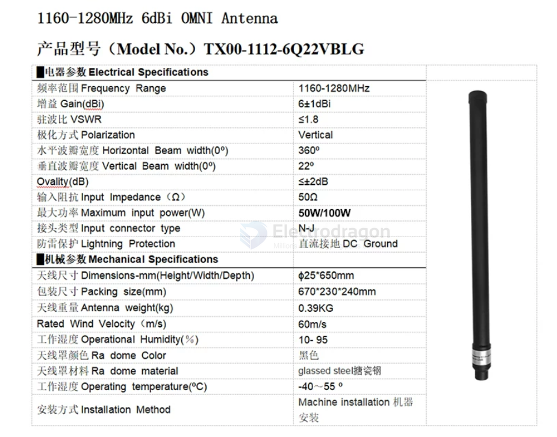

# 1.2Ghz-dat

- [[antenna-linear-dat]] - [[1.2ghz-dat]]

- [[antenna-yagi-dat]] - [[1.2ghz-dat]] - [[antenna-linear-dat]]

## antenna omni 

## tech info 

在 1.3GHz（以及 1.2GHz）图传系统中，经常可以看到被称为“Y型天线”（本质上多为经过优化的**偶极子天线 Dipole** 或 **V/Y型变体天线**）的设计。这种天线形态并不是偶然设计的，而是由 1.3GHz 频段的物理特性、射频性能需求以及航模/FPV实际应用场景决定的。

---

### 1. 频段波长与天线尺寸的权衡

* **物理尺寸较大**：1.3GHz 的电磁波长约为 **23 厘米**（$\lambda/2$ 全长约 **11.5 厘米**，单臂约 **5.75 厘米**）。如果在这个频段使用 5.8GHz 上常见的复杂多叶圆极化天线（如蘑菇头、Pagoda 等），天线体积会变得异常巨大、沉重，且迎风阻力极大。
* **回归线极化与简洁结构**：由于尺寸限制，1.3GHz 远距离图传通常放弃笨重的圆极化，转而采用结构简单、效率极高的**线极化天线**。Y型结构就是为了在保证电气性能的同时，提供合理的物理支撑。

### 2. Y型结构的核心射频与机械优势

#### ① 内置巴伦（Balun）与阻抗匹配

* 同轴电缆（如馈线）是**不平衡**传输线，而标准的半波偶极子是**平衡**负载。如果直接将同轴电缆连接到偶极子上，高频电流会沿着电缆外皮流淌（产生“馈线辐射”），这不仅会降低天线增益、恶化驻波比（VSWR），还会干扰机载其他电子设备。
* Y型的分支、套管或分叉结构（通常内部集成了 **1:1 巴伦** 或 **扼流结构**）实现了平衡到不平衡的转换，确保射频能量全部从天线振子发射出去，使驻波比（VSWR）能够严格控制在较低水平（通常 $< 1.5$）。

#### ② 全向辐射与方向图优化

* 传统的单根直立鞭状天线（Monopole）需要良好的地网（Ground Plane）。但在航模或无人机上很难提供完美的金属地网。
* Y型天线（如对称双振子或斜 V 型偶极子）自带平衡的两臂，不需要依赖机体地网就能在水平面上实现稳定的 **360 度全向辐射（Omnidirectional）**，确保机身在全方位旋转时图传信号不丢失。

#### ③ 机械强度、轻量化与抗风阻

* 1.3GHz 运用于中长距离航拍或巡航时，飞机速度往往较快。Y型的固定方式（通常由中心馈电点向两侧斜向下或水平展开，外面包裹坚固的热缩管或塑料外壳）具有极佳的**抗震动和抗剪切能力**。
* 相比单根细长的直立软线，Y型结构在高速飞行或落地时不易发生剧烈晃动或因共振折断。

### 3. 为什么 1.3GHz 远距离图传偏爱它？

1. **损耗极低**：相比圆极化天线在复杂多径环境下的损耗，设计良好的 1.3GHz 线性 Y 型偶极子效率极高，能够把宝贵的射频功率最大化地送出去。
2. **穿透力与成本**：1.3GHz 本身就靠较低的频率来获得更好的绕射和穿透能力（穿树林、抗遮挡能力远超 5.8GHz）。配合制作成本低、性能稳定、一致性好的 Y 型偶极子，能够以较低的预算实现出色的远距离图传效果。

## ref 