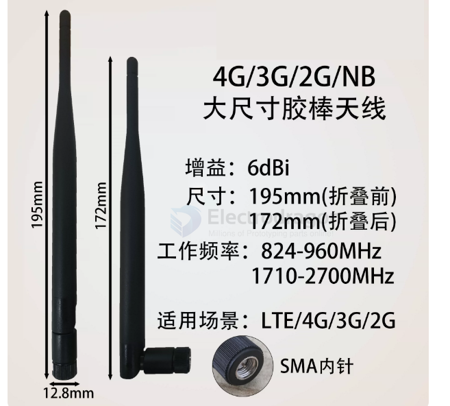

# 868mhz-dat

- [[868mhz-dat]] - 800 / 1800 mhz == [[4G-dat]] - [[3G-dat]] - [[LTE-dat]] - [[GPRS-dat]] - [[NBIOT-dat]] - [[GSM-dat]] - [[frequency-dat]] - [[CDMA-dat]] - [[RFID-dat]]

- [[antenna-dat]]

## 3dbi SMA

## 4dbi SMA

## 4.84dbi IPEX

- [[CONN-ipex-dat]]

## 6dbi SMA

## ref 

