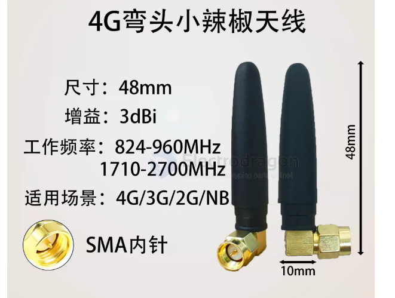
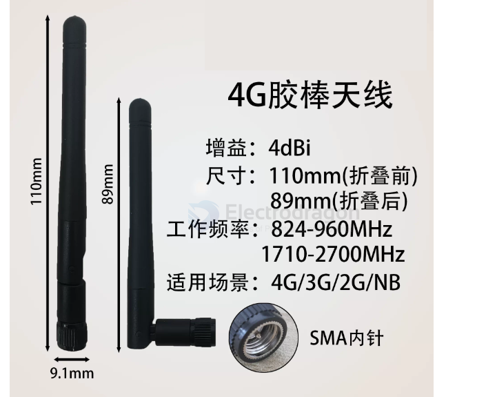
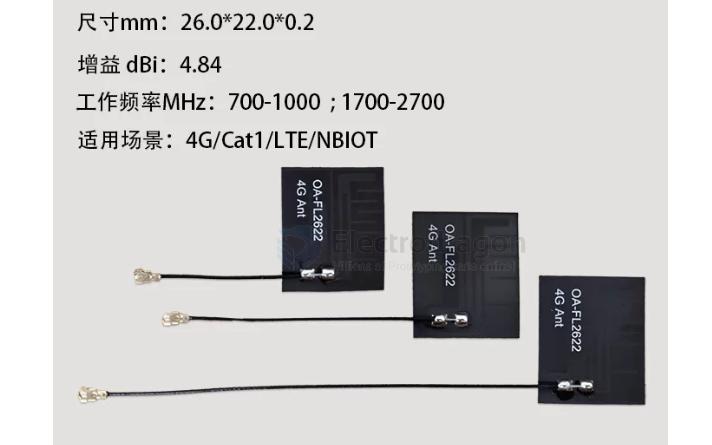

# 900mhz-dat

- [[900mhz-dat]] vs - [[2.4ghz-dat]] == [[frequency-dat]]

- [[900mhz-dat]] - 800 / 1800 mhz == [[4G-dat]] - [[3G-dat]] - [[LTE-dat]] - [[GPRS-dat]] - [[NBIOT-dat]] - [[GSM-dat]] - [[frequency-dat]] - [[CDMA-dat]] - [[RFID-dat]]

- [[antenna-dat]]

## advantages 

- [[FPV-long-range-dat]] 

**Yes — 900 MHz has an overwhelming advantage over 2.4 GHz for long-range flight.**

This is dictated by the physics of radio. Below are the core advantages and trade-offs of 900 MHz (e.g. the ELRS 915 MHz / 868 MHz bands) versus 2.4 GHz when flying long range:

---

### 1. Core advantages of 900 MHz

**1. Stronger diffraction and penetration (the most critical advantage)**

- **Physics:** the lower the frequency, the longer the wavelength. A 900 MHz wavelength is about 2.6× that of 2.4 GHz.
- **In practice:** long-range or mountain flying constantly runs into trees, ridges and buildings. 900 MHz's ability to bend around such obstacles (diffraction) far exceeds 2.4 GHz — even when partially blocked, it still holds a usable link.

**2. Lower path loss and more link margin**

- At the same TX power and distance, 2.4 GHz suffers more free-space loss than 900 MHz.
- 900 MHz receivers are usually more sensitive, which means that at extreme distances (tens of kilometres) 900 MHz can still hold a stable, reliable control link.

---

### 2. What it costs you (drawbacks and trade-offs)

900 MHz suits long range, but it is not perfect. The main drawbacks:

**1. Lower refresh rate and higher latency**

- **2.4 GHz** supports packet rates as high as 500 Hz and even 1000 Hz (F1000), so control latency is extremely low.
- **900 MHz** sits in a narrower band; packet rates are typically 25–200 Hz. For long-range cruising or fixed-wing flying, 25 Hz or 50 Hz is entirely sufficient — but for extreme freestyle or racing, where the lowest latency matters, the feel is slightly worse than 2.4 GHz.

**2. Larger antennas**

- Antenna size scales with wavelength. 900 MHz antennas (T-style dipole, Moxon, …) are physically much larger than 2.4 GHz ones, which makes layout and mounting awkward on small quads (3-inch, micro).

**3. Band legality and interference (in some regions)**

- The usable 900 MHz band differs by country (868 MHz in Europe, 915 MHz in the Americas/Asia), and the band can pick up interference from industrial and cellular signals — configure it to stay legal and clean where you fly.

---

### Summary and recommendation

- **Choose 900 MHz:** if your main flying is **long range, fixed-wing cruising, wide-area mountain flying, or gimbal camera ships**, and you want maximum signal penetration plus a huge safety margin at distance — **900 MHz is the clear first choice**.
- **Choose 2.4 GHz:** if you mainly fly **close-in freestyle, racing, or simply don't want to deal with bulky antennas**, and you stay within a few kilometres — 2.4 GHz combines a high refresh rate with decent penetration and is the more versatile option.

## antenna 

### 3dbi SMA

### 4dbi SMA

### 4.84dbi IPEX

- [[CONN-ipex-dat]]

### 6dbi SMA

## ref 

